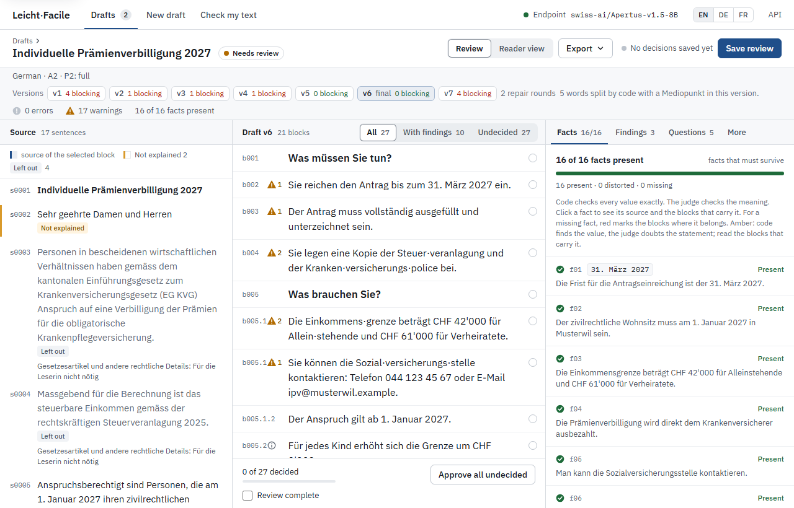
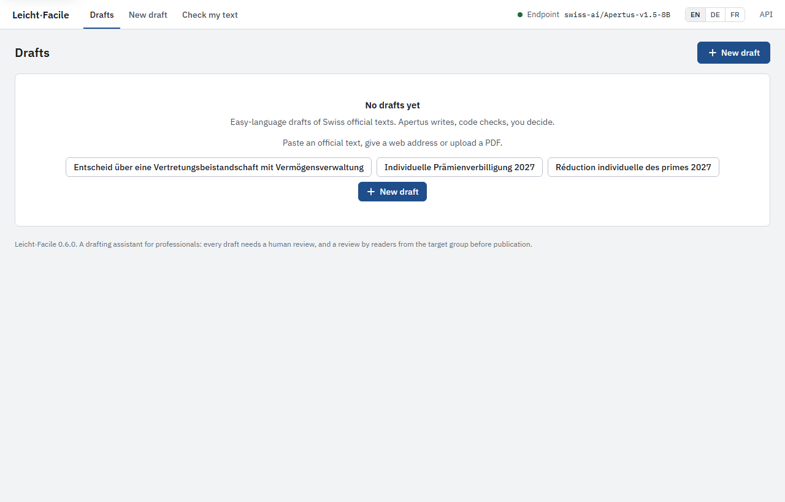
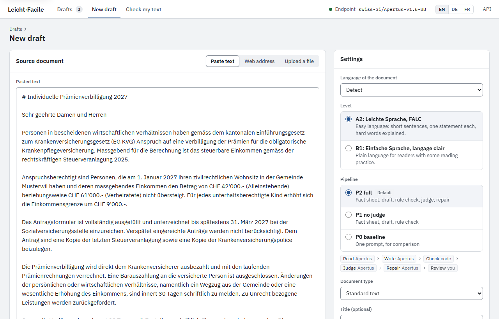

# Leicht·Facile

[](https://github.com/bobrovsky420/leicht-facile/actions/workflows/ci.yml)
[](https://github.com/bobrovsky420/leicht-facile/actions/workflows/release.yml)

Leicht·Facile drafts easy-language versions of Swiss official texts (German Leichte
Sprache and Einfache Sprache, French FALC; Italian follows) with Apertus, and proves with code that
no deadline, amount or phone number got lost. It is a drafting assistant for the
people who write official texts, from trained easy-language writers to case workers,
not a replacement for their review or for the test by readers from the target group.

> About 1.25 million adults in Switzerland aged 16 to 65 (22 percent) have low reading
> skills (Swiss Federal Statistical Office, PIAAC 2022/23). None of them should be excluded from the official
> letters that decide their money, deadlines and rights.

Two use cases: a canton's letters and web pages
([use-case-canton.md](docs/use-case-canton.md)), and easy-language letters that
accompany decisions of child and adult protection authorities (KESB) and courts, texts
that may never leave the authority (decision mode v1;
[use-case-decisions.md](docs/use-case-decisions.md)). Further use cases, from patient letters and lease terminations to
penal orders, payment orders and tax letters, are sketched in
[use-cases.md](docs/use-cases.md). Most of them are under official, medical or
tax secrecy and may not go to a chatbot on a foreign cloud: for them, **Apertus is the
only model that fits** ([why](#why-only-apertus)).

Authors: Alexander Bobrovsky (bobrovsky@seznam.cz) and Ivan Kuzmych
(i.kuzmych@hotmail.com). Demo video: <https://youtu.be/5el7q6Xtgik>. Maturity: a
deployable prototype for German and French drafts of public texts and letters, a proof
of concept for decisions. Built with AI coding assistants (Claude Code), directed and
reviewed by the authors.

> Apertus does everything that needs language understanding. Plain code does
> everything that can be counted.

1. **Understand** (Apertus): the document becomes a fact sheet: the reader's core
   questions, every fact with its exact value, hard words, passages that can go.
   Code adds every date, amount and contact the model missed.
2. **Write** (Apertus): a draft in easy language, every sentence linked to the source
   sentences it comes from, every omission explained.
3. **Check** (code): 45 deterministic rules for German and 41 for French from the
   published Swiss guidelines (sentence length, passive, genitive, numbers, Swiss
   spelling, Mediopunkt, ...) and an exact check of every fact value in both
   directions (no value lost, no value invented), in milliseconds, without a model.
4. **Judge** (a second, larger Apertus model): meaning only: distorted facts, invented
   statements, metaphors, unclear references.
5. **Repair** (Apertus): only the flagged sentences, until no blocking finding is left
   (at most 3 rounds); then one sentence for each must-keep value still missing (at
   most 10), checked like the rest.
6. **Review** (human): source and draft side by side, provenance, fact checklist,
   approve, edit or reject each block, export with an audit trail.



*The review page with the German example letter (team-written): the source with what
was left out and why, the draft with its versions and findings, and the must-keep
facts.*

### Why not one chatbot prompt?

Ask a chatbot to "rewrite this in Leichte Sprache" and you get a text, nothing more:

- **no fact contract:** nothing says which deadlines, amounts and contacts must survive;
- **no provenance:** no sentence points back to the source sentence it comes from;
- **no omission log:** what was left out, and why, is not recorded;
- **no independent check:** nothing but the model itself looks at the result.

The chatbots people reach for also run on foreign clouds. Leicht·Facile adds those four
things, a review workflow and an audit trail, and runs on infrastructure the
organisation controls.

**How we measure the difference.** The evaluation compares the full pipeline (P2) with
single prompts on the same model (P as in pipeline, not a language level;
[use-case-canton.md](docs/use-case-canton.md) §4). P0 is the plain chatbot prompt. The
fairer baseline is a strong single prompt: a published Leichte Sprache prompt from a
Swiss public administration
([simply-simplify-language](https://github.com/machinelearningZH/simply-simplify-language),
MIT), here in its "complete" mode. Final run: 20 held-out pairs of real German texts,
published by Swiss cantons and federal offices with their easy-language versions, on the
CSCS endpoint, 12 October 2026 (all numbers: [evaluation.md](docs/evaluation.md)).

| | A strong single prompt | Leicht·Facile |
|---|---|---|
| Must-keep facts found | 82 % | 100 % |
| Hard facts lost without a trace | 15 % (33 % in its default mode) | none: it lists every one it misses |
| Invented values, per 100 blocks | 0.0 | 0.0 |
| Rule errors, per 100 blocks | 15.0 | 3.7 |

### Why only Apertus

For a public web page, any good model would do. A letter that names a person is under
official secrecy (StGB art. 320), a patient letter under medical secrecy (StGB art.
321), a tax letter under tax secrecy (DBG art. 110). Four conditions follow, and only
Apertus meets all four:

| Condition | Rules out | Apertus |
|-----------|-----------|---------|
| The text stays inside the organisation (secrecy law; the cantonal data protection commissioners' [resolution of November 2025](https://www.privatim.ch/wp-content/uploads/2025/11/20251124_privatim_Resolution-Hyperscaler_DE.pdf)) | Chatbots and model APIs on foreign clouds | Runs on-premise or air-gapped: the 8B on one 24 GB GPU with the official vLLM image (run by the team on an NVIDIA L4); Swisscom and Infomaniak serve the 70B in Switzerland |
| The organisation runs the model itself | Closed models | Open weights |
| The organisation can account for what the model learned | Open-weight models that keep their training data secret (Llama, Gemma, Qwen, Mistral) | Open training data and code; website opt-outs honoured, also for older crawls |
| The model is Swiss | Fully open models built and trained abroad (EuroLLM, SmolLM3) | Built by EPFL, ETH Zurich and CSCS, trained in Lugano; German, French and Italian, with Swiss German and Romansh data |

The Canton of Ticino already runs Apertus in-house to translate sensitive government
documents. Tokens are nearly free (about 1.6 US cents per page for the full pipeline at
Public AI's list prices, [evaluation.md](docs/evaluation.md)); on own hardware the GPU is the cost. The legal
basis, the sources and the use cases:
[use-cases.md §2](docs/use-cases.md#why-only-apertus).

## Quick start

Requirements: Docker with Compose, `make`, and an API key for an Apertus endpoint
(`.env.example` is set up for the CSCS inference API).

```bash
cp .env.example .env      # LLM_BASE_URL and LLM_NAME are set for CSCS; add your LLM_API_KEY
make run                  # builds and starts the container, opens http://localhost:8000
```

The three variables can also come from the shell instead of `.env`. Every other way to
start the app (Compose or plain Docker, a local vLLM or llama.cpp server, without Docker,
the release wheel, the command line alone), the other make targets, reaching it from
other machines and what to do when it does not start: [quickstart.md](docs/quickstart.md).

Model tiers: by default the 8B reads, writes and repairs, and the 70B judges (when the
endpoint serves it; otherwise `LLM_NAME` judges).
`LLM_NAME=swiss-ai/Apertus-v1.5-70B` runs every stage on the 70B;
`LLM_UNDERSTAND_NAME=swiss-ai/Apertus-v1.5-70B` lets the 70B read (the fact sheet) and
the 8B write. [evaluation.md](docs/evaluation.md) compares the three.

### Your first draft

The interface speaks English, German or French (switch at the top right).

**1. Start a draft.** Before the first draft, the start page offers the example
letters: a municipality's letter about premium reduction in German and in French, and a
decision of a child and adult protection authority (team-written, described in the
examples' [README.md](data/examples/README.md)). Click one to open the New draft form
with it filled in, or click **New draft** and paste a text, enter a web address or
upload a file (PDF, HTML, text or Markdown). Choose the language (or let it be
detected), the level (A2 Leichte Sprache or FALC, B1 Einfache Sprache or langage clair;
the level names the rule set, not a measured reader level) and the pipeline (P2 full by
default), and click **Create draft**. Apertus answers live: a run takes a few minutes.





**2. Follow the stages.** The page updates by itself: Read, Write, Check, Judge and
Repair, each with its result as soon as it is done (the fact sheet, then each draft
version). When the pipeline is done, the review page opens.

**3. Review and export.** The review page (screenshot above, below "How it works")
shows the source, the draft and the must-keep facts. Click a block or a fact to see
where it comes from. Approve, edit or reject each block (or **Approve all undecided**),
tick **Review complete** and click **Save review**. **Reader view** shows the text as a
reader gets it; **Export** writes it as Markdown, HTML or Word, or the whole job as an
audit bundle (JSON).

**Check my text** runs the rule checker on any text you paste, without a model and
without storing it.

## Sovereign deployment

| Target architecture | How |
|---------------------|-----|
| a) On-premise | `docker compose --profile local-llm up` adds a vLLM server with Apertus 1.5 8B on one GPU with 24 GB or more (official image; run on an NVIDIA L4: [aws-l4-2026-10-10/](docs/hardware/aws-l4-2026-10-10/)); set `LLM_BASE_URL=http://vllm:8000/v1` |
| b) Air-gapped | As (a), with images and weights pulled in advance. Python packages, the spaCy model and the UI assets are inside the image: no CDN, no telemetry, no installs at runtime |
| c) Sovereign Swiss cloud | Point `LLM_BASE_URL` at a Swiss-operated Apertus endpoint; the reported numbers come from CSCS in Lugano |

Documents and review records stay in a SQLite database on a volume the organisation
controls. At runtime the container contacts only the Apertus endpoint, and a web
page's server when a user enters a URL: no telemetry, no CDN, no login provider
([architecture.md](docs/architecture.md) §10). Which texts need this, and why it leaves
Apertus as the only model:
[Why only Apertus](#why-only-apertus).

## Documentation

- [quickstart.md](docs/quickstart.md): every way to start the app, from `make run` to a development server
- [architecture.md](docs/architecture.md): design and architecture
- [ui-design.md](docs/ui-design.md): the web UI's specification: tokens, components, screens, accessibility
- [rules.md](docs/rules.md): the rule catalogue the checker implements
- [prompts.md](docs/prompts.md): prompt design and change log
- [sources.md](docs/sources.md): reference pairs, demo documents, licences
- [use-case-canton.md](docs/use-case-canton.md): a walkthrough for a cantonal administration
- [use-case-decisions.md](docs/use-case-decisions.md): letters that accompany decisions of child and adult protection authorities and courts (partly planned)
- [use-cases.md](docs/use-cases.md): all use cases at a glance; the further ones sketched with the checks they need
- [image-input.md](docs/image-input.md): what Apertus 1.5 reads from a scanned letter, by kind of value
- [hard-texts.md](docs/hard-texts.md): hard words and sentences for tests
- [evaluation.md](docs/evaluation.md): the evaluation tables, per language and setup

## Licence

Code: Apache License 2.0, see [LICENSE](LICENSE). Texts from cantonal and federal web
pages are not part of the repository; the evaluation fetches them from their URLs
([sources.md](docs/sources.md) §4).
