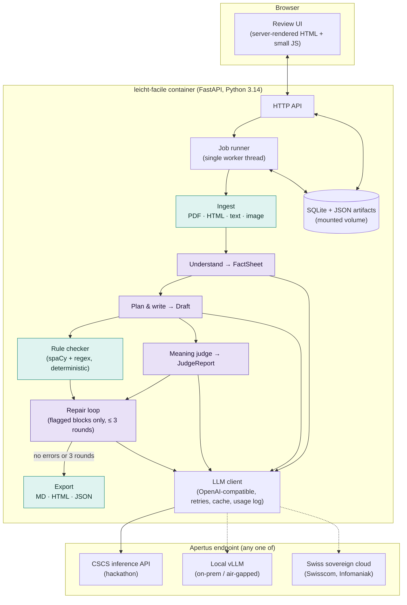

# Leicht·Facile - design and architecture

Status: design, 5 October 2026. Hack Apertus online hackathon, Track 2B.
Companion documents: [rules.md](rules.md) (the rule catalogue the code checker implements), [use-case-canton.md](use-case-canton.md) (a walkthrough from the point of view of a cantonal administration), [sources.md](sources.md) (reference pairs, demo documents and their licences) and [hard-texts.md](hard-texts.md) (hard words and sentences for tests and the presentation).
Items marked **[verify]** are assumptions to confirm against the live endpoint on day 1 (see §12).

## 1. What it is

Leicht·Facile drafts easy-language versions of Swiss official texts - letters, forms,
web pages, decisions - in German (Leichte Sprache / Einfache Sprache), French (FALC)
and Italian (lingua facile), using Apertus 1.5. It is a **drafting assistant for the
professionals who write easy language today**, not a replacement for them or for the
review by readers from the target group.

The design rests on one rule:

> Apertus does everything that needs language understanding. Plain code does
> everything that can be counted.

That split is the answer to the "purposeful use of AI" criterion, and it stops the
model from grading its own homework on things a script can check exactly.

Leicht·Facile is not a translator, and the job cannot be done with one chatbot
prompt. "Rewrite this in Leichte Sprache" yields text with no fact contract, no
provenance, no omission log and no independent check; that is the C0 baseline in §9.
The pipeline exists to add exactly those four things, plus a review workflow and an
audit trail. [use-case-canton.md §4](use-case-canton.md) lays out the comparison
from the administration's point of view.

### Goals

1. Produce a draft that keeps every fact that matters (deadlines, amounts, obligations,
   contacts) and says nothing the source does not say.
2. Follow the published rules for easy language (sentence length, no passive, digits,
   Swiss spelling, …) and prove it with numbers, not demos.
3. Give the human reviewer provenance for every sentence and a checklist of facts, so
   review is faster than writing from scratch.
4. Run entirely on infrastructure the organisation controls: one container plus an
   OpenAI-compatible Apertus endpoint, no other network dependency.

### Non-goals (for the hackathon)

- Certifying texts as "Leichte Sprache". Only a target-group review can do that.
- Translation between languages. Each language version is simplified from the
  original in that language.
- Speech output. Apertus reads images and audio but only writes text; a TTS engine
  would be a separate component.

## 2. Users and workflow

Primary user: a communications officer or an easy-language writer in a canton,
municipality, or an organisation such as Pro Infirmis' Büro für Leichte Sprache.

1. Upload a document (PDF, HTML URL, pasted text, or a photo of a letter) and choose
   language and level (A2 = Leichte Sprache, B1 = Einfache Sprache).
2. Wait 1-3 minutes while the pipeline runs. Progress is visible per stage.
3. Review: source and draft side by side, every draft sentence linked to the source
   sentences it came from, a fact checklist with pass/fail per fact, the list of
   rule findings, and the model's change notes ("left out: appeal procedure, because …").
4. Approve or edit each block, then export (Markdown, HTML, JSON with provenance).
5. Optionally, send the approved text to a target-group test. That step is outside
   the tool but the export is formatted for it (one sentence per line, ≤ 85 characters).

## 3. Architecture overview



Purple stages call Apertus. Teal stages are deterministic code. Everything runs in one
container; the only outbound connection is `LLM_BASE_URL`.

### Key decisions

| # | Decision | Why |
|---|----------|-----|
| D1 | One Python service (FastAPI) serves both the API and a server-rendered review UI. No Node build step. | One container, one `make run`, nothing to break on the judges' machine. The UI is a review tool, not a product front-end. |
| D2 | All model access goes through one OpenAI-compatible client configured by `LLM_BASE_URL`, `LLM_API_KEY`, `LLM_NAME`. | The hackathon endpoint, local vLLM and Swiss cloud providers all speak the same protocol. "Sovereign deployment" becomes a change of one variable. |
| D3 | The pipeline is a sequence of explicit stages with typed, persisted artifacts (pydantic models stored as JSON). | Every intermediate result is visible in the UI, re-runnable in isolation, and usable for evaluation and ablations. |
| D4 | Countable rules live in code (spaCy morphology + regex). Apertus only judges what needs meaning. | Exact, free, reproducible; removes self-grading bias on the easy half of the rules. |
| D5 | Writer and judge are separate model instances; by default 8B writes, 70B (thinking) judges. | A different, stronger model judging reduces bias and gives an 8B-vs-70B cost story. Both are a config switch. |
| D6 | Each language is simplified from its own original. | Simplifying a translation compounds errors; three fact sheets also allow a cross-language consistency check. |
| D7 | Storage is SQLite plus JSON files on a mounted volume. | Zero operations, works air-gapped, trivially backed up. |
| D8 | The evaluation harness is a first-class module with a fixed dataset manifest and three conditions (baseline, pipeline without repair, full pipeline). | "Technical rigour" is judged on the comparison, not the demo. |

## 4. The pipeline

Each stage takes typed artifacts and produces typed artifacts (schemas in §5). The job
runner executes stages in order and persists each result before starting the next, so
a failure resumes from the last good stage.

### 4.1 Ingest (code)

| Input | Method | Output |
|-------|--------|--------|
| HTML URL | `trafilatura` main-content extraction, keeping headings and lists | `SourceDocument` |
| PDF with text layer | `pdfplumber`, page by page; headings by font size heuristics | `SourceDocument` |
| PDF without text layer, photo | Rendered to PNG and passed to Apertus as image input in the Understand step (Apertus 1.5 is multimodal). **[verify]** image input through the CSCS API; otherwise local vLLM only. | `SourceDocument` with `segments` produced by the model |
| Pasted text | Paragraph split | `SourceDocument` |

Segmentation: paragraphs → sentences with the spaCy sentencizer for the document
language. Each segment gets a stable id (`s0001`, …), a kind (`heading`, `paragraph`,
`list_item`, `table_cell`) and its heading path. Language is detected with
`lingua-py`; the user can override it.

Chunking is not needed for understanding - Apertus 1.5 has a 262,144-token context -
but documents over ~3,000 words are **written** section by section (sharing one fact
sheet), to keep output quality and allow parallel calls.

### 4.2 Understand (Apertus)

One call over the whole document. Output: the `FactSheet` - the most important
artifact, because every later step is checked against it.

- Document type and audience.
- The reader's core questions: What is this? What must I do? By when? What does it
  cost? Whom do I contact? Each answer cites segment ids; `null` if the source does
  not answer it (the writer must then not invent one).
- `facts[]`: every fact that must survive, typed (`deadline`, `amount`, `obligation`,
  `right`, `condition`, `contact`, `procedure`, `definition`, `other`), with a
  normalised value where applicable (ISO date, decimal CHF, digits-only phone), the
  segment ids it comes from, and `must_keep` true/false.
- `hard_terms[]`: difficult words with a plain explanation, for the glossary.
- `omit_candidates[]`: passages the model considers droppable, with reasons - the
  reviewer sees these.

Model: `LLM_NAME` (8B), thinking on, temperature 0.1. Output is JSON; see §6 for
how JSON is enforced.

### 4.3 Plan and write (Apertus)

Easy language is not a sentence-by-sentence translation, so the prompt asks for a
plan first: order content by what matters to the reader, use questions as headings,
one idea per sentence, then write. Inputs:

1. The style guide for language and level (generated from [rules.md](rules.md), so
   prompt and checker never disagree).
2. Two or three short example pairs from cantonal pages in the same language
   (standard → easy), to anchor Swiss conventions: `ss` not `ß`, the Mediopunkt
   (`Sorge·recht`), `Velo`, `parkieren`, `500'000`.
3. The source segments with ids.
4. The fact sheet.

Output: `Draft` - blocks (`heading` | `sentence` | `list_item`), each with the
`fact_ids` it conveys and the `segment_ids` it was derived from (this is the
provenance the UI shows), plus `omissions[]` with reasons and a `glossary[]`.

Model: `LLM_NAME` (8B), thinking on, temperature 0.3.

### 4.4 Rule check (code)

Runs on every block, in milliseconds, no model. Produces `RuleFindings`: per-block
findings with a rule id, severity (`error` | `warn` | `info`), evidence and, where
possible, a suggestion; plus document metrics (words per sentence, readability
score, share of passive sentences, …). The full catalogue is in
[rules.md](rules.md). Highlights:

- sentence length and clause count (spaCy dependency parse);
- passive, genitive, Konjunktiv, Präteritum, nominalisations (spaCy morphology);
- numbers as digits, Swiss formats for dates, times, amounts, phone numbers;
- `ß`, `« »`, `%`, `&`, brackets, semicolons, abbreviations not on the allowlist;
- long compounds without Mediopunkt;
- **fact coverage**: every `must_keep` fact with a normalised value must appear in the
  draft in some accepted surface form (`4. Februar 2020`, `4.2.2020`, …). This is an
  exact check and the single most important automatic test;
- readability: Amstad (German Flesch) for DE, Kandel-Moles for FR, Gulpease for IT.

### 4.5 Meaning check (Apertus as judge)

A second model call with the fact sheet and the draft (source available on request
via the segment ids). It answers only what code cannot:

1. For each fact: `present` | `missing` | `distorted`, with the block ids and a note.
2. Which draft blocks state something the source does not support (hallucinations).
3. Semantic rule violations: metaphors and idioms, abstract nouns, pronouns whose
   reference is unclear, implied knowledge the reader may not have.

Model: `LLM_JUDGE_NAME` (default `swiss-ai/Apertus-v1.5-70B-thinking`), temperature
0. The judge never rewrites; it only reports. Its reliability is measured, not
assumed (§9).

### 4.6 Repair (Apertus)

Only flagged blocks are sent back, each with its findings (rule and judge) and the
facts it must convey. The model returns replacement blocks with the same ids. Then:

- rule checks rerun on changed blocks;
- the judge reruns only if a fact-related or hallucination finding was involved;
- stop when no `error`-level findings remain, or after `MAX_REPAIR_ROUNDS` (3).

All draft versions are kept, so the UI and the evaluation can show the effect of
each round. Model: `LLM_NAME`, temperature 0.2.

### 4.7 Review (human) and export (code)

The reviewer sees the final draft with provenance, findings and the fact checklist,
and records a decision per block: `approved`, `edited` (with the new text), or
`rejected`. Export formats:

- Markdown and HTML with one sentence per line, lines ≤ 85 characters, headings and
  lists preserved;
- JSON bundle: source, fact sheet, final draft, findings, decisions - the audit trail;
- DOCX (`python-docx`) if time allows, since writers work in Word.

### 4.8 Learning from edits (stretch)

Approved drafts form an SFT set; reviewer edits form preference pairs (model text vs.
edited text). With the official Apertus fine-tuning recipes, a LoRA on the 8B model
could be trained from them - in effect distilling the 70B judge's standard into the
8B writer. Only attempted if compute is available (Phoeniqs applications closed on
4 October; Hugging Face credits or a Kaggle notebook remain).

### Where Apertus is used - summary

| Stage | Role of Apertus | Model (default) | Thinking | Temp. | Output |
|-------|-----------------|-----------------|----------|-------|--------|
| Ingest (scans only) | Read a photographed or scanned letter (image input) | 8B | off | 0.0 | segments |
| Understand | Extract facts, core answers, hard terms | 8B | on | 0.1 | `FactSheet` JSON |
| Plan & write | Reorder, simplify, explain, record omissions | 8B | on | 0.3 | `Draft` JSON |
| Meaning check | Judge fact fidelity, hallucinations, semantic rules | 70B-thinking | on | 0.0 | `JudgeReport` JSON |
| Repair | Rewrite flagged blocks | 8B | off | 0.2 | blocks |
| Cross-language check (stretch) | Compare DE/FR/IT fact sheets | 70B | on | 0.0 | diff report |
| Learning (stretch) | LoRA fine-tune of 8B on approved drafts | 8B | - | - | adapter |

The rule checker, ingestion, fact coverage, readability and export use no model.

## 5. Data model

All artifacts are pydantic models serialised as JSON; the schemas double as the JSON
schemas sent to the model.

```text
SourceDocument
  id, lang (de|fr|it), title, source {type, uri, fetched_at, license_note}
  segments[]: {id, kind, text, heading_path[], page?}

FactSheet
  doc_id, doc_type, audience
  core: {what, must_do, deadline, cost, contact}  each {text|null, segment_ids[]}
  facts[]: {id, kind, text, value_norm?, segment_ids[], must_keep}
  hard_terms[]: {term, explanation, segment_ids[]}
  omit_candidates[]: {segment_ids[], reason}

Draft  (one per version)
  doc_id, lang, level (A2|B1), version, parent_version?
  blocks[]: {id, kind (heading|sentence|list_item), text, fact_ids[], segment_ids[]}
  omissions[]: {what, why, segment_ids[]}
  glossary[]: {term, explanation}

RuleFindings
  draft_version
  findings[]: {block_id, rule_id, severity, message, evidence, suggestion?}
  metrics: {blocks, avg_words, max_words, pct_passive, readability, fact_coverage}

JudgeReport
  draft_version, model
  fact_checks[]: {fact_id, status (present|missing|distorted), block_ids[], note}
  unsupported[]: {block_id, note}
  semantic_findings[]: {block_id, rule_id, note}

ReviewState
  draft_version
  decisions[]: {block_id, decision (approved|edited|rejected), text?, comment?, at}

Job
  id, status (queued|running|needs_review|done|failed), stage, created_at
  config: {lang, level, writer_model, judge_model, max_repair_rounds}
  usage[]: {stage, model, tokens_in, tokens_out, latency_ms}
  error?
```

Storage: one SQLite database (`jobs`, `artifacts`, `llm_calls`, `llm_cache`
tables) in the mounted volume; artifact JSON stored as text columns. No ORM beyond
the standard library - the schema is small.

## 6. The LLM client

`leichtfacile/llm/client.py` wraps the `openai` Python SDK:

- **Configuration** from the template's variables: `LLM_BASE_URL`, `LLM_API_KEY`,
  `LLM_NAME`; plus `LLM_JUDGE_NAME` (defaults to `LLM_NAME`) and
  `LLM_THINKING_MODE` = `model-suffix` (CSCS exposes thinking as separate
  `…-thinking` model names; the suffix is `LLM_THINKING_SUFFIX`) | `chat-template`
  (local vLLM: `extra_body={"chat_template_kwargs": {"enable_thinking": true}}`) |
  `off`. Optional: `LLM_TIMEOUT_S`, `LLM_MAX_RETRIES`, `LLM_CACHE`.
- **Endpoint profiles** (documented in `.env.example`):
  1. CSCS inference API, the hackathon default;
  2. local vLLM from the `local-llm` compose profile, for on-premise and air-gapped
     deployments;
  3. the Public AI gateway (`https://api.publicai.co/v1`), for development and
     evaluation with public documents. It serves all four Apertus 1.5 variants
     (`swiss-ai/apertus-v1.5-8b`, `-70b`, each with a `-thinking` variant, 262k
     context) at USD 0.10/0.20 per million input/output tokens for the 8B and
     0.82/2.92 for the 70B, with USD 2 of starter credit. It is run by Metagov Inc.,
     a US nonprofit, under Massachusetts law, and routes requests to compute partners
     including CSCS, AWS, Exoscale and Cudo. It requires a `User-Agent` header, which
     the client always sends. Not a sovereign deployment: never used for documents
     with personal data;
  4. the Hugging Face inference router, for development only. It serves only the
     older Apertus 1 models (`swiss-ai/Apertus-8B-Instruct-2509` through Public AI,
     `…-70B-Instruct-2509` through Featherless). No Hugging Face provider serves
     Apertus 1.5, so its results are never reported as Apertus 1.5 numbers.

  All facts on third-party endpoints were checked on 5 October 2026.
- **Reasoning removal.** A thinking model's reasoning is taken from the separate
  `reasoning_content` field when the server provides one (vLLM with
  `--reasoning-parser apertus`), and otherwise cut from the text, whether wrapped in
  `<|inner_prefix|> … <|inner_suffix|>` or `<think> … </think>`. Output cut off by
  `max_tokens` while still reasoning is flagged as truncated.
- **Structured output.** Neither the CSCS docs nor the vLLM guide document
  `response_format`, so JSON is enforced the robust way: the schema is in the
  prompt, the response is stripped of any leaked reasoning tokens
  (`<|inner_prefix|> … <|inner_suffix|>`) and code fences, parsed, and validated
  with pydantic. On failure the validation error is fed back once for a repair.
  If the endpoint turns out to accept `response_format={"type":"json_object"}`
  **[verify]**, it is used in addition, never instead.
- **Reliability.** Retries on 429, 5xx and connection errors with exponential
  backoff and jitter, honouring `Retry-After`; other 4xx errors are not retried.
  Per-call timeout, and `max_tokens` sized generously for thinking models (reasoning
  can be several times longer than the visible answer).
- **Usage log.** Every call records model, tokens in/out, latency and stage; jobs
  show totals, and the evaluation reports cost per page using a configurable
  CHF-per-million-tokens table.
- **Cache.** Responses are cached by hash of (model, messages, parameters) in SQLite
  when `LLM_CACHE=1`. It speeds up development and makes evaluation reruns cheap. The
  repository ships with an empty cache: the live run must work from the endpoint.
- **Tool calling is not used.** The thinking variants are served with tool use
  disabled, and the pipeline has no need for it.

Privacy: document text is never written to logs above `DEBUG`.

## 7. Web application

### API

| Method & path | Purpose |
|---------------|---------|
| `POST /api/jobs` | Create a job from a file upload, a URL or pasted text; options `lang`, `level`, `writer_model`, `judge_model` |
| `GET /api/jobs/{id}` | Status, current stage, usage, links to artifacts |
| `GET /api/jobs/{id}/artifacts/{name}` | `source`, `factsheet`, `draft@v`, `rules@v`, `judge@v`, `review` |
| `POST /api/jobs/{id}/review` | Submit block decisions |
| `POST /api/jobs/{id}/export?format=md\|html\|json\|docx` | Build and download the export |
| `POST /api/jobs/{id}/rerun?from=stage` | Re-run from a stage (used after prompt changes) |
| `DELETE /api/jobs/{id}` | Remove a job and its artifacts |
| `GET /healthz` | Liveness; also checks the LLM endpoint's `/v1/models` |

Jobs execute on a single worker thread with a queue; the UI polls status. That is
enough for a reviewer's workload and avoids a message broker.

### Review UI

Three panes, server-rendered (Jinja2) with a small amount of plain JavaScript:

1. **Source** - segments in order; the ones linked to the selected draft block are
   highlighted.
2. **Draft** - blocks grouped under their headings; each with a colour mark for
   findings (none / warn / error) and the approve / edit / reject controls.
3. **Side panel** - the fact checklist (present / missing / distorted, click to jump to
   the block), findings for the selected block with the suggestion, omissions with
   reasons, glossary, and the version switcher (draft v1 → v3 to see the repair
   rounds).

The UI must work without any CDN: CSS and JS are vendored, so the air-gapped profile
has no broken assets.

### CLI

`python -m leichtfacile simplify <input> --lang de --level A2 --out out/` runs the
pipeline without the web app, and `python -m leichtfacile eval …` runs the harness
(§9). Both share the same stage code.

## 8. Languages and levels

| | German | French | Italian |
|---|--------|--------|---------|
| Easy level (A2) | Leichte Sprache | FALC (facile à lire et à comprendre) | lingua facile |
| Plain level (B1) | Einfache Sprache | langage clair / simplifié | linguaggio semplice |
| Rule source | Canton Zürich rules; EBGB (federal) guide; Inclusion Europe "Informationen für alle" | Inclusion Europe "L'information pour tous"; cantonal FALC pages (FR, VD, GE) | Inclusion Europe "Informazioni per tutti"; Canton Ticino pages |
| spaCy model | `de_core_news_md` | `fr_core_news_md` | `it_core_news_md` |
| Readability | Amstad: `180 - ASL - 58.5·ASW` | Kandel-Moles (French Flesch) | Gulpease: `89 + (300·sentences - 10·letters) / words` |
| Swiss conventions | `ss` for `ß`, `500'000`, `9.00 Uhr`, `044 123 45 67`, Helvetisms | `CHF`, `1 500 francs`, Swiss terms (`septante`, `nonante`) | `fr.` / `CHF`, Ticino terms |

Thresholds differ per level (A2 ≤ 12 words per sentence, B1 ≤ 15 by our choice -
there is no official B1 rule set); both are configuration in `rules.md`.

German comes first in the build order; French and Italian are added once the German
evaluation harness runs. Syllables for readability come from `pyphen` with the
`de_CH`, `fr`, `it` dictionaries.

## 9. Evaluation

### Dataset

`data/pairs/manifest.jsonl`: one row per document pair - id, canton, language,
level, role (`eval` or `example`), URL of the standard-language page, URL of the
official easy-language page, licence note, rough fact count. `scripts/fetch_pairs.py` downloads and caches the texts under
`data/cache/` (git-ignored). Texts are committed only where the licence clearly
allows redistribution; otherwise the manifest and the fetch script are the dataset.
Target: 20-40 pairs across Zürich, Bern, St. Gallen, Fribourg (DE and FR) and Ticino
(IT). St. Gallen and Bern are hackathon partners, which makes their pages a natural
test set.

These reference pairs measure the pipeline; they are not the demo. The demo uses
documents that have no easy-language version yet, such as the Federal Council's
explanations for a past vote. Pairs used as few-shot examples in the prompts are
excluded from evaluation. The shortlist, the demo candidates and the licence terms of
each publisher are in [sources.md](sources.md).

For additional German training or calibration data, DEplain (professionally written
plain-German parallel corpus) is a candidate; its licence must be checked before any
use beyond evaluation.

### Conditions

| Code | Condition | Purpose |
|------|-----------|---------|
| C0 | Single prompt: "rewrite this in Leichte Sprache" | Baseline; what a naive user gets |
| C1 | Understand → write → rule check, no judge, no repair | Value of the fact sheet and structure |
| C2 | Full pipeline with judge and repair | Value of checking and repairing |

Each run with the 8B writer; C2 also with the 70B writer where budget allows. The
judge is always the 70B-thinking model, so C1 and C2 are judged by the same instrument.

### Metrics

| Metric | How | Why it matters |
|--------|-----|----------------|
| Fact coverage | Share of `must_keep` facts with a normalised value found in the output (exact, code) | Did anything important get lost? |
| Fact status (judge) | Share present / missing / distorted per the judge | Semantic version of the above |
| Invented statements | Unsupported blocks per 100 blocks (judge; human-labelled on a subset) | Hallucination rate |
| Rule violations | Errors and warnings per 100 blocks, by rule family | Compliance with the published rules |
| Readability | Amstad / Kandel-Moles / Gulpease: source vs. output vs. official easy version | Did it actually get easier? |
| SARI | Against the official easy-language reference | Standard simplification metric |
| Judge reliability | Agreement (Cohen's κ) between the judge and 30 hand-labelled outputs | Is the judge trustworthy? |
| Cost and speed | Tokens, latency and estimated CHF per page, 8B vs. 70B | Value, cost & scalability |

Outputs land in `eval/results/*.jsonl`; `python -m leichtfacile eval report`
renders the tables for the technical report. If the dataset is published, it follows
the Hugging Face `HackApertus/online_hack_template` layout: test cases, model
responses, and metadata with per-instance licensing.

## 10. Deployment and sovereignty

### `make run`

`make run` → `docker compose up --build`. The Makefile first checks that `.env`
exists and names `LLM_BASE_URL`, `LLM_API_KEY` and `LLM_NAME`, and prints a short
help text otherwise. The image is built from `python:3.14-slim` (the project supports
Python 3.12 and later) and installs the locked dependencies from `uv.lock` with `uv`
at **build** time, including the spaCy models as pinned wheel URLs. German is in the
image now; the French and Italian models are added when those languages ship. The
vendored UI assets are copied in the same way. At **runtime** the container needs
exactly one outbound connection: `LLM_BASE_URL`. It runs as a non-root user, keeps
its data in the named volume `appdata` (mounted at `/data`), and has a Docker health
check on `/healthz`. The app listens on `:8000`, with two pre-computed example jobs
so the UI is not empty before the first live run (clearly labelled as examples).

`make check-llm` lists the endpoint's models and makes one short call from inside the
container; it is the first thing to run once `.env` holds a key.

### The three target architectures

| Architecture | How Leicht·Facile meets it |
|--------------|----------------------------|
| a) On-premise | `docker compose --profile local-llm up`: adds a `vllm` service from the official image `ghcr.io/swiss-ai/vllm_apertus_1.5_release:latest-amd64` serving `swiss-ai/Apertus-v1.5-8B` on one GPU, with the Apertus reasoning parser and `--max-model-len 32768`; the app points at `http://vllm:8000/v1` with `LLM_THINKING_MODE=chat-template`, so one server provides both modes. The 70B judge is optional and can be the 8B in a pinch. **[verify]** on a GPU host: the compose file validates, but the service has not been started yet. |
| b) Air-gapped | Same as (a) with images and weights pulled in advance; spaCy models and UI assets are inside the image; no telemetry, no CDN, no package installs at runtime. A `make bundle` target saves the images to a tarball. |
| c) Sovereign Swiss cloud | Set `LLM_BASE_URL` to a Swiss-operated Apertus endpoint (CSCS, Swisscom AI Platform, Infomaniak). The hackathon demo itself runs against CSCS in Lugano. |

Hardware for (a)/(b), to be measured and stated precisely in the report: the 8B
model in bf16 needs roughly 16 GB for the weights plus KV cache, so a 24 GB GPU with
a reduced `--max-model-len` is realistic; the FP8 build (`onprem-ai/Apertus-v1.5-8B-FP8`,
keeps image input) halves that. The 70B is served with tensor parallelism over four
GPUs in the official guide; FP8/NVFP4 builds reduce that. The business argument of
the stretch goal (§4.8) is precisely that a fine-tuned 8B makes the 70B unnecessary
at runtime.

### Security and privacy

- Documents contain personal data. In production the model endpoint is inside the
  organisation, so content never leaves. The hackathon demo uses public documents only.
- No authentication in the prototype; it is meant to run behind the organisation's
  reverse proxy. Noted as a limitation.
- Jobs and artifacts live on the mounted volume and can be deleted via the API.
- No document text in logs above `DEBUG`; the LLM cache can be disabled.

## 11. Repository layout

```text
Makefile                  make run · check-llm · test · lint · smoke · eval · bundle
docker-compose.yml        app (+ profile local-llm: vllm)
Dockerfile
pyproject.toml, uv.lock   dependencies (uv), Python 3.12+; .python-version pins 3.14
.env.example              endpoint profiles: CSCS, local vLLM, Public AI, Hugging Face
README.md                 Track 2B challenge text (template)
technical_report.md       the report (template, to fill)
docs/
  architecture.md         this document
  rules.md                rule catalogue → implemented by src/leichtfacile/rules
  prompts.md              prompt design notes and versions (to come)
src/leichtfacile/
  __main__.py, cli.py     `simplify`, `eval`, `serve`
  config.py               env → settings (pydantic-settings)
  schemas.py              artifacts (§5)
  store.py                SQLite access
  llm/client.py           §6
  llm/prompts/<lang>/     understand.md, write.md, judge.md, repair.md (+ examples/)
  ingest/                 html.py, pdf.py, image.py, text.py, segment.py, detect.py
  pipeline/               understand.py, write.py, judge.py, repair.py, orchestrator.py
  rules/                  base.py, de.py, fr.py, it.py, facts.py, readability.py, styleguide.py
  web/                    app.py, routes/, templates/, static/ (vendored)
  export/                 markdown.py, html.py, docx.py, bundle.py
  eval/                   dataset.py, conditions.py, metrics.py, run.py, report.py
scripts/fetch_pairs.py
data/
  pairs/manifest.jsonl    URLs + licence notes (committed)
  examples/               two pre-computed jobs for the UI
  cache/                  fetched texts, LLM cache (git-ignored)
tests/                    rules (golden sentences), schema parsing (recorded outputs), smoke
```

`data/` stays well under the 100 MB limit because texts and caches are not committed.

## 12. Day-1 verification checklist

Assumptions to confirm as soon as the CSCS key arrives, in this order:

1. `GET {LLM_BASE_URL}/v1/models` lists `swiss-ai/Apertus-v1.5-8B`, `…-8B-thinking`,
   `…-70B`, `…-70B-thinking`; the base URL host issued for the hackathon
   (`api.inference.cscs.ch` per the CSCS docs; some public projects use
   `api.swissai.svc.cscs.ch`).
2. How thinking output is returned by the `-thinking` models: a separate
   `reasoning_content` field, or inline tokens that must be stripped.
3. JSON reliability: 20 Understand calls on one document, count parse failures with
   and without `response_format`.
4. Image input through the API (a photographed letter); if unsupported, scans become
   a local-vLLM-only feature.
5. Rate limits and concurrency (the docs do not state them) - determines whether
   section-parallel writing is worth it.
6. Baseline quality: C0 on 10 German pairs. This decides whether the A2 level is
   realistic for the 8B model or whether B1 becomes the primary target with A2 as the
   stretch.

## 13. Risks and mitigations

| Risk | Mitigation |
|------|------------|
| The 8B model cannot reach A2 quality | Fact sheet, examples and repair loop are designed to compensate; if it still fails, B1 becomes the primary level and the A2 gap is reported as a finding with numbers. |
| JSON output unstable | Schema in prompt, lenient parse, pydantic validation, one error-feedback retry; measured in day-1 check 3. |
| Model judging itself is biased | Everything countable is in code; the judge is a different, larger model; judge agreement with human labels is reported. |
| CSCS endpoint rate-limited or down | Backoff and cache; single-worker queue; evaluation runs overnight. |
| Image input not available on the hackathon endpoint | Feature flagged; demo uses text and HTML; scans shown with local vLLM only if time allows. |
| Scope creep across three languages | German end-to-end with numbers first (by 10 October); FR/IT only afterwards. |
| No compute for the LoRA | Stretch goal; the pipeline's value does not depend on it. The data it would need (approved drafts, edits) is collected regardless. |
| Over-promising to public-sector judges | Positioned as a drafting assistant for professionals; target-group review stays mandatory; limitations stated in the report. |

## 14. Milestones

| Dates | Deliverable |
|-------|-------------|
| Oct 5-6 | Repo, Docker, `make run` with a health check; LLM client; day-1 checks; C0 baseline on 10 German pairs |
| Oct 7-8 | Understand, write, rule checker (DE), repair loop; artifacts visible via API |
| Oct 9-10 | Judge; evaluation harness; first C0 / C1 / C2 numbers; dataset manifest at 20+ pairs |
| Oct 11-12 | Review UI; export; French and Italian rules and prompts |
| Oct 13 | 8B vs. 70B comparison; judge reliability labelling (30 items); LoRA only if compute exists |
| Oct 14-15 | Technical report (≤ 6 pages), demo video (≤ 2 min), clean-checkout test of `make run`, repo set to public |
| Oct 16, morning | Submit on hackapertus.ch/online-hack/submissions (deadline 12:00 CEST) |

## References

- Apertus v1.5 model card - context length, multimodal input, thinking mode:
  https://huggingface.co/swiss-ai/Apertus-v1.5-8B
- vLLM serving guide and official images: https://apertus-ai.org/docs/guides/vllm/
- CSCS LLM inference API (OpenAI-compatible, model names): https://docs.cscs.ch/services/inference/api/
- Canton Zürich, rules for Leichte Sprache:
  https://www.zh.ch/de/webangebote-entwickeln-und-gestalten/inhalt/barrierefreiheit/regeln-fuer-leichte-sprache.html
- EBGB (Swiss federal bureau for equality of people with disabilities), Leitfaden Leichte Sprache:
  https://www.ebgb.admin.ch/dam/de/sd-web/ZHKNDzIYahOc/Leitfaden%20Leichte%20Sprache.pdf
- Apertus fine-tuning recipes, quantised builds and community tooling: https://github.com/rnckp/awesome-apertus
- Hack Apertus Track 2B rules and deliverables: https://hackapertus.notion.site/track-2-b-own-project
