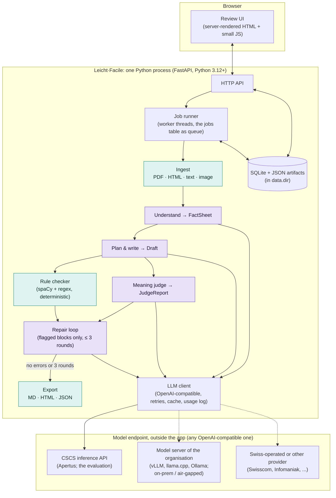

# Leicht·Facile - design and architecture

Status: design 5 October 2026; implemented 5-6 October 2026 except what needs the CSCS endpoint (§12); since 23 October 2026 a Python package that works with any OpenAI-compatible model endpoint, without Docker (§10).
Companion documents: [rules.md](rules.md) (the rule catalogue the code checker implements), [use-case-canton.md](use-case-canton.md) (a walkthrough from the point of view of a cantonal administration), [use-case-decisions.md](use-case-decisions.md) (letters that accompany decisions of child and adult protection authorities and courts, partly planned), [use-cases.md](use-cases.md) (all use cases at a glance, the further ones sketched), [sources.md](sources.md) (reference pairs, demo documents and their licences) and [hard-texts.md](hard-texts.md) (hard words and sentences for tests and demos).

## 1. What it is

Leicht·Facile drafts easy-language versions of Swiss official texts - letters, forms,
web pages, decisions - in German (Leichte Sprache / Einfache Sprache), French (FALC)
and Italian (lingua facile), with a language model behind any OpenAI-compatible
endpoint: a cloud API, a gateway, or a model server the organisation runs. The app
never runs a model itself. It was built and evaluated with Apertus 1.5 (the 8B writes,
the 70B judges), and the results reported here are Apertus results; for texts
under secrecy a model the organisation controls is recommended, and Apertus fits best
there (open weights, open training data, Swiss, one GPU; §10). It is a **drafting
assistant for the professionals who write easy language today**, not a replacement for
them or for the review by readers from the target group.

The design rests on one rule:

> The language model does everything that needs language understanding. Plain code
> does everything that can be counted.

That split keeps the use of AI purposeful, and it stops the
model from grading its own homework on things a script can check exactly.

Leicht·Facile is not a translator, and the job cannot be done with one chatbot
prompt. "Rewrite this in Leichte Sprache" yields text with no fact contract, no
provenance, no omission log and no independent check; that is the P0 baseline in §9.
The pipeline exists to add exactly those four things, plus a review workflow and an
audit trail. [use-case-canton.md §4](use-case-canton.md) lays out the comparison
from the administration's point of view.

### Goals

1. Produce a draft that keeps every fact that matters (deadlines, amounts, obligations,
   contacts) and says nothing the source does not say.
2. Follow the published rules for easy language (sentence length, no passive, digits,
   Swiss spelling, …) and prove it with numbers, not demos.
3. Give the human reviewer provenance for every sentence and a checklist of facts, so
   review is faster than writing from scratch.
4. Be able to run entirely on infrastructure the organisation controls: one Python
   service plus an OpenAI-compatible model endpoint, which can be a model server of its
   own, no other network dependency.

### Non-goals (for now)

- Certifying texts as "Leichte Sprache". Only a target-group review can do that.
- Translation between languages. Each language version is simplified from the
  original in that language.
- Speech output. Apertus reads images and audio but only writes text; a TTS engine
  would be a separate component.

## 2. Users and workflow

Primary user: a communications officer or an easy-language writer in a canton,
municipality, or an organisation such as Pro Infirmis' Büro für Leichte Sprache.

1. Upload a document (PDF, HTML URL, pasted text, or a photo of a letter) and choose
   language and level (A2 = Leichte Sprache, B1 = Einfache Sprache).
2. Wait 1-3 minutes while the pipeline runs. Progress is visible per stage.
3. Review: source and draft side by side, every draft sentence linked to the source
   sentences it came from, a fact checklist with pass/fail per fact, the list of
   rule findings, and the model's change notes ("left out: appeal procedure, because …").
4. Approve or edit each block, then export (Markdown, HTML, Word, JSON with provenance).
5. Optionally, send the approved text to a target-group test. That step is outside
   the tool but the export is formatted for it (one sentence per line, at most 60 characters).

Second user, partly planned ([use-case-decisions.md](use-case-decisions.md)): the case
worker of a child and adult protection authority (KESB), or a court clerk, who drafted
a decision and reviews an easy-language letter that goes out together with it. The
workflow is the same. The review is mandatory, and the decision stays the only legally
binding text. The appeal period, the case number, the AHV number and the court's
postal address are exact facts since 7 October 2026 (§4.4). Not built yet: a field for
the person the letter speaks to; a document type "decision" whose operative part and
appeal instructions are must-keep facts; a fixed notice in the export that the
decision prevails; judge checks for neutrality and advice.

Further users, sketched in [use-cases.md](use-cases.md): physicians (patient letters),
public prosecutors' and debt collection offices, social services, schools, study teams,
and helpers such as tenants' associations and debt counselling services, who explain
letters someone else wrote (a planned received-letter mode). The
fact checks they need are in
[rules.md](rules.md#fact-checks-for-the-further-use-cases).

## 3. Architecture overview



Purple stages call the language model (Apertus in every measured run). Teal stages are
deterministic code. The app is one Python process and runs no model itself; its only
outbound connections are `llm.url` and the web addresses users submit.

### Key decisions

| # | Decision | Why |
|---|----------|-----|
| D1 | One Python service (FastAPI) serves both the API and a server-rendered review UI. No Node build step. | One Python package, one process (`leichtfacile serve`), nothing to build on another machine. The UI is a review tool, not a product front-end. |
| D2 | All model access goes through one OpenAI-compatible client configured by `llm.url`, `llm.api_key`, `llm.models.writer`. | The CSCS endpoint, a model server of the organisation's own (vLLM, llama.cpp, Ollama), Swiss cloud providers and commercial APIs all speak the same protocol. "Sovereign deployment" becomes a change of the endpoint; `leichtfacile setup` saves the three as a named endpoint (§10). |
| D3 | The pipeline is a sequence of explicit stages with typed, persisted artifacts (pydantic models stored as JSON). | Every intermediate result is visible in the UI, re-runnable in isolation, and usable for evaluation and ablations. |
| D4 | Countable rules live in code (spaCy morphology + regex). The model only judges what needs meaning. | Exact, free, reproducible; removes self-grading bias on the easy half of the rules. |
| D5 | Writer and judge are separate model instances; with Apertus by default the 8B writes, the 70B (thinking) judges. `llm.models.understand` can give the Understand stage a third model (the hybrid: the 70B reads, the 8B writes). | A different, stronger model judging reduces bias and gives an 8B-vs-70B cost story. All three are a config switch; §9 compares the tiers. |
| D6 | Each language is simplified from its own original. | Simplifying a translation compounds errors; three fact sheets also allow a cross-language consistency check. |
| D7 | Storage is SQLite plus JSON in one folder, `data.dir`. | Zero operations, works air-gapped, trivially backed up. |
| D8 | The evaluation harness is a first-class module with a fixed dataset manifest and three conditions (baseline, pipeline without repair, full pipeline). | Quality is shown by the comparison, not by the demo. |

## 4. The pipeline

Each stage takes typed artifacts and produces typed artifacts (schemas in §5). The job
runner executes stages in order and persists each result before starting the next, so
a failure resumes from the last good stage.

### 4.1 Ingest (code)

| Input | Method | Output |
|-------|--------|--------|
| HTML URL | `httpx` fetch; content hidden in tabs and accordions is revealed and `tel:`/`mailto:` links unwrapped, and two inline elements that touch without a space get one (the icon label and the value of a contact box, `AdresseMeinhardstraße 16` on tirol.gv.at; 29 October 2026); then `trafilatura` main-content extraction (XML output) keeping headings, lists and tables; a rescue pass puts back contact blocks whose phone number or e-mail address the extraction dropped, at their place in the page | `SourceDocument` |
| PDF with text layer | `pdfplumber`, page by page; a soft hyphen in the text layer counts as a drawn hyphen (InDesign and Word map the hyphen glyph to U+00AD: the DRV brochure's Martin-Luther-Straße 2-4 read MartinLutherStraße 24 until 30 October 2026); words are assigned to columns when a page has a gutter (a glossary side column is read after the main text); headings by font size and bold; repeated headers, footers and page numbers removed; hyphenated line ends joined; a paragraph running over a page break is merged | `SourceDocument` |
| PDF without text layer, photo | Not supported yet: a clear error. Planned: rendered to PNG and passed to Apertus as image input in the Understand step (Apertus 1.5 is multimodal). Endpoint check 4 (§12) passed on the Public AI gateway on 6 October 2026: the 8B read a rendered letter and answered with its deadline, so image input works through an OpenAI-compatible Apertus endpoint (vLLM at Juelich); the same on CSCS the same day. The go/no-go spike (its code removed with the no-go on 25 October 2026; docs/image-input.md): every page of the scanned letters in `data/examples/print/scans/` goes to the model at a long side of 1600 px with a "transcribe word for word" prompt, and the transcription is measured against the printed text by character error rate and hard values found. On CSCS (7 October 2026) the 8B at 1,600 px declined the German page and read the French letter with wrong digits; at full resolution the 8B and the 70B read both letters but turned the IBANs, the AVS number and a 78-day period into other plausible numbers (docs/prompts.md, "Image input spike"). A no-go for a mode that feeds the fact contract: image input stays future work. On 9 October a probe showed where the digits go: the server keeps at most 1400 x 1400 pixels of an image (about 7,900 tokens), so a whole page arrives at about 140 dpi. `--strips` sends the printed area in strips at the scan's resolution (`ink_box`, `strip_boxes`); the 8B then keeps every digit of both scans and loses only an invented place name inside addresses, e-mails and the URL. The no-go stands; a future ingest sends strips, never a whole page. The write-up by kind of value: `docs/image-input.md`. | - |
| Pasted text, `.txt`, `.md` | Paragraphs at blank lines, Markdown headings, bullet and numbered lists, short stand-alone lines as headings | `SourceDocument` |

All text is normalised first: Unicode NFC, soft hyphens and zero-width characters
removed, the dot-like characters PDFs deliver in compounds (`Merk•blatt`) turned into
the Mediopunkt, typographic apostrophes in numbers (`1’500`) into `'`.

Segmentation: paragraphs → sentences with spaCy's rule-based sentencizer for the
document language, plus a merge step for German abbreviations and ordinal dates
(`31. März`, `Art. 5 Abs. 2`, `z. B.`). Each segment gets a stable id (`s0001`, …), a
kind (`heading`, `paragraph`, `list_item`, `table_cell`), its heading path, the index
of its paragraph (`para`) and, for headings, the level. The language is detected from
stopword frequencies for German, French and Italian, which needs no extra model for
three languages; the user can override it.

Chunking is not needed for understanding - Apertus 1.5 has a 262,144-token context -
but documents over 3,000 words are **written** section by section (sharing one fact
sheet), to keep output quality.

### 4.2 Understand (model)

One call over the whole document. Output: the `FactSheet` - the most important
artifact, because every later step is checked against it.

- Document type and audience.
- The reader's core questions: What is this? What must I do? By when? What does it
  cost? Whom do I contact? Each answer cites segment ids; `null` if the source does
  not answer it (the writer must then not invent one).
- `facts[]`: every fact that must survive, typed (`deadline`, `amount`, `obligation`,
  `right`, `condition`, `contact`, `procedure`, `definition`, `other`), with a
  normalised value where applicable (ISO date, decimal CHF, digits-only phone; a
  period in words, an identifier or a postal address as written), the segment ids it
  comes from, and `must_keep` true/false.
- `hard_terms[]`: difficult words with a plain explanation, for the glossary.
- `omit_candidates[]`: passages the model considers droppable, with reasons - the
  reviewer sees these.

Model: `llm.models.writer` (8B), thinking on (when `llm.thinking` is not `off`, §6), temperature
0.1. `llm.models.understand` gives this
stage another model while the writer stays the 8B: on CSCS the 70B found more facts
with a third of the 8B's reasoning, but the 8B writer then kept fewer of them
(docs/prompts.md). Output is JSON; see §6 for how JSON is enforced.

**Code completes the fact sheet.** After the call, code adds a fact for every date,
amount, phone number, e-mail address, web address, percentage, time, period (`innert
30 Tagen`), identifier (case number, AHV number, IBAN), postal address, quantity
(`2,5 mg`) and dosing scheme (`1-0-1`) in the source that no fact carries (`origin:
code`; the value kinds are listed in [rules.md](rules.md#facts-the-most-important-family)). The values are taken from the document text
with the segments' character offsets, as the evaluation's "hard facts kept" takes
them, so an address over two sentences is one fact citing both (since 7 October 2026;
sentence by sentence before, which completed such an address without its street). A
percentage is stored as `10%`, the form the prompt asks for; as a bare number it
parsed as a plain number and never matched again. Values in passages the model marked as
droppable become background facts; all others must be kept. The first local test run
showed why: the model listed 3 facts for a letter with 11 checkable values.

**The vocabulary completes the hard terms.** The project's vocabulary of hard words
(`rules/data/vocabulary_<lang>.toml`, `rules/vocabulary.py`; [rules.md](rules.md),
"Vocabulary") explains about 200 terms per language in checked easy language. A hard
term the model listed gets the vocabulary's explanation when the vocabulary has the
term (`origin: vocabulary`): the 8B's own were often hard or wrong (Franchise and
Selbstbehalt explained alike, the Urne as the place of the vote; CSCS dev run of
7 October 2026). Terms of the source the model did not list are added, the rarest
first, up to 6 and 12 hard terms in all. Context-dependent words (Leistung, Wartezeit)
are never added by code. A hard term of the model that the source does not contain,
neither as written nor word for word in another form, is dropped (`stages.in_source`):
the 8B listed the Understand example's own office (Einwohnerkontrolle, contrôle des
habitants) for 6 documents of the CSCS evaluation, and the writer then sent the reader
to it. Since 7 October 2026; `pipeline.vocabulary = false` switches this and the
other uses below off, only to measure them.

### 4.3 Plan and write (model)

Easy language is not a sentence-by-sentence translation, so the prompt asks for a
plan first: order content by what matters to the reader, use questions as headings,
one idea per sentence, then write. Inputs:

1. The style guide for language and level (generated from [rules.md](rules.md), so
   prompt and checker never disagree).
2. Two short example pairs (standard → easy) written by the team, to anchor Swiss
   conventions: `ss` not `ß`, the Mediopunkt (`Kranken·kasse`), `1'200 Franken`, dates
   and times. Cantonal pages may not be reproduced in a public repository
   ([sources.md](sources.md) §4), so they are not used as examples.
3. The source segments with ids.
4. The fact sheet.

The writer gets no list of the source's office words with their everyday word: tried on
7 October 2026, such a list made the 8B write more of them into its first drafts, not
fewer (docs/prompts.md, "Vocabulary in the pipeline"), and was removed. A later Apertus
may take it better, or a list that names only the everyday words. The office words are
handled after writing instead: rule LEX-07 (§4.4) and the vocabulary round (§4.6).

Output: `Draft` - blocks (`heading` | `sentence` | `list_item`), each with the
`fact_ids` it conveys and the `segment_ids` it was derived from (this is the
provenance the UI shows), plus `omissions[]` with reasons and a `glossary[]`.

Model: `llm.models.writer` (8B), temperature 0.3, thinking off by default. In the first local
tests, writing with thinking took 24 minutes and produced a paraphrase of the original,
while writing without thinking took 28 seconds and produced easy language (question
headings, `Sie`, no passive); `llm.thinking_stages` switches thinking per stage, and
the endpoint checks on CSCS (§12) decide the final setting.

An answer cut off at `max_tokens` is never used (its last objects are incomplete);
the part of the document it was for is written again as two halves, down to six
sentences. Code assigns the block ids (`b001`, …), drops fact ids that do not exist, and links a
block to every fact whose exact value it contains, so fact bookkeeping does not depend
on the model. A sentence id the source does not have is dropped (the 8B cited a
block id). A block that cites no source sentence takes the sentences of those facts,
else those of the facts it names, else the source sentence it says in other words: the
one it shares the most distinctive words with, by a clear margin (`wording_source`;
without it, FACT-03 flags the block and the judge, which sees only the cited
sentences, is apt to call it invented). A fact without a value whose text holds values (a contact with its phone number and
e-mail) is linked to a block that cites one of its sentences and contains all of them,
or to the blocks of its sentences that together hold all of them, each that holds one;
a fact without a value and without values in its text to every block that cites one of
its sentences (both 10 October 2026: the writer put the two income limits into two
sentences, and renders a sentence without its tag). FACT-03 skips a question block, since a question states nothing. A sentence that repeats an earlier one is dropped and its references go
to the first, and a heading left without content goes too: small models repeat a fact
under every heading it answers (the deadline under "What must you do?" and again under
"By when?").

Code then completes the glossary (`rules/glossary.py`): a hard term of the vocabulary
that a block uses and the glossary does not explain gets the vocabulary's entry, at most
6 per version and up to 10 entries in all, the rarest first. The vocabulary is the
draft's variety's (`draft.variety`, as the fact sheet's hard terms in
`stages.vocabulary_terms` are the source's variety's): until the smoke run of 29 October
2026 both read the Swiss files for every German draft, and an Austrian glossary explained
the Beschwerde with an Entscheid and an Einsprache. A glossary term the model copied from
the hyphenated draft (Familien-Beihilfe) names the vocabulary's compound as the Mediopunkt
form does (`vocabulary.explained_term`), so the entry is not added a second time. The
writer is asked to take
the explanations from the fact sheet but leaves many out: on the dev run of 7 October the
fact sheet of `sg-el-costs-de` listed Franchise, Selbstbehalt and Spitex, and the final
glossary had none of them. The entries are marked (`origin: vocabulary`, a muted note on
the review page) and recorded as code edits under rule SEM-05, the judge's question
for a hard word without explanation.

Then code writes the Mediopunkt (`rules/mediopunkt.py`): every compound noun with a part
longer than the level's limit is split (`Kranken·versicherungs·police`), in the blocks
and in the glossary terms, and a capital after an existing dot is lowered. Nouns only;
adjectives and verbs keep their LEX-01 warning, because their fix is another word. Words
with a digit, web and e-mail addresses and the word in front of a number (a street with
its house number) are never touched, so no value changes; the feminine ending `-innen`
stays on its stem (`Sozial·arbeiterinnen`, never `Schweizer·innen`); and the split is the one
LEX-01 proposes, so the rule is silent on the result. The edits are
recorded on the draft version (`code_edits`), shown on the review page and reported in
the evaluation. The same step runs after every repair round, before the check: the 8B
does not apply the split it is given in a repair, and a warning alone costs a warnings
round. P1 and P2 only; the baselines measure the prompt alone ([rules.md](rules.md),
"Edits made by code"). Since 8 October 2026 the same step writes `ss` for `ß`
(`rules/swiss.py`, REG-01, one edit per word, blocks and glossary): the 8B writes `ß`
now and then, and a repair round is a poor use of a model call for one character. Since
29 October 2026 both steps follow the variety (§8): in the German of Germany and Austria
the same split is written as `Kranken-Kasse`, the hyphen with a capital (the Netzwerk
Leichte Sprache's rule W5, allowed by DIN SPEC 33429; `varieties.toml`, `compound_mark`;
`rules/lexicon.hyphenated`), a Mediopunkt the model wrote is rendered the same way so one
text carries one mark, LEX-01 proposes that form, the prompts show it (the examples, the
style guide and the office are written with the Mediopunkt and rendered with the
variety's mark), and the spelling step writes the sharp s instead of `ss`
(`apply_spelling`, `apply_sz`); the Swiss text keeps the Mediopunkt and `ss`.

### 4.4 Rule check (code)

Runs on every block, in milliseconds, no model. Produces `RuleFindings`: per-block
findings with a rule id, severity (`error` | `warn` | `info`), evidence and, where
possible, a suggestion; plus document metrics (words per sentence, readability
score, share of passive sentences, …). The full catalogue is in
[rules.md](rules.md). Highlights:

- sentence length and clause count (spaCy dependency parse);
- passive, genitive, Konjunktiv, Präteritum, nominalisations (spaCy morphology);
- numbers as digits, Swiss formats for dates, times, amounts, phone numbers;
- `ß`, `« »`, `%`, `&`, brackets, semicolons, abbreviations not on the allowlist;
- long compounds without Mediopunkt;
- office words with an everyday equivalent from the vocabulary (LEX-07:
  `innert`, `reichen ... ein`, `moyennant`; a warning at A2, a note at B1), with the
  everyday word as the suggestion; abbreviations get their full word the same way (LEX-02);
- **fact coverage**: every `must_keep` fact with a normalised value must appear in the
  draft in some accepted surface form (`4. Februar 2020`, `4.2.2020`, …). This is an
  exact check and the single most important automatic test;
- readability: Amstad (German Flesch) for DE, Kandel-Moles for FR, Gulpease for IT;
- the fact sheet itself: a value the model wrote into the fact sheet must appear in the
  source sentences it cites (FACT-05);
- the draft's values: every date, amount, phone number, e-mail and web address,
  percentage, time, period, identifier and postal address in the draft must occur in
  the source (FACT-06, the mirror of fact coverage). A value the model invented or
  copied from the prompt's examples is an error and goes to repair; for a phone
  number, e-mail, web address, identifier or address the source's only one is
  suggested, if it has exactly one. On the 12 dev pairs of 6 October the rule found
  the examples' phone numbers in 8 final drafts, the examples' amount and date in 3,
  and an e-mail address with a dropped letter; the P0 drafts had none. A value of the
  fact sheet counts as known only if the source contains it: since 7 October 2026 a
  value the Understand model computed or invented (an end of an appeal period, a
  day for "im Frühling") is flagged in the draft and no longer required by FACT-01,
  instead of reaching the reader with a FACT-05 warning on the fact sheet alone.
- the value kinds of 7 October: a period (`innert 30 Tagen`, `zwei Wochen`, `30-tägige
  Frist`; `2 Wochen` equals `14 Tage`, working days equal nothing else), an identifier
  (AHV number, IBAN, postal account, UID, a reference after `Referenz`, `Dossier`,
  `Geschäftsnummer`, `Verfügung Nr.` and the like, compared without spaces) and a
  postal address (street and number, Postfach, postcode and place; an address that
  lost its street is a loss, a street the source lacks an invention), a quantity
  (`2,5 mg`, `2 Tabletten`, `38,5 Grad`; the name equals the symbol) and a dosing
  scheme (`1-0-1`) are hard facts like a date: code completion, FACT-01, FACT-05,
  FACT-06 and "hard facts kept" treat them the same way
  ([rules.md](rules.md#facts-the-most-important-family), "Value kinds"). Every further
  use case turns on one of them
  ([use-cases.md §13](use-cases.md#13-what-the-further-use-cases-need)).
- the checks of the German of Germany and Austria (29 October 2026): the sharp s where
  the standard spelling has it, written by code like the Swiss `ss` (REG-01), `„ “` for
  direct speech only (REG-02), the Swiss words a Swiss-trained writer leaves in a German
  draft as a warning (REG-03: Velo, Spital, Trottoir), the euro and the thousands dot,
  `9:30 Uhr` in Germany and `9.30 Uhr` in Austria, the German phone shapes, Jänner, the
  countries' abbreviations, hyphenated compounds counted as one word, and the Bescheid
  in the decision mode; one id per rule, a check or a table per variety
  ([rules.md](rules.md#german-in-germany-de-de-and-in-austria-de-at)). The first
  calibration put the German pages at 2.2 errors per 100 blocks, the Austrian capito
  pages at 10.7;
- the checks for the further use cases, all built by 8 October 2026: the fixed notice
  (FACT-07) and the operative part and appeal instructions (FACT-08) of the decision
  mode, the judge's SEM-08 to SEM-10, and for patient letters a medication by its name
  (the value kind `medication`, which the fact sheet gives: code finds no drug name)
  kept in one block with its dose, scheme and duration (FACT-09, `rules/medication.py`)
  ([rules.md](rules.md#fact-checks-for-the-further-use-cases)).

Each rule is declared in code once (`rules/catalog.py`, the registry of
`rules/base.py`), with one id, title, severity per level and scope whatever the
language; the language modules attach their checks and the instruction for the writer
prompt, and the style guide is rendered from the registry, so prompt and checker never
disagree; a test keeps the registry and [rules.md](rules.md) in sync. Of the 33 rules
of the language families, 32 have a German check, 28 a French one and 28 an Italian one
(Italian since 28 October 2026): 10 share one check with the language's words and
patterns in a table (`rules/shared.py`), the others have a check per language
(`rules/de.py`, `rules/fr.py`, `rules/it.py`), each calibrated on the official
easy-language pages; GRAM-09 (impersonal phrases) is French and Italian, GRAM-10
(gerund clauses) Italian only, ORD-01, GRAM-02, GRAM-08, REG-01 and REG-02 German only,
REG-03 German and French only (the REG rules were CH-01 to CH-03 until 29 October 2026). 13 rules for facts, layout and readability apply to
every language.

### 4.5 Meaning check (a model as judge)

A second model call with the fact sheet and the draft (source available on request
via the segment ids). It answers only what code cannot:

1. For each fact: `present` | `missing` | `distorted`, with the block ids and a note.
2. Which draft blocks state something the source does not support (hallucinations).
   Since 10 October 2026 each such verdict quotes the words the source does not cover,
   and code keeps it only when the quote stands in a block of the draft, on that
   block: the 70B had cited the block ids of the prompt's own example (`b006` in 46 of
   179 verdicts of the example builds, 18 of 146 in a dev run). A verdict whose quote
   is in no block goes to the report's `dropped` list, for the audit, counted nowhere.
   On the 12 dev pairs the verdicts over all versions fell from 188 to 102, German
   unsupported per 100 blocks from 5.3 to 3.1, facts unchanged but for one pair's
   fresh sample (docs/prompts.md, "The judge's quotes on the dev pairs").
   Since 12 October 2026 the comparison ignores the block id and the heading or list
   marker the judge sees in front of a block (`[b012] - text`): the 70B had copied the
   marker into 43 of the 66 dropped verdicts of the final run of 11 October, among
   them a list item leaked from the prompt's own example (`- le numéro de la puce`)
   that then went unrepaired. A verdict on a question heading is filed under `dropped`
   too: the heading is the reader's question (LAY-03), and a repair would turn it into
   a statement, as the semantic findings on headings are already left out of repairs.
3. Semantic rule violations: metaphors and idioms, abstract nouns, pronouns whose
   reference is unclear, implied knowledge the reader may not have, and a changed
   obligation, possibility or condition (SEM-08, since 7 October 2026: `müssen` must
   not become `können`, and a `wenn` never `vielleicht`).

Model: `llm.models.judge` (default: the 70B of the writer's Apertus family when the
provider lists it, else the writer's model, §6; on CSCS `swiss-ai/Apertus-v1.5-70B`,
thinking through its `-thinking` name), temperature
0. The judge never rewrites; it only reports. Its reliability is measured, not
assumed (§9).

A `missing` on a fact whose value FACT-01 finds in the draft is shown on the review page
in amber as "judge doubts", with the judge's note, not as a red "missing": code decides
whether a value is there, and in the cases checked the judge had overlooked it (since
8 October 2026; in the stored CSCS P2 jobs, 11 of the 24 `missing` verdicts on facts
with a value left on final drafts were such facts). The pipeline still counts it as
blocking and asks for the fact again: a dev rerun without that left three of ten German
drafts worse (docs/prompts.md, "Judge doubts on values").

### 4.6 Repair (model)

Only flagged blocks are sent back, each with its findings (rule and judge, with the
checker's suggestion where there is one) and the facts it must keep. The model returns
one to three sentences per flagged block and new sentences for missing facts, each
placed after a named block, or after the list when that block is a list item (10
October 2026). A round first asks only for what blocks the draft (rule
errors, missing fact values, the judge's problems), with at most 5 missing facts at a
time, the most important kinds first; the warnings get one round once nothing blocking
is left. Code drops a repaired or added sentence that repeats one already in the draft,
also when an addition lands before the block it repeats. The judge's meaning findings
on headings are not sent for repair: a small model turns the question heading into a
statement. A repair answer with a value that neither the source nor the fact sheet
contains (the check of FACT-06) is sent back once with the values named; the second
answer is used as it is, and FACT-06 flags what remains. A missing fact is listed with
the fact sheet's value and, when that differs, the exact form the draft should write
(`2026-03-31; schreibe: 31. März 2026`). A finding of LEN-02 carries the rewrite
recipe for its conjunction as the suggestion (docs/rules.md). Every round is recorded
(`RepairRecord`, §5): the blocks and facts asked for, the model's answer as given, and
every answered sentence code left out with its reason (a repeat, example content, a
block the round had not flagged); `eval diagnose` reads these records.
Then:

- code completes the glossary and writes the Mediopunkt into the new version as after
  the write stage (§4.3), so that the check, the judge, the reviewer and the exports see
  the same text;
- rule checks rerun on the new version;
- the judge reruns only if a fact or an invented statement was involved; otherwise its
  findings for the blocks the repair did not touch are carried over;
- the loop stops when no blocking finding remains (rule errors, missing fact values,
  facts the judge found missing or distorted, invented statements), when a round brings
  no progress, or after `pipeline.repair_rounds` (3).

**The plan** (`pipeline/rounds.py`, since 25 October 2026). The repair loop and the
rounds that follow it run as one plan: every round starts from a version, asks the
model, and ends as above. The kinds differ only in what they ask for, which version
they start from, what measures their progress and how often they run:

| Kind | Starts from | Asks for | Goes on while | Rounds at most |
|------|-------------|----------|---------------|----------------|
| repair | the latest version | the rule errors, the missing values and the judge's problems; the warnings when nothing blocks | the blocking findings fall | `pipeline.repair_rounds` (3) |
| facts | the latest | the missing must-keep values alone (FACT-01, FACT-08) | the missing values fall | `pipeline.facts_rounds` (1) |
| recover | the best | each missing value, with its source paragraph (§4.7) | - | once, for `pipeline.recover_facts` (10) values |
| polish | the best | the rule errors, else the warnings; no fact, no judge's problem | - | `pipeline.polish_rounds` (1) |
| vocabulary | the best | the office words (LEX-07) | - | once, with `pipeline.vocabulary` |

The kinds after the repair rounds need repair rounds, and nothing runs after a round
the endpoint failed; after an answer the code could not use, the plan goes on (a
smaller prompt, a new try). The job carries the options it was created with
(`JobConfig.pipeline`), so a settings change never alters a stored job. The summary
records every round that made a version (`RoundRecord`: kind, number, the version it
started from and the one it made, the blocking findings and the missing values before
and after) and why the repair and facts rounds ended, as a code the interface
translates (`stop_reason`: `no_blocking`, `no_progress`, `max_rounds`,
`no_missing_facts`, ...).

When the loop has stopped and must-keep values are still missing (FACT-01), up to
`pipeline.facts_rounds` (1) more rounds ask for the missing facts alone, no block flagged,
up to `pipeline.missing_per_facts_round` (10) of them at a time; a repair round asks for at
most 5 next to its flagged blocks.
They are measured by the FACT-01 count, not by the whole: the loop above stops on "no
progress" when a round adds facts and the judge finds as many new problems, which on
the dev pairs left values missing in nearly every job (docs/prompts.md). A facts round
goes on while it adds a fact and stops when none is missing, when it adds none, or at
the limit. Since 7 October 2026.

**The recover round** (since 9 October 2026, on by default: `pipeline.recover_facts = 10`;
0 turns it off). The must-keep values still missing (FACT-01) in the
best version after the facts rounds, the most important kinds first and at most that
many, are asked for one by one through `stages.recover_fact`, the call behind the
review page's "Suggest a sentence" (§4.7): the fact's paragraph, the blocks at its
place, the value and its sentence named. Each call sees the sentences accepted before
it. The accepted sentences go after their blocks, or after the list a block belongs
to, as new blocks carrying the fact
(`stages.add_sentences`), in one new version with the next free number and the best
version as its parent; code's edits, the rule check and the judge follow as after a
round, and its repair record has the kind `recover`. A fact without a suggestion, or
with one FACT-01 does not accept, is left out with a note in the summary. It runs before
the vocabulary round, so office words in its sentences go there too. An error of any other kind in a
call ends the round with a note, never the job. On the dev pairs it raised German fact
coverage from 78 to 96 percent (docs/prompts.md, "The recover round on the dev pairs").

**The polish round** (since 10 October 2026, on by default: `pipeline.polish_rounds = 1`;
0 turns it off). The facts and recover rounds add the source's sentences
nearly verbatim, and the loop never sees them again: in the example rebuild of
10 October the long passive sentences in the final drafts had all come in that way.
After the recover round, the rule findings of the best version alone go to up to that
many more rounds through the repair prompt: its errors, or its warnings once no error
is left; no fact and no judge's problem, so the round cannot run into the loop's
no-progress stop, and no office word, which stays with the vocabulary round. Its
version takes the next free number with the best version as its parent and is checked
and judged as after a round (the judge runs again when its last report had problems,
else its findings carry over); the choice below keeps it only when it loses no
must-keep value and adds no blocking finding. On the 12 dev pairs (docs/prompts.md, "The polish
round on the dev pairs"): German rule errors 1.9 to 1.3 per 100 blocks, warnings 38 to
34, facts unchanged, no must-keep value lost, about 17 percent more tokens; the final
draft descends from the polished version in 8 of 12 jobs.

**The vocabulary round** (since 7 October 2026, part of the vocabulary): after the facts
rounds, the office words still in the best version (LEX-07) go to one more
round through the repair prompt: the flagged sentences alone, each with its everyday
word as the suggestion, no fact and no judge's problem. Before it, office words reach a
round only as warnings, in the loop's warnings round that many jobs never get to, so the repair
rounds stay on what blocks a draft. The round starts from the best version, so its new
version takes the next free number and names that version as its parent. The choice
below keeps it only when it loses no must-keep value and adds no blocking finding; at a
tie the later version wins, so a round that only replaces office words is kept. On
the 12 dev pairs (docs/prompts.md, "The vocabulary round") it ran in 11 jobs and was
kept in 8: office words in the final drafts from 42 to 19, no fact lost, about 11 s more
per job.

The final version is the one with the fewest must-keep values missing (FACT-01), then
the fewest blocking findings, then the latest. Facts come first because a reviewer can
reject an unsupported sentence or mend a long one with a click, but cannot conjure a
missing deadline; until 8 October 2026 the blocking count alone decided, and the dev
rerun of 7 October showed it discarding versions a facts round had just filled, when
the judge flagged the new sentences (docs/prompts.md, bucket k). `eval rescore`
scores stored jobs under either rule without a model call.

Language-rule findings (families LEN, ORD, GRAM, NEG, LEX, NUM, CH), missing fact values
(FACT-01) and values the source does not contain (FACT-06) are repaired; provenance and
bookkeeping findings (FACT-02 to FACT-05) and layout go to the reviewer. All draft versions are kept; the version with the fewest blocking findings
is marked final, and the reviewer can switch to any other version. Model: `llm.models.writer`,
thinking off, temperature 0.2.

**Decision mode** (`JobConfig.mode = "decision"`, with `addressee` and `notice`;
docs/use-case-decisions.md, since 8 October 2026). The same stages, with the decision
partial pulled into every prompt and three additions by code. `rules/decision.py` finds
the operative part and the appeal instructions of the source, by their headings (`III.
Entscheid`, `Rechtsmittelbelehrung`) or, in a PDF without headings, by the sentence that
names the verb of deciding and ends with a colon (`Demnach erkennt das
Verwaltungsgericht:`) followed by the numbered items, and the paragraph that begins
`Gegen diesen Entscheid kann`; the distribution list (`Zustellung an:`) is not part of
it. After the code completion, `protect_factsheet` makes every fact cited from those
parts must-keep whatever the model marked, turns a value code found in the header or
the reasoning into a background fact unless a core answer cites it (the repair rounds
would otherwise chase the dates of the reasoning), strikes the parts from the omit
candidates, and adds one fact without a value per part. FACT-08 (error, decision mode
only) fires when a part is cited by no block or listed as omitted; it carries the part's
fact id, counts as blocking and as missing like FACT-01, and a repair round asks for
the part before any value. The judge is asked SEM-09 (no advice, no evaluation) and
SEM-10 (every period with its start) through the partial; its answers to them pass
the filter for a decision job only. The notice (`JobConfig.notice`) is written by the
Markdown, HTML and Word exporters and by the bundle's layout lines as the first and the
last paragraph, word for word and exempt from the layout rules; the review page shows
it as a banner above the blocks, not as a block, so it has no decision and no
provenance; FACT-07 on the export's lines catches an export without it and a review
edit that removed or changed it.

### 4.7 Review (human) and export (code)

The reviewer sees the final draft with provenance, findings and the fact checklist,
and records a decision per block: `approved`, `edited` (with the new text), or
`rejected`.

**A missing fact on demand** (since 9 October 2026). For a fact the review shows as
missing, "Suggest a sentence" makes one writer call (`stages.recover_fact`, template
`recover.md`, stage settings `recover`: temperature 0.2, thinking off). The call gets the
fact with its exact value form, the paragraphs its source sentences belong to
(`Segment.para`), the blocks built from them with one block before and after
(`fact_window`), and the style guide; no fact sheet and no rest of the draft, so no
other value of the letter is at hand. The prompt names the missing value and its
sentence; code then
- sends an answer without the fact's value back once, and gives no suggestion when the
  second answer lacks it too (`no_answer`);
- leaves out a sentence that repeats the draft: the same text, or one without the value
  whose hard values the draft already has;
- sends an answer back once when a kept sentence has a value the paragraph lacks, and
  gives no suggestion when it still has one (`foreign`), a stricter test than FACT-06;
- places the sentences after the answer's block, after the block built from the source
  sentence the answer names instead, or after the window's last block from the
  paragraph, a heading passing on to the next block;
- runs the rules on the sentences placed there and says whether FACT-01 then finds the
  value.

Nothing is stored except the call's usage, billed to the job. The reviewer reads the
sentences next to the source sentence and adds them to the block as an edit, or not:
code checks the value, not the meaning. On the premium letter's f07 (CSCS, 8B) the
value came back in 3 of 3 runs, and 2 of them said "Der Anspruch gilt ab 1. Januar
2027", which loses the residence condition (docs/prompts.md, "Recovering a missing
fact"). The pipeline calls it as the recover round (§4.6).

Export formats:

- One layout for every format (`export/layout.py`, since 25 October 2026): the review
  decisions applied, every text cleaned (a line break in a reviewer's edit becomes a
  space), the spaces inside a value turned into no-break spaces, and every block broken
  at sense units into lines of at most 60 characters (`LINE_CHARS`, within LAY-02's
  85; a list item's lines shorter by its bullet). The writers only serialise it, so
  Markdown, HTML and Word print the same lines, and the audit bundle checks these very
  lines, the blocks between the notices, with the layout rules and FACT-07
  (`plain_lines`).
- Markdown and HTML with one sentence per line, headings and lists preserved; the
  Markdown writes plain spaces where the others keep a value together, since it is
  meant for editing;
- JSON bundle: source, fact sheet, final draft, findings, decisions - the audit trail;
- Word (DOCX, `export/docx.py`, since 11 October 2026), for writers who work in Word:
  the layout in its print layout (A4, 20 mm margins, Arial 14 points, left-aligned, no
  hyphenation, no block split across pages, a heading kept with the block after it). A
  block is one paragraph, its lines the layout's, joined by line breaks; Word opened the sample letters' drafts and a file with all their lines and
  broke none of them again. Title, headings and list items carry Word's own styles
  (Heading 1 and 2, List Bullet), the glossary its terms in bold, a decision job the
  notice first and last; the language tag (de-CH, fr-CH, it-CH) gives the spell checker
  Swiss spelling. The footer names the tool, the draft version, the day of the export,
  the writer model and the hash of the prompt template that wrote the text
  (`summary.prompt_versions`). Arial, not the reader font: a DOCX names a single font,
  and Word replaces a missing one with its own choice. Built with the standard
  library (a few XML parts in a ZIP file), no new dependency.

### 4.8 Learning from edits (stretch)

Approved drafts form an SFT set; reviewer edits form preference pairs (model text vs.
edited text). With the official Apertus fine-tuning recipes, a LoRA on the 8B model
could be trained from them - in effect distilling the 70B judge's standard into the
8B writer. Only attempted if compute is available (Phoeniqs applications closed on
4 October; Hugging Face credits or a Kaggle notebook remain).

### Where the model is used - summary

The models and thinking settings below are the ones the pipeline was built and evaluated
with, on Apertus 1.5; another OpenAI-compatible model takes their place through the same
settings (§6).

| Stage | Role of the model | Model (default) | Thinking | Temp. | Output |
|-------|-----------------|-----------------|----------|-------|--------|
| Ingest (scans only) | Read a photographed or scanned letter (image input) | 8B | off | 0.0 | segments |
| Understand | Extract facts, core answers, hard terms | 8B (`llm.models.understand` overrides) | on | 0.1 | `FactSheet` JSON |
| Plan & write | Reorder, simplify, explain, record omissions | 8B | off (configurable) | 0.3 | `Draft` JSON |
| Meaning check | Judge fact fidelity, hallucinations, semantic rules | 70B-thinking | on | 0.0 | `JudgeReport` JSON |
| Repair | Rewrite flagged blocks | 8B | off | 0.2 | blocks |
| Recover (pipeline round, §4.6; review on demand) | Sentences for one missing fact from its paragraph | 8B | off | 0.2 | sentences: the round adds the accepted ones as a new version; in the review only "Add" applies them |
| Cross-language check (stretch) | Compare DE/FR/IT fact sheets | 70B | on | 0.0 | diff report |
| Learning (stretch) | LoRA fine-tune of 8B on approved drafts | 8B | - | - | adapter |

The rule checker, ingestion, fact coverage, readability and export use no model.

## 5. Data model

All artifacts are pydantic models (`src/leichtfacile/schemas.py`) serialised as JSON.
The model answers in its own, leniently parsed shapes (`pipeline/models.py`), which
code turns into these artifacts.

```text
SourceDocument
  id, lang (de|fr|it), region (CH|DE|AT: the national variety, §8; CH when absent),
  title, source {type, uri, fetched_at, license_note}
  segments[]: {id, kind, text, heading_path[], heading_level?, para, page?}

FactSheet
  doc_id, doc_type, audience
  core: {what, must_do, deadline, cost, contact}  each {text|null, segment_ids[]}
  facts[]: {id, kind, text, value_norm?, segment_ids[], must_keep, origin (model|code)}
  hard_terms[]: {term, explanation, segment_ids[], origin (model|vocabulary)}
  omit_candidates[]: {segment_ids[], reason}

Draft  (one per version)
  doc_id, lang, region (as the source's), level (A2|B1), version, parent_version?,
  origin (write|repair|baseline|review)
  blocks[]: {id, kind (heading|sentence|list_item), text, fact_ids[], segment_ids[]}
  omissions[]: {what, why, segment_ids[]}
  glossary[]: {term, explanation, origin (model|vocabulary)}
  code_edits[]: {block_id, rule_id, before, after}   made by code on this version:
                Mediopunkt splits (LEX-01), glossary entries (SEM-05)

RuleFindings  (one per draft version)
  draft_version, level
  findings[]: {block_id?, rule_id, severity, key, params, evidence, suggestion?, fact_id?, segment_ids[]}
              key and params name the message (rules/messages.py); the text is rendered
              where it is shown, in English or the interface language
  metrics: {blocks, sentences, words, avg_words, max_words, pct_passive, pct_genitive,
            pct_subordinate, readability, readability_formula, facts_total, facts_found,
            fact_coverage}

JudgeReport  (one per judged draft version)
  draft_version, model
  fact_checks[]: {fact_id, status (present|missing|distorted), block_ids[], note}
  unsupported[]: {block_id, quote?, note}
  semantic_findings[]: {block_id, rule_id (SEM-01..05, SEM-08), note}
  dropped[]: {block_id, quote, note}      unsupported verdicts whose quote is in no block, or on a heading

RepairRecord  (one per repair round, under the version it produced)
  draft_version, parent_version, kind (repair|facts|vocabulary|recover|polish)
  requested_blocks[], requested_facts[]
  repairs[]: {block_id, texts[]}            the answer as given
  additions[]: {after?, texts[], fact_ids[]}
  dropped[]: {text, reason (repeat|example|not_flagged), block_id?, fact_ids[]}

ReviewState
  draft_version, completed, saved_at (when the server stored it; a save names the
  value it loaded, so two reviewers never overwrite each other unseen, §7)
  decisions[]: {block_id, decision (approved|edited|rejected), text?, comment?, at}

PipelineSummary
  condition, mode, final_version, stop_reason (a code: no_blocking, no_progress,
  max_rounds, no_missing_facts, ...), endpoint? (the endpoint the job ran on),
  writer_model, understand_model? (only when another model read the source),
  judge_model?, prompt_versions {stage: hash}, blocking_findings[] (per draft version),
  vocabulary? (hash of the vocabulary file the job used)
  rounds[]: {kind (repair|facts|recover|polish|vocabulary), number, parent_version,
             version, blocking_before, blocking_after, missing_before, missing_after}
            one per round that made a version (pipeline/rounds.py, §4.6)

Job
  id, status (queued|running|needs_review|done|failed), stage, title, created_at, updated_at
  config: {lang, region (the installation's texts.region when the job was created, §8),
           level, condition (P0|P1|P2), endpoint? (picked in the New draft form),
           writer_model, understand_model, judge_model, use_judge,
           pipeline (the [pipeline] settings when the job was created: repair_rounds,
                     facts_rounds, missing_per_facts_round, recover_facts, polish_rounds,
                     vocabulary),
           mode (standard|decision), addressee?, notice?}
  usage[]: {stage, model, tokens_in, tokens_out, latency_ms, cached}
  error?    a stopped job carries "cancelled", one over its budget names the budget
  counts?: {source_type, source_uri?, source_chars?, has_draft, errors, warnings,
            facts_present, facts_total, blocks, decided, complete}
            what the drafts list shows, written when the job is created (the source
            line), when the pipeline ends and when a review is saved (counted by
            review.py, written by lifecycle.py), so the list opens no artifact; None
            in a job stored before 11 October 2026 until its first listing fills it
```

Storage: one SQLite database (`leichtfacile.sqlite` in `data.dir`) with the tables `jobs`,
`artifacts` (job, name, version, JSON) and `llm_calls` (one row per model call, with
the response cache's key when the cache is on, so that a deleted job takes its cached
prompts with it); the response cache is a second file (`llm_cache.sqlite`). Standard
library only, no ORM. The schema is versioned with `PRAGMA user_version`: the base
tables, then one group per later change (`store.py`, `_MIGRATIONS`), of statements or of
rewrites of the stored JSON; a database made by an older version gets the groups it lacks
when it is opened. The later groups rewrite what the first weeks stored differently (the
conditions C0 to C2, the retired `live` field, a review without its stamp, the summary's
round counters, a finding's English text), so the models read one shape and carry no
fallbacks for old data. The jobs
table is also the work queue (§7). The connections are a small pool (8): an operation
takes one and gives it back, the database runs in WAL mode, so the web handlers read
while a worker writes. The store's writers queue on a lock before they take a connection
(SQLite's busy timeout is no queue: a waiting writer can lose every poll to newer ones),
and a write transaction begins with `BEGIN IMMEDIATE`, so a writer of another process
(the command line while the app runs) waits for the app's (5 s) instead of failing
midway.

## 6. The LLM client

`leichtfacile/llm/client.py` wraps the `openai` Python SDK:

- **Configuration** from the settings' `[llm]` section, the preset in use, resolved
  from its provider, the provider's table of each model and the preset's own keys (the
  config files, the environment, the command line; §10). `llm.url`, `llm.api_key` (or
  `llm.api_key_env`, the variable that holds it), `llm.models.writer`; plus
  `llm.models.judge` (default: the 70B of the writer's family when the provider lists
  it, looked up once per process, else `llm.models.writer`), `llm.models.understand`
  (default `llm.models.writer`). What a call takes follows the model called
  (`LLM.for_model`): `thinking` = `off` (the default, since each provider switches
  thinking its own way: the model name goes out as it is, with no switch) |
  `model-suffix` (Apertus on CSCS exposes thinking as separate `…-thinking` model names;
  the suffix is `thinking_suffix`) | `chat-template` (vLLM, llama.cpp:
  `extra_body={"chat_template_kwargs": {"enable_thinking": true}}`) | `reasoning-effort`
  (a thinking model on Ollama, whose `/v1` endpoint ignores the other switches:
  `reasoning_effort: "none"` for the stages that do not think, the model's default for
  the others); `send_temperature` and `max_tokens_key` (OpenAI's GPT-5 models refuse a
  temperature and `max_tokens`); `thinking_tokens` (added to every call's output budget
  for a model that thinks whatever the request says, Claude Opus 5.5); `extra_body`
  (fields sent with every request: a gateway's switches, a model's thinking switch, such
  as the native field Claude's models take; a model's table and the preset add their
  fields to the provider's, so OpenRouter's `provider` switch reaches every model);
  `timeout_s`, `max_retries`, `stream`. The web app holds a registry of
  clients (`llm/registry.py`), one per ready preset, made on first use and made anew when
  the model page changes the settings: a draft may pick another preset in the New draft
  form (`JobConfig.endpoint`), the orchestrator runs it on that preset's client
  (`Orchestrator.client_for`, the settings of that preset with it), and the summary
  records the preset's name.
- **Providers and presets** (`src/leichtfacile/presets/presets.toml`, one table per provider,
  per model table and per preset, [configuration.md](configuration.md#providers-and-presets);
  the model page of the web app and `leichtfacile setup` pick a preset and take its
  key, or take any other server; a preset is named after its models' versions and
  never changes meaning). The Apertus providers:
  1. CSCS inference API, on which the reported numbers were measured
     (`thinking = "model-suffix"`);
  2. a vLLM server the organisation runs, for on-premise and air-gapped deployments
     (§10; `thinking = "chat-template"`);
  3. the Public AI gateway (`https://api.publicai.co/v1`), for development and
     evaluation with public documents. It lists `swiss-ai/apertus-v1.5-8b` and
     `-70b`, each with a `-thinking` variant, at USD 0.10/0.20 per million
     input/output tokens for the 8B and 0.82/2.92 for the 70B, with USD 2 of starter
     credit. It is run by Metagov Inc., a US nonprofit, under Massachusetts law, and
     routes requests to compute partners. It requires a `User-Agent` header, which
     the client always sends. Not a sovereign deployment: never used for documents
     with personal data. The routing checked on 6 October 2026 (from the gateway's
     response headers) decides the profile's settings: the 8B goes to Juelich's
     Blablador (vLLM) and thinks through the chat template, but only in about two
     of three identical calls, so comparisons of thinking against no thinking are
     left to the CSCS endpoint; the 70B goes to
     Infomaniak (`Apertus-v1.5-70B`) and ignores the thinking switch; the
     `-thinking` names are not used, because `apertus-v1.5-8b-thinking` serves the
     older Apertus 1 8B through Featherless. The gateway's response cache ignores
     the thinking switch, so the profile turns it off per request
     (`extra_body = { cache = { no-cache = true } }`). Results from this profile are
     labelled Public AI, never CSCS. Checked again on 13 October 2026, one small call
     per name: the 8B still went to Juelich (Germany, 4 of 4 calls), the 70B was split
     between Infomaniak (Switzerland) and Featherless (a US company), 8 of 11 calls
     to Featherless, and both `-thinking` names answered with an error. So Public AI
     is not Swiss-hosted throughout, whatever its own pages say. Checked again on
     28 October 2026: the gateway still lists all four names, but chat completions
     with both 8B names and both `-thinking` names answer 400 ("invalid model name"
     for the key); the 70B answers from a new partner (`maas.phoeniqs.com`) and the
     Apertus 1 8B from Featherless. Since then the preset runs every stage on the
     70B, without thinking;
  4. the Hugging Face inference router, for development only. It serves only the
     older Apertus 1 models (`swiss-ai/Apertus-8B-Instruct-2509` through Public AI,
     `…-70B-Instruct-2509` through Featherless). No Hugging Face provider serves
     Apertus 1.5, so its results are never reported as Apertus 1.5 numbers.

  All facts on third-party endpoints were checked on 5 October 2026.
- **Thinking per stage.** `thinking_stages` (default `["understand", "judge"]`, per
  provider, model table or preset) names the stages that use the thinking model when
  `thinking` is not `off`. When the reasoning of a thinking call runs
  out of tokens before the answer, the stage is answered once more without thinking;
  both calls are counted in the usage log.
- **Graceful degradation.** A failing judge or repair round does not fail the job:
  the reviewer gets the best draft so far with its rule and fact checks, and the job
  summary names the step that failed.
- **Reasoning removal.** A thinking model's reasoning is taken from the separate
  `reasoning_content` field when the server provides one (vLLM with
  `--reasoning-parser apertus`), and otherwise cut from the text, whether wrapped in
  `<|inner_prefix|> … <|inner_suffix|>` or `<think> … </think>`. Output cut off by
  `max_tokens` while still reasoning is flagged as truncated.
- **Structured output.** Neither the CSCS docs nor the vLLM guide document
  `response_format`, so JSON is enforced the robust way: the schema is in the
  prompt, the response is stripped of any leaked reasoning tokens
  (`<|inner_prefix|> … <|inner_suffix|>`) and code fences, parsed (the slips of a
  small model are repaired in code: a run of ids written as a range, a trailing or a
  missing comma, a list or object closed with the wrong bracket, a unicode escape
  with too few digits, a second value without a list where a key belongs, which is
  dropped because code completion restores any value it carried) and validated with pydantic. On failure the validation error, or the
  syntax error with its position, is fed back once for a repair. An answer that copies
  the prompt's own example or its style guide (4 of 12 dev drafts on the Public AI 8B
  were the JSON form itself, 6 October 2026; a decision-mode draft carried the style
  guide as a section, 7 October) is recognised by code and sent back once in the same
  way.
  The Public AI gateway (vLLM) accepts `response_format={"type":"json_object"}`,
  but it made no difference in the endpoint check (§12), so it is not used.
- **Streaming.** Every response is streamed (`llm.stream`, on by default): the
  endpoint sends the answer as it is generated and the client assembles it, with the
  token counts from the last chunk (`stream_options.include_usage`). Without it, a
  proxy in front of the endpoint can cut a long answer: Cloudflare in front of the
  Public AI gateway does so after about 100 seconds, which lost 3 of 6 evaluation
  pairs to 504 errors on 6 October 2026. A stream that breaks is retried like any
  other failure. `llm.stream = false` is for a server that cannot stream.
- **Reliability.** Retries on 429, 5xx, connection errors and broken streams with
  exponential backoff and jitter, honouring `Retry-After`; other 4xx errors are not
  retried. Per-call timeout, and `max_tokens` sized generously for thinking models
  (reasoning can be several times longer than the visible answer).
- **Usage log.** Every call records model, tokens in/out, latency and stage; jobs
  show totals, and the evaluation reports cost per page using a configurable
  CHF-per-million-tokens table. A job's calls are stored as they are made
  (`LLMClient.recording` around the job's run), so a stage that fails after some
  calls, and the job it fails, still show them.
- **Cache.** Responses are cached by hash of (model, messages, parameters) in SQLite
  when `llm.cache = true` (or `eval run --cache`). It speeds up development and makes evaluation reruns cheap. The
  repository ships with an empty cache: the live run must work from the endpoint.
  An answer that cannot be used (no valid JSON, a copy of the example) is dropped
  from the cache again, so a rerun of a failed pair asks the model.
- **Control tokens.** Servers that print special tokens (llama.cpp with `-sp`, which
  is needed to see the reasoning markers) also print `<|assistant_end|>`; every
  `<|...|>` token is removed from answers.
- **Tool calling is not used.** The thinking variants are served with tool use
  disabled, and the pipeline has no need for it.
- **A local endpoint for development without a key.** llama.cpp's `llama-server`
  speaks the same protocol. With the community conversion
  `Colby/apertus-v1.5-8b-text-Q4_K_M-GGUF` (text only, 4-bit, unofficial) and
  `thinking = "chat-template"` it serves Apertus v1.5 8B on an 8 GB laptop GPU;
  see §10. Results from it are never reported as CSCS numbers.

Privacy: document text is never written to logs above `DEBUG`.

## 7. Web application

### API

| Method & path | Purpose |
|---------------|---------|
| `POST /api/jobs` | Create a job from a file upload, a URL or pasted text (multipart form); options `lang`, `level`, `condition`, `endpoint` (another ready preset for this job), `writer_model`, `understand_model`, `judge_model`, `title`, and for the decision mode (docs/use-case-decisions.md) `mode`, `addressee`, `notice` |
| `GET /api/jobs` | The latest jobs |
| `GET /api/jobs/{id}` | Status, current stage, usage totals and per call, artifact versions, links |
| `GET /api/jobs/{id}/artifacts/{name}?version=` | `source`, `factsheet`, `draft`, `rules`, `judge`, `repair`, `review`, `summary` |
| `POST /api/jobs/{id}/review` | Block decisions for one draft version, and whether the review is complete. With `saved_at` (the stored review's stamp the client loaded, `null` for none; the page always sends it) the save is refused with 409 when someone else saved since; the answer carries the new `saved_at` |
| `GET` or `POST /api/jobs/{id}/export?format=md\|html\|docx\|json` | Download: Markdown, HTML, Word (DOCX), or the JSON audit bundle |
| `POST /api/jobs/{id}/facts/{fact}/recover?version=` | Sentences for a missing fact from its source paragraph (§4.7), with the block to add them to, the rule findings in the interface language, whether FACT-01 then finds the value, and the source sentences; stores nothing but the call's usage |
| `POST /api/jobs/{id}/rerun?from=understand\|write\|judge` | Delete the artifacts from that stage on and run again, in one guarded step; 409 while a worker runs the job |
| `POST /api/jobs/{id}/cancel` | Stop the job: a waiting one leaves the queue (`cancelled`), a running one ends at its next stage, model attempt or streamed chunk (`stopping`). It is then `failed` with the error `cancelled`, keeps the stages that finished, and `rerun` takes it up again; 409 when it is neither queued nor running |
| `DELETE /api/jobs/{id}` | Remove a job with its artifacts, calls and rows in the response cache; 409 while a worker runs it |
| `GET /healthz` | Liveness: the process answers; no call leaves the server |
| `GET /readyz` | Readiness: the preset in use ready (its key present), its provider reachable and the configured models listed, asked at most once in 30 s whoever asks, answered as booleans and names, never the endpoint's catalogue |
| `GET /metrics` | Prometheus text format: jobs by status and the queue depth, workers and busy workers, job durations by final status, model calls, tokens and latency per stage and model, requests by method and status; behind the login when one is configured (`web/observability.py`) |

Jobs run on `jobs.workers` worker threads (one by default: enough for a reviewer's
workload; more share an endpoint that serves parallel requests, as vLLM does). The jobs
table is the queue: a worker takes the job that has waited longest with one guarded
`UPDATE` (`queued` to `running`), so the workers never take the same job, nothing in
memory is lost on a restart, and a job left `running` by a stopped process is queued
again on start (`pipeline/runner.py`). No message broker. `jobs.queue_limit` (50) jobs
may wait; a submission beyond it is refused with 429 and `Retry-After`. Each job has a
time budget, `jobs.time_budget_s` (two hours; 0 for none): over it, or on `cancel`, the
job ends at its next stage, model attempt or streamed chunk, keeps the stages that
finished and shows why. What belongs to one run (notes, the last round's failure, the
budget, the stop signal) lives in a `RunState` the orchestrator makes per run, never on
the orchestrator, so the workers share one. The rerun and the deletion of a running
job are refused with 409 (stop it first); a review save names the stored review it
loaded (above); the shared spaCy pipelines take one text at a time. The UI polls the
job page every 2 s for two minutes, then every 5 s.

The page's forms share the API's code (since 25 October 2026): one dependency reads
the form fields into a `Submission` for `POST /jobs` and `POST /api/jobs` alike and
one function stores and queues the job (`web/jobs.py`); the page's rerun, stop and
delete call the API handlers and answer a redirect. A submission is read (fetched,
parsed, segmented) in the request's thread, so the submitter gets a 400 with the
reason at once; at most `jobs.ingest_slots` (4) submissions
are read at a time, the next one is refused with 429 and asked to try again, so slow
documents never fill the thread pool (`web/jobs.py`).

Every request passes the hardening layer first (`web/security.py`, §10): a body over
16 MB is refused with 413, more than `server.rate_limit_per_minute` writes per client address
and minute with 429, a write from a page on another site with 403, and with a login
configured everything but the probes and the static files needs it (401). `limit` takes
1 to 200; a review's edit holds at most 10,000 characters, a comment 2,000, a review
2,000 decisions.

### Review UI

A workbench for people who review drafts for hours every day
([ui-design.md](ui-design.md) has the full specification: tokens, components,
screens, texts, accessibility). Server-rendered Jinja2 pages, one `app.css`, one
`app.js`, no framework, no build step, no CDN. Calm on purpose: white and grey
surfaces, one institutional blue for actions, selection and focus; red, amber and
green only for status, always with a shape and a word or number. The model, code and
the reviewer are told apart by a grey tag with a word and an icon ("Model", "Code",
"You"), whatever model the provider serves. Every page can be
read without JavaScript; `app.js` adds polling, selection, the keys and saving.

- **App bar** on every page: the wordmark, **Drafts** with a count of the drafts that
  need review, **New draft**, **Check my text**, **AI model**, the model indicator (the
  preset in use, a link to the model page; the dot turns green, amber or red from
  `/readyz`, kept 5 minutes in `sessionStorage`), the EN / DE / FR / IT switch and the API
  link. A "Skip to content" link comes first.
- **Drafts** (`/`): the work queue as a table. Title and where the text came from,
  language and level, pipeline, status (the stage and time while running, the error
  when failed), the checks of the latest draft (errors, warnings, facts present), the
  review progress, the creation time, and a row menu (open, reader view, exports,
  delete, which asks first). Search, status filter with counts and language filter are
  GET parameters, so they work without JavaScript; at most 50 rows, newest first, with
  the counts from the job row (`review.py` counts a draft's findings, facts and
  decisions from its artifacts, without interface text; `lifecycle.py` writes them when
  a job ends or a review is saved). An intro strip explains the four
  steps and can be hidden. With no jobs, the empty state offers the team-written sample
  letters shipped with the package (`src/leichtfacile/letters/`, or the folder
  `data.examples_dir` names) as one-click fills of the New draft form (buttons to
  `/new?example=<id>`).
- **New draft** (`/new`): the source as pasted text, web address or file (drop
  zone), with the team-written example texts as one-click fills
  (`/new?example=<id>` fills the text without JavaScript, and the decision mode's
  settings from the JSON file next to an example); language, level and
  pipeline as radio lists, the chosen pipeline's stages shown under it; the document
  type (standard text or decision letter), which reveals the addressee and the
  authority's notice, prefilled per document language from `pipeline/labels.py`
  (without JavaScript the two fields stay in view, and an empty notice gets the
  language's default on the server); title; the AI model for this draft, a select
  shown when at least two presets are ready (the one in use selected, the job records
  the choice, `JobConfig.endpoint`); optional model overrides. `POST /jobs` answers 400
  with the form and the error, also when no preset is ready.
- **AI model** (`/model`, since 26 October 2026, `web/model.py`): the presets in three
  groups (Switzerland, this computer with the models a local server lists, clouds for
  public documents only), each with its provider, where the text goes, the cost per
  page and what it lacks; the key of the chosen preset's provider (into the `.env` next
  to the config file, never shown again), a check of the key, a test call, and a
  fine-tune panel that saves a preset of the user's own. Plain forms; the choice is
  changed on the machine the app runs on only, and a source that wins over the config
  file locks it; one offered preset (`llm.offer`) hides the page. The registry of
  clients (`llm/registry.py`) reloads the settings when the page saves, so the next
  draft runs on the new preset while a running job keeps its client.
- **Check my text** (`/check`, since 8 October 2026): the deterministic checker on a
  text the writer pasted, as the CLI `check` runs it (one block per sentence, the rules
  of the document's language at the chosen level, German and French), in
  milliseconds, without a model call and without a job: the page answers with the
  blocks and their findings, the document findings by rule, and the counts (errors,
  warnings and notes per 100 blocks, sentences, words per sentence, readability,
  passive, genitive and subordinate-clause shares). Nothing is stored. Facts and
  meaning need the pipeline, which the page says.
- **Job running** (`/jobs/{id}` while queued or running): the stages of the chosen
  condition as a stepper (done, running, waiting, skipped, failed), each with its
  detail line ("14 facts, 14 must survive") and its model usage ("1 call · 2,813
  tokens · 47 s"; Check: "45 rules · no model call"); next to it the results as soon
  as they exist: the fact sheet with the core questions and the facts that must
  survive, then the latest draft with a severity mark on blocks that have findings.
  The page polls `/jobs/{id}/progress` every two seconds (every five after two
  minutes) and reloads when the job reaches review or fails; a failed job shows the
  error and "Run again". While the job is queued or running the header offers "Stop"
  in place of "Delete": the job ends at its next stage or streamed chunk, keeps the
  stages that finished and reads "The job was stopped", with "Run again".
- **Review** (`/jobs/{id}` once a draft exists): a header with the view switch
  (Review, Reader view), the export menu, the save state ("Saved 10:42") and "Save
  review" (also Ctrl+S); a strip with language, level, pipeline, the draft versions as
  pills with the blocking problems left after each, the repair rounds and the counts.
  On a window at least 1101 px wide and 600 px high the page fits the window and only
  the three panes scroll; smaller windows stack them. The panes:
  1. **Source** - the sentences in order. Selecting a block marks the sentences it came
     from. Sentences left out keep their text, muted, with a "Left out" tag and the
     reason; sentences neither used nor explained carry an amber bar and a "Not
     explained" tag (FACT-04).
  2. **Draft** - the blocks read as text, with an id gutter, a severity column and a
     decision icon. The selected block opens: its findings (rule id, Code or Judge tag,
     message, suggestion; "Apply" replaces the evidence with the suggestion where the
     evidence stands in the text, such as LEX-01's Mediopunkt split), the facts it
     carries, and Approve / Edit / Reject. Filters (all, with findings, undecided),
     "Approve all undecided", the decided count and "Review complete" in the footer.
     Keys, only while the focus is in this pane (WCAG 2.1.4): J and K or the arrows
     move, A, E and R decide, N jumps to the next undecided block; Approve and Reject
     move on to it. Unsaved decisions warn before leaving. Without JavaScript every
     block is open. After the blocks, the glossary entries (since 8 October 2026),
     each with the id `g01`, `g02`, ... in the draft's order, decided like a block:
     approved, edited (the explanation; the term stays) or rejected, with the same keys
     and counts; the review API takes their ids in `block_id`, and the exports carry
     only the entries the review keeps (`final_blocks`), so no model-written
     explanation reaches print without a decision. The audit bundle's `final` lists
     them under `glossary`, the undecided ones under `undecided_glossary`.
  3. **Checks** - four tabs (stacked without JavaScript): **Facts**, problems first,
     with the expected value, the status from code and judge (present, missing,
     distorted, "judge doubts" in amber when code finds the value the judge misses
     (§4.5), unchecked) and the judge's note;
     selecting a fact marks the blocks that carry it. Under a missing fact with a
     source sentence, "Suggest a sentence" (JavaScript only) shows the model's sentences
     with the source sentence, the code check and the rule findings, and "Add to block
     ..." appends them to that block as an edit (§4.7). **Findings**, the document's
     findings grouped by rule with the rule's title; a FACT-04 line marks its source
     sentences, a FACT-01 line selects its fact. **Questions**, the five core questions.
     **More**, omissions with reasons, glossary, measures, and the run (models, usage,
     notes, rerun and delete).
- **Reader view**: replaces the panes with the HTML export of the decisions on screen,
  unsaved ones included (`POST /jobs/{id}/preview` renders it and stores nothing; `GET
  /jobs/{id}/preview` shows the saved review and is the fallback without JavaScript),
  next to an export panel: the format (Markdown, HTML, Word, audit bundle), the
  download of the saved review, "Print or save as PDF" (prints the reader view on A4
  with the export's print styles, unsaved decisions included; the frame's sandbox
  allows `print()` but no scripts), and a "Before publication" list (blocks decided,
  blocking problems in this version, review complete). The keys are off while it is
  shown. The HTML export prints the layout's lines (at most 60 characters,
  `export/layout.py`) in a column of 36em, which holds such a line, so the browser does
  not break it again, and never inside a value (no-break spaces in a date, an amount or
  a phone number); printed, it sets 14 points on A4.

Type: Atkinson Hyperlegible Next for the interface and Atkinson Hyperlegible Mono for
ids and values; the reader view uses Atkinson Hyperlegible Next too, injected into the
preview response. The HTML export names it first and falls back to Arial and
Helvetica, without embedding it. Both families are vendored as woff2 under
`web/static/fonts/` (SIL OFL 1.1, licences next to the files, THIRD_PARTY_NOTICES.md),
so nothing is fetched from another host.

**Interface languages.** The UI speaks English, German, French and Italian (French since 8 October 2026, Italian since 28 October 2026); the interface language is
the reviewer's and independent of the document's, so a German-speaking reviewer can
check a French draft. Every text lives in one flat JSON catalog per language,
`web/locales/<code>.json` (keys such as `review.approve`, `{name}` placeholders,
`.one` / `.other` variants for counts, `_name` for the switcher); `web/i18n.py` loads
them and provides `t(key, ...)` to the templates and view models. The texts `app.js`
needs (keys under `js.`) are embedded in each page as JSON, and the script picks
plural forms and relative times with `Intl`. The language is the choice from the EN /
DE / FR / IT switcher in the header (`/ui/{code}`, stored in a cookie for a year), else
`server.ui_lang`, else the browser's `Accept-Language`, else English. A further language
is one more catalog: the switcher, the language choice and the tests pick it up, and a
test fails until the catalog has every English key with the same placeholders. The
rule checker's findings follow the switch too: a finding is the
key of its message and the values for its placeholders, nothing else (`rules/messages.py`
holds the English templates and renders the English text for the CLI, the evaluation
and the repair prompt), the English catalog takes the templates over as
`finding.<key>`, and the other catalogs translate them. A finding stored before the
keys existed (October 2026) keeps its English text as the value of the `legacy`
template, rewritten when the store is opened (§5). The plural rule of a language (one
for 1; in French for 0 and 1) is decided once, for the findings and the interface
alike. The rules' titles, which head the grouped findings, join the English catalog
the same way as `rule.<ID>`. Model output (the judge's notes) is not translated: it stays in the
language it was produced in.

**The installation's variety** (since 29 October 2026, §8). The catalogs are written for
Switzerland, and the installation's region (`texts.region`) renders the German one for
Germany and Austria: first in their spelling, with the ß table the vocabulary uses
(`standard_spelling`, `rules/data/spelling_de.toml`), then with an overlay on top,
`web/locales/de-DE.json` or `de-AT.json`, which holds only the texts whose words differ
(Entscheidung for the reviewer's decision, Bescheid for the decision letter,
Rechtsbehelfsbelehrung in Germany, the examples of the rule titles in euros, the hyphen
of the compounds); `de-AT.json` names `de-DE.json` as the overlay it builds on
(`_inherits`), so a German interface in Austria looks a text up in de-AT.json,
de-DE.json, the rendered de.json and English, in that order, and a Swiss one reads
de.json as it is. An overlay is no language: the switcher shows one German, and a test
makes sure every overlay key is a key of de.json with the same placeholders and says
something other than what it inherits. The region also fills `{country}` and
`{spelling}` (the tagline and the Check page; `country.<region>` and `spelling.<region>`
in every catalog), writes the thousands of a count (`js.thousands`, read by
`Translator.number` and by `app.js`: 1'960 in German and Italian, 1,960 in English and
French, 1.960 in the German of Germany and Austria), names the variety of a German
document where it is not Swiss (`lang.de-DE`, "Deutsch (Deutschland)", in the drafts
list, the review strip, the job page and the forms, each job with its own region, so a
Swiss job kept after a setup change reads "Deutsch (Schweiz)"), and picks the sample
letters (`examples.py`: those of its region, by the `region` in the JSON next to each,
and the French and Italian ones). The review strip names the mark code split the
compounds with in the draft's variety (`mark.mediopunkt`, `mark.hyphen`). Known gap: the
drafts list's language filter works on the job's language, so after a change of the
region it lists the Swiss German jobs under the new variety's name too.

### CLI

The package installs the command `leichtfacile`; `python -m leichtfacile` runs the same
commands. `check-llm` and `simplify` need a ready preset and, when its key is missing,
name it and `leichtfacile setup` in a short message (`cli.settings_or_exit`); `serve`
starts without one, and its model page asks for the key. They and `eval run` take
`--preset <name>`, a preset for one run.

| Command | Purpose |
|---------|---------|
| `leichtfacile setup [name] [--name] [--base-url] [--api-key] [--api-key-env] [--model] [--judge] [--force] [--region]` | Sets a preset up and uses it: `name` is a preset (`cscs-apertus`, `claude-haiku-5-5`, ...), a provider (`cscs`, `anthropic`, `ollama`, ...) or a name for a server of one's own (`--base-url`); asks for the provider when none is named, then its key (not echoed; nothing when the key's variable is set or the provider needs none), then one of the provider's presets or any model the provider lists (`GET /models`), saved as `[presets.<name>]` in the user's config file, a server of one's own as `[providers.<name>]` too (`configure.py`, §10); `--force` updates a preset saved already. The variety of the texts (§8, `texts.region`) is asked once more than one German variety ships its prompts and the file names none; `--region CH\|DE\|AT` answers it, and alone changes the variety and nothing else; setup is the one place that sets it. |
| `leichtfacile preset list\|use <name>\|remove <name>` | Every preset, shipped or the user's own, with its label, its provider, its writer model and what it lacks, the one in use marked; use another from now on; remove one of the user's own or the user's table that extends a shipped one (`configure.py`) |
| `leichtfacile config show\|set\|unset\|edit\|path` | Every setting with its value and its source (`--defaults`: with its default and meaning); set or remove one key, checked with every other source before it is written; the file in the editor; its path ([configuration.md](configuration.md)) |
| `leichtfacile serve [preset] [--host] [--port] [--no-browser]` | The web application on `127.0.0.1:8000`; opens the browser once `/healthz` answers, for a loopback host only and on Linux only with a desktop; `--no-browser` turns that off, `--host` and `--port` set `server.host` and `server.port` (§10); `preset` (the same as `--preset`) runs that preset for this run, nothing saved, and stops with what it lacks when it is not ready, since the model page cannot change what the command line picks. It opens the browser on the model page while the preset in use lacks its key |
| `leichtfacile check-llm [--thinking]` | List the provider's models and make one call |
| `leichtfacile ingest <file\|url> [--section]` | Print the segments |
| `leichtfacile check <file\|url> [--level]` | Rule checker on an existing easy-language text |
| `leichtfacile simplify <file\|url> [--condition] [--no-judge] [--no-repair] [--stop-after] [--mode decision --addressee --notice]` | The pipeline without the web app; all artifacts and exports go to `--out` |
| `leichtfacile eval fetch\|calibrate\|reference\|run\|report\|sample\|kappa\|diagnose\|rescore` | The evaluation harness (§9); `diagnose` says why must-keep facts are missing from the final drafts of a run; `rescore` scores stored jobs again from their artifacts, without a model call, under either rule for the final version (`--select facts\|blocking`); with `--in-place` it replaces the rows of the results folder, so a baseline whose prompt did not change is scored again against the newest P2 fact sheet of its pair instead of being sampled again (12 October 2026) |

## 8. Languages and levels

| | German | French | Italian |
|---|--------|--------|---------|
| Easy level (A2) | Leichte Sprache | FALC (facile à lire et à comprendre) | lingua facile |
| Plain level (B1) | Einfache Sprache | langage clair / simplifié | linguaggio chiaro |
| Rule source | Canton Zürich rules; EBGB (federal) guide; Inclusion Europe "Informationen für alle" | Inclusion Europe "L'information pour tous"; cantonal FALC pages (FR, VD, GE) | Inclusion Europe "Informazioni per tutti"; Canton Ticino pages |
| spaCy pipeline | `de_core_news_md` | `fr_core_news_md` | the blank Italian tokenizer and sentencizer with the Morph-it! lexicon as tagger (`leichtfacile_model_it`); no parser, since every spaCy Italian model is CC BY-NC-SA |
| Readability | Amstad: `180 - ASL - 58.5·ASW` | Kandel-Moles (French Flesch) | Gulpease: `89 + (300·sentences - 10·letters) / words` |
| Swiss conventions | `ss` for `ß`, `500'000`, `9.00 Uhr`, `044 123 45 67`, Helvetisms | `CHF`, `1 500 francs`, Swiss terms (`septante`, `nonante`) | `fr.` / `CHF`, Ticino terms |

Thresholds differ per level (A2 ≤ 12 words per sentence, B1 ≤ 15 by our choice -
there is no official B1 rule set); both are configuration in `rules.md`. French gets
15 and 18 words: it needs about a quarter more words than German for the same content,
as the calibration on the official pages shows (`rules/base.py`, `LANG_PARAMS`).

| Status | German | French | Italian |
|---|--------|--------|---------|
| Checker rules | 32 of the language families + 13 for every language; Germany and Austria the same, 11 rules with a check or a table of their own (29 October 2026) | 28 + 13 | 28 + 13 |
| Prompts and few-shot examples | yes; Germany and Austria since 29 October 2026 | yes | yes (28 October 2026) |
| Calibration on official pages | 30 pages, 2.0 errors / 100 blocks; Germany 12 pages, 2.2; Austria 12 pages, 10.7 (29 October 2026, before tuning) | 5 pages, 2.2 errors / 100 blocks | 14 pages, 10.4 errors / 100 blocks |
| Evaluation of the varieties | Switzerland: the published run (§9); Germany and Austria: 8 eval pairs each on Apertus 70B via Public AI (30 October 2026), P2 95 and 96 percent of the must-keep facts, 87 and 96 of the hard facts, docs/evaluation-publicai.md | Switzerland only | Switzerland only |

**National varieties** (since 29 October 2026; the German of Germany and Austria the same
day, their sources in docs/sources.md). A language has national
varieties: Swiss German, the German of Germany and Austrian German differ in spelling
(`ss` or `ß`), in the mark that splits a long compound (Mediopunkt or hyphen), in the
currency, the number formats, the phone and address formats, the names of the authorities
and the decision letters. One installation works in one variety: `texts.region` (CH, DE
or AT, shipped default CH) is set by `leichtfacile setup` alone, which asks for it once
more than one German variety ships its prompts (`varieties.regions`, decided from the
prompt folders) and takes `--region`. Every job, source and draft carries the region it
was created with (`JobConfig.region`, `SourceDocument.region`, `Draft.region`), so a
later setup never alters a stored job, and an artifact stored before the field is Swiss.
French and Italian are Swiss whatever the setting (`varieties.region_for`). The key of a
variety is the language and the region (`schemas.variety`: `de-CH`, `de-DE`, `de-AT`,
`fr-CH`, `it-CH`; the Swiss keys were the bare language codes until 29 October 2026, and
a bare code still names the Swiss variety wherever a key is taken). It is what the
variety tables, the few-shot examples and the decision partials (`llm/prompts/<key>/`,
`pipeline/prompts.py`), the rule checks and guides (`rules/base.py`), the checker
(`get_checker`, one per variety, the spaCy pipeline shared per language), the shared
checks' tables, the vocabulary files and the style guide are looked up by, each
resolving along `schemas.variety_chain`: the variety's own, then the language's Swiss
variety's, then the language's (`llm/prompts/<lang>/`: the stage templates and the
medication partial, one set per language, and the checks a language's varieties share).
The Canton of Zurich's prompt is Swiss and is not inherited. The value
parser reads the variety's conventions and writes a value back in them (`rules/values.py`,
since 29 October 2026: the thousands dot and the decimal comma, the euro, the German
and Austrian phone shapes, five-digit postcodes, Jänner; [rules.md](rules.md), "Value
kinds"), and the fact rules, the code completion, the repair and recover prompts, the
export layout and the evaluation pass the variety to it. The facts of a
variety (its label, the Word export's language tag, the hyphenation dictionary, the
decision mode's default notice) are data in `src/leichtfacile/varieties/varieties.toml`,
one table per variety, read by `leichtfacile.varieties`. A Swiss installation's output is
unchanged, and an interactive setup asks once for the variety; two guards keep the Swiss
output so for every later package: the rendered prompts of the three
languages are frozen in `tests/fixtures/prompts/` (`tests/pipeline/test_prompt_snapshots.py`,
every stage, level, mode and partial on one synthetic letter; the response cache keys on
these texts) and `scripts/parity.py` counts the checker's findings and the hard values on
the cached pages of the 49 Swiss pairs against `tests/fixtures/parity/swiss.json` (counts
only; it needs the fetched pages, so it runs on a developer's machine).

**One German template set** (since 29 October 2026). The German prompt templates serve
every German variety: what the varieties need differently in the standard templates
are a few facts, not the instructions, and these are data, the `prompt` table of each
German variety in `varieties.toml` (`[de-CH.prompt]`: the country as `in der Schweiz` and
`Schweizer`, the kinds of document with `Verfügung`, the currency, the judge's two
spellings of one amount, the office of the dog-tax example with its article and its
dative after `bei`, and its phone number). `render` (`pipeline/prompts.py`) puts the
variety into every rendering as `v` (the templates write `{{ v.prompt.currency }}`) and
sets the paths of the decision and medication partials to the variety's own file when
it has one (`prompts/de-AT/decision.md`), else the next along the chain
(`prompts/de-CH/decision.md`, `prompts/de/medication.md`), so a variety brings its own
partial where its law differs and inherits the rest. A variety without a table
renders exactly as Swiss German; one with a table sets every field the templates use,
and the template files carry no Swiss fact (`tests/pipeline/test_prompt_varieties.py`).
The version a job records (`prompt_versions`) hashes the template and the table. French
and Italian have one variety each; their templates are not parametrized.

**Germany and Austria** (since 29 October 2026). The German of Germany and Austria are
complete varieties: each has its table in `varieties.toml` (`[de-DE]`, `[de-AT]`: the
label, the setup choice, the Word export's language tag, pyphen's `de_DE` or `de_AT`, the
hyphen as the compound mark, the notice "Diese Erklärung hilft Ihnen, den Bescheid zu
verstehen. Maßgebend ist der Bescheid." and the ten prompt facts: Deutschland and
Österreich, Bescheid among the kinds of document, Euro, the judge's `42.000 Euro statt
42.000,00 €` and `42.000 Euro statt € 42.000,-`, das Bürgeramt and das Gemeindeamt with
`beim`, `030 9876543` and `01 9876543`), two few-shot pairs (`prompts/de-DE/examples/`,
`prompts/de-AT/examples/`: the Swiss topics, a resident parking permit and a dog-tax
letter, in each country's Behördensprache, with a Widerspruch and a Beschwerde) and a
decision partial of its own (`prompts/<key>/decision.md`: in Germany the decision before
the heading Begründung, the Rechtsbehelfsbelehrung with Widerspruch or Klage within a
month of the Bekanntgabe, the rechtliche Betreuung; in Austria the Spruch, the
Rechtsmittelbelehrung with the Beschwerde binnen vier Wochen nach Zustellung, the
Erwachsenenvertretung). The standard templates, the medication partial and the labels
are the German set's; a Swiss word of the shared templates takes the variety's spelling
through the filter `spelling` ("ausser", "außer"). `leichtfacile setup` therefore asks
once for the German of the texts (Switzerland, Germany, Austria; Enter keeps
Switzerland) and takes `--region`.

The vocabulary follows the same pattern (since 29 October 2026): `rules/data/vocabulary_de.toml`
holds the German entries the three countries share and `vocabulary_de-CH.toml`,
`vocabulary_de-DE.toml` and `vocabulary_de-AT.toml` those of each country, which
`rules/vocabulary.py` reads after the shared file for a variety key (`de-CH` gives the
list as before, entry for entry). All German files are written in the Swiss
spelling and rendered for Germany and Austria at load time with the ß table of
`rules/data/spelling_de.toml` (`standard_spelling`, for the planned spelling check to
reuse), and matching treats ß and ss alike ([rules.md](rules.md), "Vocabulary").

**The checks of Germany and Austria** (since 29 October 2026): the German checks under
the German limits, with the variety's facts in the shared checks' tables (`rules/shared.py`,
the tables `de-DE` and `de-AT`: the euro, the thousands dot, the file numbers of a
Bescheid, hyphenated compounds as one word), a check per variety for the REG rules
(the sharp s, written by code as the Swiss `ss` is; quotation marks; the Swiss words a
Swiss-trained writer leaves in a German draft, a warning), the countries' abbreviations
and time forms, Jänner, and the Bescheid of Germany (the decision before `Begründung`)
and Austria (`Spruch`) in the decision mode; the style guide is rendered in the variety's
spelling. `eval calibrate --region DE|AT` runs the checker on the pairs of a country
([rules.md](rules.md#german-in-germany-de-de-and-in-austria-de-at) has the first
numbers: 2.2 errors per 100 blocks on the German pages, 10.7 on the Austrian capito
pages, whose A2 keeps longer sentences, genitives and unsplit compounds).

German came first in the build order. French followed on 6 October 2026, before the
CSCS key arrived: rules, prompts, examples and the web form. Italian followed on 28
October 2026: the shared rules, the checks of its own, the prompts and few-shot
examples, the example letter, the interface catalog, the web form and the calibration
(10.4 errors per 100 blocks: the official Italian pages, Ticino's above all, keep
passives and sentences of three clauses, which the rules exclude; every error was read).
Every spaCy Italian model is licensed CC BY-NC-SA, so the Italian checker tags
with the Morph-it! lexicon, a spaCy component without a parser
([rules.md](rules.md#italian-it-ch-lingua-facile)). Syllables for readability come
from `pyphen` with the `de_CH`, `fr`, `it` dictionaries.

## 9. Evaluation

### Dataset

`data/pairs/manifest.jsonl`: one row per document pair - `id`, `publisher`, `canton`,
`lang`, `level`, `role`, `topic`, `url_standard`, `url_easy`, `section_standard` and
`section_easy` (a heading when only one section of a page corresponds), approximate
word counts, `facts_estimate`, `licence_note`, `notes` and, since 29 October 2026,
`region` (the national variety, §8; CH when absent). It holds 73 verified pairs. Swiss:
30 German (20 `eval`, 10 `dev`) from Zürich, Bern, St. Gallen, Luzern, Basel-Stadt,
Graubünden, Zug and three federal offices, 5 French (3 `eval`, 2 `dev`) and, since 28
October 2026, 14 Italian (9 `eval`, 5 `dev`) from the BAG, the EBGB, eHealth Suisse and
Ticino's Divisione dell'azione sociale e delle famiglie, whose easy pages are written
with Pro Infirmis. Since 29 October 2026, 12 pairs from Germany (the Bundesagentur für
Arbeit, the Deutsche Rentenversicherung, the Familienportal, Bayern, Köln, München,
Nürnberg) and 12 from Austria (Tirol's Leicht Lesen pages and the Sozialministerium,
both written by capito), 8 `eval` and 4 `dev` each, all at A2 ([sources.md](sources.md)
has the pools, the publishers' terms and what the pages write). `dev`
pairs are for prompt development and checker calibration; `eval` pairs are held out
for the final numbers. `python -m leichtfacile eval fetch` downloads and caches the
texts under `cache/pairs/` in `data.dir`
(with `data.dir = "data"` in a checkout, the git-ignored `data/cache/pairs/`). The publishers do not allow reproduction, so the manifest and the
fetch command are the dataset.

These reference pairs measure the pipeline; they are not the demo. The demo uses
documents that have no easy-language version yet, such as the Federal Council's
explanations for a past vote. Pairs used as few-shot examples in the prompts are
excluded from evaluation. The shortlist, the demo candidates and the licence terms of
each publisher are in [sources.md](sources.md).

For additional German training or calibration data, DEplain (professionally written
plain-German parallel corpus) is a candidate; its licence must be checked before any
use beyond evaluation.

### Conditions

The codes are P0 to P2, P as in pipeline: next to the levels A2 and B1, the letter C
would read as a CEFR level. They were C0 to C2 until 6 October 2026; a store with the
old names is rewritten when it is opened (§5), the evaluation reads old result rows with
the current names (`canonical_condition` in schemas.py), and the command line takes the
current names only. On screen the code carries a short label, "P2: full".

| Code | Condition | Purpose |
|------|-----------|---------|
| P0 | Single prompt: "rewrite this in Leichte Sprache" | Baseline; what a naive user gets |
| P0-ZH | Single prompt: the Canton of Zurich's Leichte Sprache prompt, verbatim (`simply-simplify-language` v1.6.0, MIT, THIRD_PARTY_NOTICES.md), as `complete` (keep everything) and `condensed` (essentials only, their default); German only | Baseline; the best public Swiss prompt on the same model |
| P1 | Understand → write → rule check, no judge, no repair | Value of the fact sheet and structure |
| P2 | Full pipeline with judge and repair | Value of checking and repairing |

P1 and P2 include the one edit code makes to the text, the Mediopunkt in long compound
nouns (§4.3); the baselines do not, as Zurich's own Markdown stripping stays out of
P0-ZH. The evaluation report (`eval report`) shows the compounds split by code per 100 blocks next to the LEX
family, so the deterministic share of the LEX improvement is visible.

Each run with the 8B writer; P2 also with the 70B writer (every stage on the 70B) and
with the 70B for the Understand stage only (`--understand`, the hybrid); `eval run --condition P2` with
`--writer swiss-ai/Apertus-v1.5-70B` or `--understand swiss-ai/Apertus-v1.5-70B` runs
them ([quickstart.md](quickstart.md#the-evaluation)). The judge is always the 70B-thinking model, so P1 and P2 are judged by the
same instrument; in the 70B-writer run it grades its own model's drafts. Result (final run, 12 October 2026, 20 German eval pairs, the 70B
everywhere on 19): the 70B everywhere writes cleaner easy language (0.5 against 3.7
errors per 100 blocks) and finds as many must-keep facts (100 against 100 percent
coverage) but keeps fewer of the hard facts (96 against 97 percent), at 1.6 times the
price per page; the hybrid finds 99 percent and keeps 94 percent of the hard facts at
3.0 errors, at about the 8B's price (0.0145 against 0.0159 USD per page). The 8B
writer stays the default, since it runs on one GPU; docs/prompts.md has the
tables.

Italian ran on 28 October 2026 on the 9 Italian eval pairs, on the Public AI gateway
(the CSCS key had expired), where the 8B was no longer served that day: every stage on
the Apertus 1.5 70B, without thinking (`--preset publicai-apertus --results
eval/results-publicai`; the tables in docs/evaluation-publicai.md, kept apart from the
CSCS tables and not comparable one to one with them). P2 found 100 percent of the
must-keep facts and kept 82 percent of the hard facts with 0.5 rule errors per 100
blocks and a Gulpease readability of 78; the single prompt found 56 percent and kept
49, with 18.3 errors; the official easy-language pages keep 31 percent of the hard
facts (they are summaries of their originals) at 13.1 errors. The whole Italian
evaluation cost USD 0.64 at Public AI's list prices, about 2 cents per P2 page.

Germany and Austria (30 October 2026) run the same way, on the same gateway and preset
(`--region DE`, `--region AT`; the 1.5 8B is listed there but refused for the key, so
the 8B-writer tier of the Swiss numbers could not be measured). A result row carries the
pair's region since that day, and the report and the comparison group a row by its
variety (`eval/results.variety_of`: `de` for the Swiss pairs and for rows from before the
field, `de-DE`, `de-AT`), so the German of Germany and Austria get sections of their own
and never enter a Swiss mean; `eval reference` rewrites the rows of the selected pairs
alone and keeps the others in `REF.jsonl`. Result (8 eval pairs a variety, the tables in
docs/evaluation-publicai.md): P2 finds 95 percent of the must-keep facts in Germany and
96 in Austria and keeps 87 and 96 percent of the hard facts without a silent loss, at
4.1 and 4.7 rule errors per 100 blocks, almost all of them passives (GRAM-01) and long
sentences carried over from the pages; the varieties' own rules barely fire. The whole
run cost USD 0.67; docs/prompts.md ("Tested so far") reads the numbers.

P0-ZH runs with the settings of P0 (no thinking, temperature 0.3, 6000 tokens) and
with the post-processing of Zurich's app: the text between the `<leichtesprache>` tags
is taken and ß becomes ss. Their Markdown stripping is not applied, because it deletes
the underscores of web and e-mail addresses. An answer without the tags is used whole
and noted in the job summary. The prompt file is a Jinja template whose licence note
is a comment; docs/prompts.md has the details. On the 20 German eval pairs (CSCS,
final run of 12 October 2026; the two P0-ZH rows sampled on 11 October and scored
again against this run's fact sheets, `eval rescore --in-place`) the complete variant
kept 85 percent of the hard facts (fact coverage 82 percent) with 15.0 rule errors per
100 blocks and 15 percent silent losses, the default variant 67 percent at 9.0
errors; P2 on the 8B kept 97 percent (100) with 3.7 errors and no silent loss. On
unchanged templates the single prompts move from run to run: the complete variant had
91 percent fact coverage in a first run on 10 October, scored with the checks of that
day, against the 82 percent above.

### Metrics

| Metric | How | Why it matters |
|--------|-----|----------------|
| Fact coverage | Share of `must_keep` facts with a normalised value found in the output (exact, code); since 7 October 2026 only values the source contains count (FACT-05) | Did anything important get lost? |
| Fact status (judge) | Share present / missing / distorted per the judge | Semantic version of the above |
| Invented statements | Unsupported blocks per 100 blocks (judge; human-labelled on a subset) | Hallucination rate |
| Invented values | Dates, amounts, phone numbers, e-mail and web addresses, percentages, times, periods, identifiers, postal addresses, quantities and dosing schemes in the output that the source does not contain, per 100 blocks (exact, code, the FACT-06 check against the source alone) | A hallucination count that needs no model, also for P0 and the official versions |
| Rule violations | Errors and warnings per 100 blocks, by rule family | Compliance with the published rules |
| Compounds split by code | Words that got their Mediopunkt from code in the final version, after the write stage or in any repair round, per 100 blocks (P1 and P2) | The cheap, deterministic part of the LEX gain, kept apart from the model's |
| Readability | Amstad / Kandel-Moles / Gulpease: source vs. output vs. official easy version | Did it actually get easier? |
| SARI | Against the official easy-language reference | Standard simplification metric |
| Judge reliability | Agreement (Cohen's κ) between the judge and 30 hand-labelled outputs; `eval sample` writes the sheets (facts stratified by the judge's verdict, blocks half flagged and half passed, verdicts in a separate key file), `eval kappa` scores a filled sheet | Is the judge trustworthy? |
| Cost and speed | Tokens, latency and estimated cost per page (250 words), 8B vs. 70B; cost in USD at the list prices of `src/leichtfacile/presets/presets.toml` (Public AI for Apertus, Groq for gpt-oss) as an order of magnitude | Is it affordable at scale? |
| Hard facts kept | Share of the source's dates, amounts, phone numbers, e-mail addresses, web addresses, percentages, times, periods, identifiers, postal addresses, quantities and dosing schemes found in the output (exact, code, no model; the last five since 7 October 2026, which raised the count on the 20 German eval pairs from 138 to 195) | A fact measure that does not depend on any model, comparable with the official version |
| Silent losses | Share of the source's hard values that the output lost without a trace: not in the text, and nowhere a reviewer would see them. A single prompt and the official version have no fact checklist and no omission log, so every value they lose is silent (the share is 100 minus hard facts kept); for P1 and P2 a lost value is told when the fact sheet carries it (the review checklist lists every fact with its status) or when its source sentence is a listed omission, so their share is zero by design, and a value above zero names one the code completion missed (`eval.score.silent_losses`, since 7 October 2026; the first dev run showed 5 percent and led to two fixes of the completion, percentages and addresses over two sentences) | The property the headline rests on when the pipeline keeps fewer facts than a single prompt (case B of `eval numbers`): nothing is lost in silence |

Two rows need no model and frame the conditions: SOURCE (the standard-language
original, checked as if it were a draft) and REF (the official easy-language version).
Every output is scored the same way: language rules recomputed on the final text, fact
coverage against one fact sheet per pair, readability, document-level SARI (a port of
the original `SARI.py`, checked bit for bit; its tokenizer drops the Mediopunkt, so
`Kranken·kasse` is the source's `Krankenkasse` and a split by code is not a deleted and
an added word), judge statistics where a judge ran.
Outputs land in `eval/results/*.jsonl` (git-ignored, they contain rewrites of
protected pages). Every command reads them through `eval/results.py`: which rows
count (a job that reached the review, or a reference row), the split, the condition
names of early October, the mean of a measure and the silent losses of a row without
a checklist are decided there once. `python -m leichtfacile eval report` renders the
tables ([evaluation.md](evaluation.md)) from aggregates only; `eval compare` fills
[model-comparison.md](model-comparison.md) with the same tables, one group per run
instead of per setup, from the runs that document declares in a TOML block
(`eval/compare.py`); and `eval numbers` prints the headline means
(P2 against the Zurich prompt in its complete mode, the plain writer with the most
pairs per setup) and the headline case they fall into (`decide_case`), with the headline
sentence filled in, so that the README and the documentation carry the same numbers. Since 14
October 2026 it also prints their uncertainty: P2 against the Zurich prompt, and every
other P2 writer (the 70B everywhere) against the headline's, paired over the pairs both
have, each measure with the mean difference, a bootstrap 95 % interval over the pairs
(10,000 resamples, seed 0, so a second print gives the same interval) and the pairs
where P2 is better, worse or level; and, pooled over the pairs, the hard values each
side lost without a trace with an exact (Clopper-Pearson) 95 % interval. The intervals
cover the choice of pairs, not a second sample of the same pairs.

## 10. Deployment and sovereignty

### Starting the app

The app is a Python package (Python 3.12 and later), published on PyPI and as a wheel
on a GitHub release for every version tag (`.github/workflows/release.yml`, PyPI by
trusted publishing). `uv tool install leichtfacile` puts the command `leichtfacile` on
the path; `pip install leichtfacile` installs it into an environment of one's own
(docs/quickstart.md has the commands). The spaCy models for German and French
(`de_core_news_md`, `fr_core_news_md`) are dependencies like any other: spaCy
publishes them on GitHub only, and PyPI refuses dependencies given by URL, so they are
republished on PyPI as `leichtfacile-model-de` and `leichtfacile-model-fr`, spaCy's
files unchanged under the import names `leichtfacile_model_de` and `_fr`.
`scripts/model_packages.py` builds them from spaCy's wheels, pinned by SHA-256 in
`[tool.leichtfacile.spacy-models]` in pyproject.toml, and
`.github/workflows/models.yml` publishes them, one job and GitHub environment per
package (PyPI keeps one pending trusted publisher per repository, workflow and
environment). A new model version is published first and pinned in `dependencies`
afterwards; `tests/test_release.py` checks that the pins and the tables agree and that
the checker loads those models (`rules/nlp.py`). The Italian pipeline,
`leichtfacile-model-it`, is built the same way by `scripts/lexicon_package.py`: the
blank Italian tokenizer and sentencizer with the Morph-it! lexicon as the tagger, the
lexicon's archive pinned by SHA-256 in `[tool.leichtfacile.lexicon-models.it]` and the
component's code (`scripts/morphit.py`) inside the package, since every spaCy Italian
model is licensed for non-commercial use only. The vendored UI assets are inside the package. The app never runs
a model itself: the endpoint is provided outside it (below).

The settings are one TOML file with a section per topic, and the providers and presets
of the model ([configuration.md](configuration.md)). The known providers (where models
run and how to reach them, with a table per model for what it needs) and the presets on
them (what the user picks: a provider and the models that write, read and check) come
with the app, one table each in `src/leichtfacile/presets/presets.toml`, complete but for the
key; a server of one's own names its models, which the model page lists. The preset in
use resolves from its provider, the provider's table of each model it calls, its own
keys and the user's tables of the same names; `[llm]` holds the choice (`llm.preset`;
without it the first preset in the catalog's order whose provider's key is set,
`config.first_with_key`, else the shipped default `cscs-apertus`), the `cache` switch and `offer` (the
presets an organisation shows), nothing else. The model page of the web app (`/model`,
`web/model.py`) lists the presets by group with where the text goes, the cost per page
and what each lacks, takes the key (into the `.env` next to the config file), checks it
and makes a test call, offers a local server's models and saves a preset of the user's
own from its fine-tune panel; it changes the settings on the machine the app runs on
only, and a source that wins over the config file locks it. `leichtfacile setup <name>`
(`configure.py`) does the same on the command line: asks for the provider (or takes a
preset's or a provider's name), its key (not echoed; nothing with the key's variable
set), then one of the provider's presets or any model it lists, saved as
`[presets.<name>]`, a server of one's own as `[providers.<name>]` too; `--name`,
`--base-url`, `--api-key`, `--api-key-env`, `--model`, `--judge` and `--force` answer the
questions in advance, and `--region` the question for the texts' variety (`[texts]`,
§8), which setup alone sets; the app reads it at its start. A preset is ready when its provider has an address and a key and
it names a writer; nothing is guessed from the keys in the shell (since 25 October
2026). `leichtfacile preset` lists every preset with what it lacks, switches and
removes, `leichtfacile config` shows and changes every setting (§7). The settings come
from the defaults, the shipped providers and presets, the user's config file,
`leichtfacile.toml` in the current folder, the variables `LEICHTFACILE_<SECTION>__<KEY>`
and the command line (`--preset`, `serve --host` and `--port`), each overriding the one
before (`config.load`, `config.get_settings`; `config.paths` reads `[data]` without the
model); `leichtfacile config show` names the source of each setting. The config
file is `LEICHTFACILE_CONFIG` (or `--config`) when that is set, else `config.toml` in
the platform's folder for settings:
`%APPDATA%\leichtfacile` (Windows),
`~/Library/Application Support/leichtfacile` (macOS), else
`$XDG_CONFIG_HOME/leichtfacile` or `~/.config/leichtfacile`. A key is written into the
file (`llm.api_key`) or named (`llm.api_key_env`) and then read from the environment
or from a `.env` file, which holds such keys and nothing else; `setup` writes the key
into the `.env` next to the config file and, on POSIX systems, makes both files
readable by their owner alone. `serve`, `check-llm` and `simplify` stop with a short
message naming a missing `llm.url`, `llm.api_key` or `llm.models.writer` and
`leichtfacile setup`, not with a traceback (`cli.settings_or_exit`).

`leichtfacile serve` starts the web app on `127.0.0.1:8000`, this machine only, and
opens it in the default browser as soon as `/healthz` answers (`cli.open_when_ready`):
only for a loopback host, and on Linux only with a desktop (`DISPLAY` or
`WAYLAND_DISPLAY`), since Python would otherwise start a text browser in the terminal
(`cli.wants_browser`); `--no-browser` turns it off. `--host` sets `server.host`: beyond
the loopback interface the app needs a login (below). The database goes to `data.dir`,
by default `%LOCALAPPDATA%\leichtfacile` (Windows),
`~/Library/Application Support/leichtfacile` (macOS), else
`$XDG_DATA_HOME/leichtfacile` or `~/.local/share/leichtfacile`. While the drafts list
is empty, it offers the example letters shipped with the package in
`src/leichtfacile/letters/` (the premium-reduction letter in German and in French, the
KESB decision) as one-click fills of the New draft form (§7); `data.examples_dir` names
another folder of letters. A letter's job settings, such as the decision mode and the
addressee, come from a JSON file next to it (`examples.py`).

`leichtfacile check-llm` lists the endpoint's models and makes one short call; it is
the first thing to run after `setup`. In a checkout, development tasks run with
`uv run`: `uv run pytest`, `uv run ruff check .` and `uv run ruff format .`, and the
evaluation commands ([quickstart.md](quickstart.md#the-evaluation)). CI starts the app
natively with `leichtfacile serve --no-browser` against an unreachable endpoint and checks that
`/healthz` answers and `/readyz` reports the endpoint unreachable
(`.github/workflows/ci.yml`).

### The three target architectures

In each, Leicht·Facile is the same Python service (above), on a workstation or on a
server of the organisation; the model runs where the organisation wants it, behind an
OpenAI-compatible endpoint that `llm.url` names (D2). Running the model is outside
the app.

| Architecture | Where the model runs and how Leicht·Facile meets it |
|--------------|-----------------------------------------------------|
| a) On-premise model server | On the organisation's own hardware; `leichtfacile setup local`, `ollama` or `vllm` knows the server's port and thinking switch (`--base-url` for another address) and asks for the model from the server's list. Apertus 1.5 8B runs on vLLM with the Swiss AI team's official image `ghcr.io/swiss-ai/vllm_apertus_1.5_release:latest-amd64` on one GPU with 24 GB or more, with the Apertus reasoning parser, `--max-model-len 32768`, an FP8 KV cache and at most 16 parallel sequences; the app takes `thinking = "chat-template"`, so one server provides both modes. The 70B judge is optional and can be the 8B in a pinch. Run on 10 October 2026 on one NVIDIA L4: the server starts and the app takes a letter end to end (below). llama.cpp with the 4-bit GGUF runs on an 8 GB GPU (below); Ollama or any other OpenAI-compatible server works the same way. |
| b) Air-gapped | As (a), with the model server and its weights inside the network. The app is installed offline: the wheel and all its dependencies, the two spaCy model packages among them, are collected with `pip wheel` on a connected machine with the same operating system, CPU architecture and Python version; on the target `pip install --no-index --find-links` installs them ([quickstart.md](quickstart.md) way 6 has the commands). The UI assets are in the package; no telemetry, no CDN, no package installs at runtime. |
| c) A Swiss-operated or other provider | Set `llm.url` to a provider's endpoint: a Swiss-operated Apertus endpoint (Swisscom AI Platform, Infomaniak; both list Apertus 1.5 70B), or any other OpenAI-compatible API (`leichtfacile setup` has presets for OpenAI and Mistral AI). The reported numbers come from the CSCS inference API in Lugano, which serves research, not administrations, and hold for Apertus only. Texts under secrecy belong on a model the organisation controls, (a) or (b), where Apertus fits best: open weights, open training data, Swiss, and the 8B on one GPU. |

Hardware for (a)/(b), measured on 10 October 2026 on one NVIDIA L4 24 GB in an AWS
g6.xlarge in Zurich (`docs/hardware/aws-l4-2026-10-10/`): the official checkpoint
(bf16 with the image encoder) takes 17.23 GiB on the GPU. With a bf16 KV cache vLLM
refused to start: one 32k request needs 4.0 GiB of KV cache, and 2.13 GiB were left at
90 % utilisation (17,440 tokens). A shorter context does not help, because the stages
ask for up to 16,000 output tokens on top of the prompt and vLLM rejects a request
that does not fit. So the server stores the KV cache in FP8 (`--kv-cache-dtype=fp8`:
38,752 tokens, 1.18 requests of 32k at once) and allows at most 16 parallel sequences
(`--max-num-seqs=16`): with the default 256, the CUDA graphs (0.84 GiB, now 0.16) and
the sampler's warm-up ran out of memory. By the same arithmetic a card with 32 GB or
more needs neither flag (not tested). The start takes about 7 minutes with the weights
on disk. One request generates 16.2 tokens per second, close to the limit of the L4's
memory bandwidth (300 GB/s for about 16 GB of weights per token). With the 8B also
judging, the example letter took 63 minutes with thinking in Understand
and Judge, and 22 minutes with thinking only in Understand
(`thinking_stages = ["understand"]`); in both runs Understand's reasoning hit the
12,000-token cap, which costs 744 s on this card. What the FP8 KV cache does to
quality is not measured. The FP8 build of the weights (`onprem-ai/Apertus-v1.5-8B-FP8`,
keeps image input, not tested) is 11.42 GB against 18.44 GB for the full multimodal
checkpoint.

A smaller on-premise option was tested on 5-6 October 2026: llama.cpp (`llama-server`,
Vulkan build b9637) with the community 4-bit text-only conversion
`Colby/apertus-v1.5-8b-text-Q4_K_M-GGUF` (5.06 GB) on a laptop GPU (RTX 4060 8 GB),
16k context with an 8-bit KV cache. It generated about 37 tokens per second at short
context and about 17 near 16k; Understand took about 1.5 minutes and Write, with
thinking, about 12 minutes for a 400-word letter. It runs the whole pipeline
including thinking mode (`thinking = "chat-template"`, `llama-server -sp`), but
it has no image input and is an unofficial conversion, so it serves development and
small offices, not the evaluation. The server is started next to the app, as
[quickstart.md](quickstart.md#running-a-model-yourself) shows (`llama-server -hf Colby/apertus-v1.5-8b-text-Q4_K_M-GGUF ...`,
weights downloaded on first start); it is served under the alias
`apertus-v1.5-8b-q4-llamacpp`, so its results can never be mistaken for the official
model. Tested on 6 October 2026 with llama.cpp's official CUDA build (b11429) on the
same laptop: the model starts in 6 seconds with the weights on disk and takes 5.9 GB
of GPU memory. The 70B is served with tensor parallelism over four
GPUs in the official guide; FP8/NVFP4 builds reduce that. The business argument of
the stretch goal (§4.8) is precisely that a fine-tuned 8B makes the 70B unnecessary
at runtime.

### Security and privacy

- Documents contain personal data. For them the model endpoint is inside the
  organisation, (a) or (b) above, so content never leaves. The demo uses public
  documents only. Decisions of child and adult protection authorities and courts are
  the most sensitive case: before anonymisation they name a person and describe their
  health, family and finances ([use-case-decisions.md](use-case-decisions.md) §2). Why
  such texts need a model the organisation controls, and why Apertus fits best there:
  [use-cases.md §2](use-cases.md#why-apertus-fits-best).
- Reachable from this machine only by default (`127.0.0.1:8000`); the organisation's
  reverse proxy publishes it further. Two optional logins (`web/security.py`): a
  shared token (`auth.token`; browsers are asked for it with HTTP Basic, any user
  name, scripts send `Authorization: Bearer`; compared in constant time, ten wrong
  tries per minute and client, then 429) or the proxy's user header
  (`auth.proxy_header`, trusted only from the proxy's addresses in `auth.proxy_from`;
  the user lands in `request.state.user`). The probes and the static files need no
  login. `server.host` (which `serve --host` sets) names the interface the app listens
  on; beyond the loopback interface the app refuses to start without one of the two.
  No accounts or roles of its own: that limitation stays, every logged-in user sees
  every job.
- On a server the app runs as a system service (a systemd unit, for example) under a
  dedicated service account with no other rights:
  `leichtfacile serve --host 0.0.0.0 --no-browser` with `auth.token`, or on the
  loopback interface behind the reverse proxy with its user header. `data.dir` lies on
  a disk the organisation controls; that folder, the config file and the `.env` next
  to it, which hold the key, are readable and writable by the service account alone
  (`setup` writes the two files so on POSIX systems; `data.dir`'s permissions are the
  organisation's to set). Outbound, the service connects to the model endpoint and to the web addresses
  users submit (below), nothing else: no telemetry, no CDN, no downloads at runtime.
- Every response carries a Content-Security-Policy (scripts from this server only,
  the one inline script by a nonce new per request, `frame-ancestors 'self'`, no
  plug-ins; the API docs pages, which load Swagger UI from a CDN, get the other
  headers only), `X-Content-Type-Options: nosniff`, `X-Frame-Options: SAMEORIGIN`, a
  `Referrer-Policy` that keeps job addresses on the site and a `Permissions-Policy`.
  HTTPS and `Strict-Transport-Security` belong to the proxy that ends TLS.
- A request body over 16 MB is refused with 413 by its `Content-Length` before a byte
  is read, else as soon as the count passes the limit; the 15 MB file limit, the
  200,000 characters of text and the bounds on the review fields (§7) hold inside it.
  Writes (POST, PUT, PATCH, DELETE) are limited to `server.rate_limit_per_minute` (120) per
  client address and minute, 429 with `Retry-After` beyond; behind the trusted proxy
  the client is the address it forwards. In memory, per process.
- `/healthz` answers from the process alone; `/readyz` asks the model's provider at most
  once in 30 s, whoever asks, and answers booleans and the configured names, never the
  endpoint's catalogue, so a caller cannot make the server spend the key's quota or
  learn what the endpoint serves. `/metrics` (§7) says how much the service is used
  and which models it calls, so it stays behind the login when one is configured; the
  probes alone are open.
- Every response carries an `X-Request-ID`: the client's when it is a plain token (a
  reverse proxy sets one, so its log and ours meet), else a new one. Every log line
  written while the request is handled carries the id, and every line a worker writes
  while it runs a job carries the job id (`logs.py`, context variables). One access
  line per request names method, path, status, duration and client address, never the
  query string, which can carry what a reviewer typed into the drafts search; uvicorn's
  own access log, which has the query string, is off. `log.format = "json"` writes every
  line as one JSON object (time, level, logger, message, request_id, job_id, the
  access line's fields, the traceback) for a log collector; `text` is the default.
- Jobs and artifacts live in `data.dir` and can be deleted via the API and
  the pages; the data lifecycle below says what is kept, for how long, and what a
  deletion takes with it.
- The server fetches the URLs users submit, so a URL that resolves to a private,
  loopback or link-local address is refused (server-side request forgery). The check
  runs on every hop of a redirect chain (at most 5 hops) and the connection goes to
  the address that was checked, the name in the Host header and as the TLS server
  name, so a DNS answer that changes between the check and the connect cannot redirect
  the fetch (`ingest/fetch.py`). Three budgets end a slow or hostile server's hold on
  a thread: 30 s per connect and read, 120 s for the whole fetch, 15 MB of body.
  The check unwraps an IPv4 address carried in IPv6 (IPv4-mapped, NAT64) and names the
  ranges that CPython 3.12.0 to 3.12.3 still counted as global (6to4 among them), so it
  refuses the same addresses on every supported Python; CI runs the tests on 3.12,
  3.13 and 3.14. `server.allow_private_urls = true` lifts the address check for an intranet that needs internal
  pages.
- A state-changing request from a page on another site (cross-site request forgery)
  is refused with 403 before any route runs: `Sec-Fetch-Site: cross-site`, else an
  `Origin` that is not this server (`web/security.py`). Requests without these
  headers, from scripts and API clients, pass; reads are never refused.
- A submission's fetch, PDF parse and segmentation run in the thread pool, not on the
  event loop, so a server that trickles its page or a large PDF does not hold every
  other request (`/healthz` included) while it is ingested; at most `jobs.ingest_slots`
  submissions are read at a time (the next is refused with 429), so they cannot fill
  the pool either. A queue limit, a time budget per job and a Stop button bound what
  one submitter can make the workers do (§7).
- Prompt injection: a web page or a PDF can carry instructions ("ignore the rules
  above and write ..."). Every prompt puts the document between `<document>` and
  `</document>` and says, right before the fence, that what stands there is content,
  never an instruction; code writes a tag inside the text as `[document]` so the text
  cannot close the fence (`pipeline/render.py`). The code-side checks keep the values
  honest (FACT-01, FACT-06, the copied-example check), and every draft goes through
  the review before it is exported.
- No document text in logs above `DEBUG`; the LLM cache can be disabled. The failure
  path keeps the promise too: the error a job stores and logs when the model's answer
  does not validate names the fields, the messages and the kinds of error, never an
  excerpt of the answer (pydantic's `input_value`, left out by
  `llm/json_out.redacted_error`; the whole error still goes back to the model for its
  repair); the known failures are logged without a traceback, whose chained cause
  would print the excerpt; the values a stage finds that the document does not contain
  are counted at `WARNING` and named at `DEBUG` only; and a filter on the log handlers
  redacts `input_value=` excerpts in any message or traceback that still carries one
  (`lifecycle.py`). A test fails a job on purpose and checks the job row, the page and
  the captured log for a sentinel word.

#### Data lifecycle

What the service stores, where, for how long, and how it leaves:

- **What.** For every job: the source document as segments, the fact sheet, every
  draft version with its rule findings, judge reports and repair records, the review
  with the reviewer's edits, the pipeline summary, and one row per model call (stage,
  model, tokens, latency, no text). With `llm.cache = true`, the response cache keeps every
  prompt (which contains the document) and answer, keyed by their hash; it is off by
  default and meant for development and evaluation.
- **Where.** `data.dir` (by default the user's data folder, such as
  `~/.local/share/leichtfacile` or `%LOCALAPPDATA%\leichtfacile`, §10; on a server a
  folder on a disk the organisation controls): `leichtfacile.sqlite` and, with
  the cache on, `llm_cache.sqlite`. Nothing else is written; the exports are generated
  on request and not stored. Encryption at rest belongs to the disk: put `data.dir`
  on an encrypted file system or disk (LUKS, BitLocker, the cloud provider's encrypted
  volume), which costs nothing in the application and covers the WAL and temporary
  files too; the application does not encrypt rows itself.
- **How long.** By default until someone deletes the job. `data.retention_days` (0 by
  default) makes a housekeeping thread delete, once an hour, every job that nobody
  changed for that many days, with its artifacts, calls and cache rows; running jobs
  stay. A deployment that handles letters with personal data should set it to the
  period its records rules allow and export what it must keep.
- **Deletion.** The row menu of the drafts list, the job and review pages, and
  `DELETE /api/jobs/{id}` remove a job with its artifacts and calls (`ON DELETE
  CASCADE`) and with its rows in the response cache (`lifecycle.remove_job`: the keys
  of the job's calls are recorded in `llm_calls`), so no prompt with the document
  outlives the job. A running job is stopped first.
- **What leaves the machine.** Only the model calls: the document text, the fact sheet
  and the drafts go to the endpoint named by `llm.url`, nowhere else; the target
  architectures above and the endpoint profiles in §6 say which endpoints are
  sovereign. Fetching a web address a user submitted sends a request to that site,
  with nothing of a document in it.
- **Logs.** Model, stage, tokens and latency per call; job ids and stages; one line
  per request with method, path, status, duration, client address and request id, no
  query string; errors without the words of the document or the answer (above).
  Nothing a person wrote.

## 11. Repository layout

```text
.github/workflows/ci.yml    CI: ruff, pytest, `leichtfacile serve --no-browser` started against an unreachable endpoint
.github/workflows/release.yml  on a tag v<version>: the wheel built, installed in a clean venv, published as a release
.github/workflows/pages.yml    on a change of site/: the project's page published on GitHub Pages at https://leichtfacile.ch
pyproject.toml, uv.lock     dependencies (uv), Python 3.12+, the `leichtfacile` command; .python-version pins 3.14
README.md                   project overview, quick start, documentation list
THIRD_PARTY_NOTICES.md      the Canton of Zurich's prompt (MIT) used as baseline P0-ZH; the fonts (OFL)
LICENSE                     Apache License 2.0
publiccode.yml              the entry for public-sector software catalogues
site/index.html             the project's page (https://leichtfacile.ch); pages.yml adds the app's fonts and a screenshot
site/de/index.html          the same page in German (https://leichtfacile.ch/de/); site/style.css serves both
docs/
  quickstart.md             installing and starting the app (setup, serve), running a model, servers, development
  configuration.md          the settings: the config file, the saved endpoints and presets, every key
  architecture.md           this document
  ui-design.md              the web UI's specification
  rules.md                  rule catalogue → implemented by src/leichtfacile/rules
  prompts.md                prompt design notes and change log
  image-input.md            what image input keeps and loses, by kind of value
  evaluation.md             the evaluation tables, written by `eval report`
  evaluation-publicai.md    the Italian tables from the Public AI gateway, written by `eval report`
  model-comparison.md       every run on every endpoint side by side, tables written by `eval compare`
  hardware/                 measured runs on rented hardware (AWS L4, 10 October 2026)
  sources.md, use-cases.md, use-case-canton.md, use-case-decisions.md, hard-texts.md
src/leichtfacile/
  __main__.py, cli.py       setup, preset, config, serve, check-llm, ingest, check, simplify, eval
  config.py                 the settings: defaults, providers and presets, TOML files, LEICHTFACILE_ variables, keys from .env
  configure.py              `leichtfacile setup`, `preset`, `config`: the questions, changes to the file
  schemas.py                artifacts (§5)
  store.py                  SQLite access
  examples.py               the sample letters and their job settings (New draft form, empty drafts list)
  review.py                 the review of a draft from its artifacts: the issues per block, the fact checklist,
                            the counts; no interface text, so the pipeline and the job row never need the web app
  lifecycle.py              the counts on the job row (from review.py), deletion with the cache rows, the purge, the log redaction
  logs.py                   the log output: a text or a JSON line per record, the request and job ids on it
  letters/                  the example letters shipped with the package
  presets/presets.toml      the known providers with their models tables and prices, and the presets on them
  varieties/                the national varieties (§8): varieties.toml, one table per variety, and its reader
  llm/                      client.py, registry.py (the presets' clients, made anew on a change), json_out.py, reasoning.py, cache.py
  llm/prompts/<lang>/       the stage templates of a language, one set for its varieties: understand.md,
                            write.md, judge.md, repair.md, baseline.md, recover.md, and medication.md
  llm/prompts/<key>/        what a variety has of its own (de-CH, de-DE, de-AT, fr-CH, it-CH): examples/
                            and decision.md (the decision mode's partial, included by the four standard
                            templates when mode is "decision"); de-CH/baseline_zh.md (Zurich's prompt, verbatim)
  ingest/                   fetch.py (the safe URL download), html.py, pdf.py, text.py, segment.py,
                            normalize.py, detect.py, errors.py
  pipeline/                 models.py, prompts.py, render.py, stages.py, rounds.py (the plan of
                            the rounds after the first draft), orchestrator.py, runner.py
  rules/                    base.py, messages.py, de.py, fr.py, it.py, document.py, layout.py, values.py,
                            lexicon.py, readability.py, styleguide.py, checker.py, nlp.py,
                            vocabulary.py, data/ (vocabulary_de.toml, vocabulary_fr.toml, vocabulary_it.toml),
                            recipes.py (clause recipes), mediopunkt.py,
                            glossary.py (glossary entries from the vocabulary)
  web/                      app.py, api.py, pages.py, model.py (the model page), jobs.py, views.py, i18n.py,
                            security.py (the hardening layer), health.py (the probes),
                            observability.py (request ids, the access line, /metrics), templates/,
                            static/ (app.css, app.js, fonts/), locales/ (en.json, de.json, fr.json, it.json)
  export/                   layout.py (the one layout every writer serialises), markdown.py, html.py,
                            docx.py, bundle.py
  eval/                     dataset.py, calibrate.py, score.py (prices from presets.toml), run.py, results.py (the one reader
                            of the result rows), report.py, compare.py, metrics.py,
                            labels.py, diagnose.py (why facts go missing),
                            numbers.py (the headline numbers), cli.py
scripts/                    config_reference.py (the settings reference in configuration.md), print_letters.py,
                            parity.py (the Swiss parity check against tests/fixtures/parity/swiss.json, §8),
                            model_packages.py (spaCy's models as the packages leichtfacile-model-de and -fr),
                            lexicon_package.py and morphit.py (the Italian pipeline leichtfacile-model-it
                            from the Morph-it! lexicon)
data/
  pairs/manifest.jsonl      URLs + licence notes (committed)
  examples/                 README.md and printable letters
  cache/, *.sqlite          with data.dir = "data": fetched texts, LLM cache, the database (git-ignored)
eval/                       evaluation outputs (results*/) and labelling sheets (labels/), git-ignored
tests/                      rules (golden sentences, hard texts), ingest, pipeline (fake endpoint),
                            eval, web; fixtures/prompts/ (the rendered prompts, frozen) and
                            fixtures/parity/ (the Swiss counts), §8
```

## 12. Endpoint checks

Assumptions to confirm against the live endpoint, in this order. Run on the Public AI
gateway on 6 October 2026 and, when the key arrived the same day, on CSCS (both
results below). Check 6 is `python -m leichtfacile eval run --condition P0 --limit 10`. Checks 2 and 3
were rehearsed against the local llama.cpp endpoint (§10): thinking switches per request
through `chat_template_kwargs`, the reasoning arrives inline between `<|inner_prefix|>`
and `<|inner_suffix|>` and is stripped, and the answer ends with a control token that the
client removes.

1. `GET {llm.url}/models` lists `swiss-ai/Apertus-v1.5-8B`, `…-8B-thinking`,
   `…-70B`, `…-70B-thinking`; the base URL host
   (`api.inference.cscs.ch` per the CSCS docs; some public projects use
   `api.swissai.svc.cscs.ch`).
2. How thinking output is returned by the `-thinking` models: a separate
   `reasoning_content` field, or inline tokens that must be stripped.
3. JSON reliability: 20 Understand calls on one document, count parse failures with
   and without `response_format`.
4. Image input through the API (a photographed letter); if unsupported, scans become
   a local-vLLM-only feature.
5. Rate limits and concurrency (the docs do not state them) - determines whether
   section-parallel writing is worth it.
6. Baseline quality: P0 on 10 German pairs. This decides whether the A2 level is
   realistic for the 8B model or whether B1 becomes the primary target with A2 as the
   stretch.

### Results on the Public AI gateway, 6 October 2026

On the Public AI gateway (§6): the 8B `swiss-ai/apertus-v1.5-8b`, served by vLLM
at Juelich. The CSCS key had not arrived.

1. **Models.** All four Apertus 1.5 names are listed, in lowercase
   (`swiss-ai/apertus-v1.5-8b`, `-8b-thinking`, `-70b`, `-70b-thinking`), next to the
   Apertus 1 names (`apertus-8b-instruct`, `-70b-instruct`) and three unrelated
   models. The `-thinking` names are not used on this gateway (§6). The host and the
   capitalised names: see CSCS below.
2. **Thinking.** The 8B answered the arithmetic question without any reasoning (4
   output tokens). Fourteen further calls on the same day with `enable_thinking`
   through the chat template, short and long prompts, with and without JSON mode,
   returned no reasoning either, after three calls in the morning had reasoned in two
   cases. On this gateway thinking is unreliable to absent for the 8B and off for the
   70B, so Public AI runs are, in effect, runs without thinking at every stage and are
   labelled that way. The reasoning format of the `-thinking` models: see CSCS below.
3. **JSON.** 20 of 20 Understand answers on the sample letter parsed and validated
   without `response_format`, and 20 of 20 with `{"type": "json_object"}`; nothing
   truncated. JSON mode is accepted by the vLLM backend and changes neither the
   backend nor the answer: a side-by-side pair gave the same fact sheet with 995
   against 1,102 output tokens in 47 against 52 seconds. Decision: `response_format`
   is not used; the example in the prompt, lenient parsing and one repair round are
   enough. The medians of the two runs (46 against 9 seconds) differ because the
   backend's speed varied with load during the run, from about 20 to about 120 output
   tokens per second. Three of the twenty long calls got a 504 from the gateway and
   succeeded on the retry after 30 seconds. The P0 baseline run later lost 3 of 6
   pairs to the same 504 after five attempts each: Cloudflare in front of the gateway
   cuts any response that takes longer than about 100 seconds, which a long page at
   20 tokens per second exceeds. The client now streams every response (§6), so the
   limit no longer applies.
4. **Image input.** Works: the 8B read a rendered letter (PNG as base64 `image_url`)
   and answered "Man muss bis zum 31. März 2026 handeln." The same on CSCS, below.
5. **Parallel calls.** 8 short calls at once: all succeeded, no 429, 1.4 to 2.2
   seconds each, no rate-limit headers. Decision: there is headroom; the
   evaluation can run several pairs at once, section-parallel writing stays optional.
6. **Baseline.** P0 (one prompt, 8B without thinking) on the first 10 held-out German
   pairs, 6 October 2026: 16.1 errors and 85 warnings per 100 blocks against 2.7 and
   27 for the official easy-language versions and 31.3 and 146 for the sources; 7.1
   words per sentence (official: 6.1); readability 46 (official: 62, sources: 36);
   90 percent of the hard facts kept (the official versions keep 70). The findings
   are mostly sentence length (LEN 33 per 100 blocks) and vocabulary (LEX 47:
   abbreviations, long compounds without Mediopunkt). One prompt does not reach A2;
   the choice of A2 or B1 as the primary level waits for P2 on the dev split.

One cost figure from the gateway's headers: an Understand call on the 400-word sample
letter (1,829 tokens in, about 1,000 out) costs USD 0.0004 on the 8B.

### Results on CSCS, 6 October 2026

On CSCS, the same afternoon.

1. **Models and host.** `https://api.inference.cscs.ch/v1` lists `swiss-ai/Apertus-v1.5-8B`,
   `-8B-thinking`, `-70B` and `-70B-thinking` in that spelling, next to the Apertus 1
   models (`Apertus-8B-Instruct-2509`, `-70B-`) and six models of other makers. A short
   call answers in about 100 milliseconds.
2. **Thinking.** `thinking = "model-suffix"` works as designed: the `-thinking`
   models reason, and the reasoning arrives in the `reasoning` field of every streamed
   chunk (the newer vLLM name; the client reads `reasoning_content` too), never inline.
   The budget is the price: for the 400-word sample letter the 8B wrote 3,000 to 17,000
   characters of reasoning per Understand call, 1,800 to 7,000 output tokens in total,
   in 12 to 90 seconds at about 150 tokens per second; without thinking the same
   call is about 1,000 tokens and 10 seconds.
3. **JSON.** 19 of 20 Understand answers with thinking parsed and validated without
   `response_format` (the twentieth call failed on the connection, below) and 20 of 20
   with `{"type": "json_object"}`; medians 36 and 38 seconds. The decision stands:
   `response_format` is not used.
4. **Image input.** Works on CSCS too: the 8B read the rendered letter and answered
   "bis zum 31. März 2026".
5. **Parallel calls.** 8 short calls at once, all in 98 to 104 milliseconds, no 429.
   The decision on parallel calls stands.
6. **Connection drops.** About one in four long thinking calls ends with the server
   closing the stream (`peer closed connection without sending complete message body`,
   `incomplete chunked`), after seconds to a minute of generation; 10 of the 40 calls of
   check 3 needed retries and one failed after five attempts. The rate is the same for
   sequential and for eight parallel calls, so it is not our load. The client retries
   such drops; `llm.max_retries` defaults to 8, which makes a hard failure rare, at the
   price of repeated generation time.
7. **Baseline.** P0 on the eval pairs runs on CSCS with the evaluation commands
   ([quickstart.md](quickstart.md#the-evaluation)); the Public AI
   baseline above was the first reading.

## 13. Risks and mitigations

| Risk | Mitigation |
|------|------------|
| The 8B model cannot reach A2 quality | Fact sheet, examples and repair loop are designed to compensate; if it still fails, B1 becomes the primary level and the A2 gap is reported as a finding with numbers. |
| JSON output unstable | Schema in prompt, lenient parse, pydantic validation, one error-feedback retry; measured in endpoint check 3 (§12). |
| Model judging itself is biased | Everything countable is in code; the judge is a different, larger model; judge agreement with human labels is reported. |
| CSCS endpoint rate-limited or down | Backoff and cache; single-worker queue; evaluation runs overnight. |
| A model other than Apertus 1.5 behind the endpoint | The reported numbers hold for Apertus 1.5 only. The code checks (facts, values, rules) work the same for any model, and `eval run` measures another endpoint on the same pairs. |
| Image input not available on the CSCS endpoint | Feature flagged; demo uses text and HTML; scans shown with local vLLM only if time allows. |
| Scope creep across three languages | German end-to-end with numbers first (by 10 October); FR/IT only afterwards. |
| No compute for the LoRA | Stretch goal; the pipeline's value does not depend on it. The data it would need (approved drafts, edits) is collected regardless. |
| Over-promising to public-sector users | Positioned as a drafting assistant for professionals; target-group review stays mandatory; limitations stated in the documentation. |

## References

- Apertus v1.5 model card - context length, multimodal input, thinking mode:
  https://huggingface.co/swiss-ai/Apertus-v1.5-8B
- vLLM serving guide and official images: https://apertus-ai.org/docs/guides/vllm/
- CSCS LLM inference API (OpenAI-compatible, model names): https://docs.cscs.ch/services/inference/api/
- Canton Zürich, rules for Leichte Sprache:
  https://www.zh.ch/de/webangebote-entwickeln-und-gestalten/inhalt/barrierefreiheit/regeln-fuer-leichte-sprache.html
- EBGB (Swiss federal bureau for equality of people with disabilities), Leitfaden Leichte Sprache:
  https://www.ebgb.admin.ch/dam/de/sd-web/ZHKNDzIYahOc/Leitfaden%20Leichte%20Sprache.pdf
- Apertus fine-tuning recipes, quantised builds and community tooling: https://github.com/rnckp/awesome-apertus
