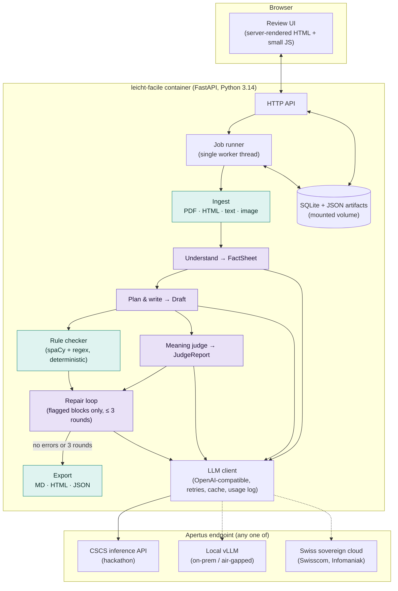

# Leicht·Facile - design and architecture

Status: design 5 October 2026; implemented 5-6 October 2026 except what needs the CSCS endpoint (§12). Hack Apertus online hackathon, Track 2B.
Companion documents: [rules.md](rules.md) (the rule catalogue the code checker implements), [use-case-canton.md](use-case-canton.md) (a walkthrough from the point of view of a cantonal administration), [sources.md](sources.md) (reference pairs, demo documents and their licences) and [hard-texts.md](hard-texts.md) (hard words and sentences for tests and the presentation).
Items marked **[verify]** are assumptions to confirm against the live endpoint on day 1 (see §12).

## 1. What it is

Leicht·Facile drafts easy-language versions of Swiss official texts - letters, forms,
web pages, decisions - in German (Leichte Sprache / Einfache Sprache), French (FALC)
and Italian (lingua facile), using Apertus 1.5. It is a **drafting assistant for the
professionals who write easy language today**, not a replacement for them or for the
review by readers from the target group.

The design rests on one rule:

> Apertus does everything that needs language understanding. Plain code does
> everything that can be counted.

That split is the answer to the "purposeful use of AI" criterion, and it stops the
model from grading its own homework on things a script can check exactly.

Leicht·Facile is not a translator, and the job cannot be done with one chatbot
prompt. "Rewrite this in Leichte Sprache" yields text with no fact contract, no
provenance, no omission log and no independent check; that is the C0 baseline in §9.
The pipeline exists to add exactly those four things, plus a review workflow and an
audit trail. [use-case-canton.md §4](use-case-canton.md) lays out the comparison
from the administration's point of view.

### Goals

1. Produce a draft that keeps every fact that matters (deadlines, amounts, obligations,
   contacts) and says nothing the source does not say.
2. Follow the published rules for easy language (sentence length, no passive, digits,
   Swiss spelling, …) and prove it with numbers, not demos.
3. Give the human reviewer provenance for every sentence and a checklist of facts, so
   review is faster than writing from scratch.
4. Run entirely on infrastructure the organisation controls: one container plus an
   OpenAI-compatible Apertus endpoint, no other network dependency.

### Non-goals (for the hackathon)

- Certifying texts as "Leichte Sprache". Only a target-group review can do that.
- Translation between languages. Each language version is simplified from the
  original in that language.
- Speech output. Apertus reads images and audio but only writes text; a TTS engine
  would be a separate component.

## 2. Users and workflow

Primary user: a communications officer or an easy-language writer in a canton,
municipality, or an organisation such as Pro Infirmis' Büro für Leichte Sprache.

1. Upload a document (PDF, HTML URL, pasted text, or a photo of a letter) and choose
   language and level (A2 = Leichte Sprache, B1 = Einfache Sprache).
2. Wait 1-3 minutes while the pipeline runs. Progress is visible per stage.
3. Review: source and draft side by side, every draft sentence linked to the source
   sentences it came from, a fact checklist with pass/fail per fact, the list of
   rule findings, and the model's change notes ("left out: appeal procedure, because …").
4. Approve or edit each block, then export (Markdown, HTML, JSON with provenance).
5. Optionally, send the approved text to a target-group test. That step is outside
   the tool but the export is formatted for it (one sentence per line, ≤ 85 characters).

## 3. Architecture overview



Purple stages call Apertus. Teal stages are deterministic code. Everything runs in one
container; the only outbound connection is `LLM_BASE_URL`.

### Key decisions

| # | Decision | Why |
|---|----------|-----|
| D1 | One Python service (FastAPI) serves both the API and a server-rendered review UI. No Node build step. | One container, one `make run`, nothing to break on the judges' machine. The UI is a review tool, not a product front-end. |
| D2 | All model access goes through one OpenAI-compatible client configured by `LLM_BASE_URL`, `LLM_API_KEY`, `LLM_NAME`. | The hackathon endpoint, local vLLM and Swiss cloud providers all speak the same protocol. "Sovereign deployment" becomes a change of one variable. |
| D3 | The pipeline is a sequence of explicit stages with typed, persisted artifacts (pydantic models stored as JSON). | Every intermediate result is visible in the UI, re-runnable in isolation, and usable for evaluation and ablations. |
| D4 | Countable rules live in code (spaCy morphology + regex). Apertus only judges what needs meaning. | Exact, free, reproducible; removes self-grading bias on the easy half of the rules. |
| D5 | Writer and judge are separate model instances; by default 8B writes, 70B (thinking) judges. | A different, stronger model judging reduces bias and gives an 8B-vs-70B cost story. Both are a config switch. |
| D6 | Each language is simplified from its own original. | Simplifying a translation compounds errors; three fact sheets also allow a cross-language consistency check. |
| D7 | Storage is SQLite plus JSON files on a mounted volume. | Zero operations, works air-gapped, trivially backed up. |
| D8 | The evaluation harness is a first-class module with a fixed dataset manifest and three conditions (baseline, pipeline without repair, full pipeline). | "Technical rigour" is judged on the comparison, not the demo. |

## 4. The pipeline

Each stage takes typed artifacts and produces typed artifacts (schemas in §5). The job
runner executes stages in order and persists each result before starting the next, so
a failure resumes from the last good stage.

### 4.1 Ingest (code)

| Input | Method | Output |
|-------|--------|--------|
| HTML URL | `httpx` fetch; content hidden in tabs and accordions is revealed and `tel:`/`mailto:` links unwrapped; then `trafilatura` main-content extraction (XML output) keeping headings, lists and tables; a rescue pass puts back contact blocks whose phone number or e-mail address the extraction dropped, at their place in the page | `SourceDocument` |
| PDF with text layer | `pdfplumber`, page by page; words are assigned to columns when a page has a gutter (a glossary side column is read after the main text); headings by font size and bold; repeated headers, footers and page numbers removed; hyphenated line ends joined; a paragraph running over a page break is merged | `SourceDocument` |
| PDF without text layer, photo | Not supported yet: a clear error. Planned: rendered to PNG and passed to Apertus as image input in the Understand step (Apertus 1.5 is multimodal). Day-1 check 4 passed on the Public AI gateway on 6 October 2026: the 8B read a rendered letter and answered with its deadline, so image input works through an OpenAI-compatible Apertus endpoint (vLLM at Juelich); the same on CSCS the same day. | - |
| Pasted text, `.txt`, `.md` | Paragraphs at blank lines, Markdown headings, bullet and numbered lists, short stand-alone lines as headings | `SourceDocument` |

All text is normalised first: Unicode NFC, soft hyphens and zero-width characters
removed, the dot-like characters PDFs deliver in compounds (`Merk•blatt`) turned into
the Mediopunkt, typographic apostrophes in numbers (`1’500`) into `'`.

Segmentation: paragraphs → sentences with spaCy's rule-based sentencizer for the
document language, plus a merge step for German abbreviations and ordinal dates
(`31. März`, `Art. 5 Abs. 2`, `z. B.`). Each segment gets a stable id (`s0001`, …), a
kind (`heading`, `paragraph`, `list_item`, `table_cell`), its heading path, the index
of its paragraph (`para`) and, for headings, the level. The language is detected from
stopword frequencies for German, French and Italian, which needs no extra model for
three languages; the user can override it.

Chunking is not needed for understanding - Apertus 1.5 has a 262,144-token context -
but documents over 3,000 words are **written** section by section (sharing one fact
sheet), to keep output quality.

### 4.2 Understand (Apertus)

One call over the whole document. Output: the `FactSheet` - the most important
artifact, because every later step is checked against it.

- Document type and audience.
- The reader's core questions: What is this? What must I do? By when? What does it
  cost? Whom do I contact? Each answer cites segment ids; `null` if the source does
  not answer it (the writer must then not invent one).
- `facts[]`: every fact that must survive, typed (`deadline`, `amount`, `obligation`,
  `right`, `condition`, `contact`, `procedure`, `definition`, `other`), with a
  normalised value where applicable (ISO date, decimal CHF, digits-only phone), the
  segment ids it comes from, and `must_keep` true/false.
- `hard_terms[]`: difficult words with a plain explanation, for the glossary.
- `omit_candidates[]`: passages the model considers droppable, with reasons - the
  reviewer sees these.

Model: `LLM_NAME` (8B), thinking on, temperature 0.1. Output is JSON; see §6 for
how JSON is enforced.

**Code completes the fact sheet.** After the call, code adds a fact for every date,
amount, phone number, e-mail address, web address, percentage and time in the source
that no fact carries (`origin: code`). Values in passages the model marked as
droppable become background facts; all others must be kept. The first local test run
showed why: the model listed 3 facts for a letter with 11 checkable values.

### 4.3 Plan and write (Apertus)

Easy language is not a sentence-by-sentence translation, so the prompt asks for a
plan first: order content by what matters to the reader, use questions as headings,
one idea per sentence, then write. Inputs:

1. The style guide for language and level (generated from [rules.md](rules.md), so
   prompt and checker never disagree).
2. Two short example pairs (standard → easy) written by the team, to anchor Swiss
   conventions: `ss` not `ß`, the Mediopunkt (`Kranken·kasse`), `1'200 Franken`, dates
   and times. Cantonal pages may not be reproduced in a public repository
   ([sources.md](sources.md) §4), so they are not used as examples.
3. The source segments with ids.
4. The fact sheet.

Output: `Draft` - blocks (`heading` | `sentence` | `list_item`), each with the
`fact_ids` it conveys and the `segment_ids` it was derived from (this is the
provenance the UI shows), plus `omissions[]` with reasons and a `glossary[]`.

Model: `LLM_NAME` (8B), temperature 0.3, thinking off by default. In the first local
tests, writing with thinking took 24 minutes and produced a paraphrase of the original,
while writing without thinking took 28 seconds and produced easy language (question
headings, `Sie`, no passive); `LLM_THINKING_STAGES` switches thinking per stage, and
the day-1 checks on the CSCS endpoint decide the final setting.

Code assigns the block ids (`b001`, …), drops fact ids that do not exist, and links a
block to every fact whose exact value it contains, so fact bookkeeping does not depend
on the model. A sentence that repeats an earlier one is dropped and its references go
to the first, and a heading left without content goes too: small models repeat a fact
under every heading it answers (the deadline under "What must you do?" and again under
"By when?").

### 4.4 Rule check (code)

Runs on every block, in milliseconds, no model. Produces `RuleFindings`: per-block
findings with a rule id, severity (`error` | `warn` | `info`), evidence and, where
possible, a suggestion; plus document metrics (words per sentence, readability
score, share of passive sentences, …). The full catalogue is in
[rules.md](rules.md). Highlights:

- sentence length and clause count (spaCy dependency parse);
- passive, genitive, Konjunktiv, Präteritum, nominalisations (spaCy morphology);
- numbers as digits, Swiss formats for dates, times, amounts, phone numbers;
- `ß`, `« »`, `%`, `&`, brackets, semicolons, abbreviations not on the allowlist;
- long compounds without Mediopunkt;
- **fact coverage**: every `must_keep` fact with a normalised value must appear in the
  draft in some accepted surface form (`4. Februar 2020`, `4.2.2020`, …). This is an
  exact check and the single most important automatic test;
- readability: Amstad (German Flesch) for DE, Kandel-Moles for FR, Gulpease for IT;
- the fact sheet itself: a value the model wrote into the fact sheet must appear in the
  source sentences it cites (FACT-05).

Each rule is registered in code once (`rules/base.py`), with its id, severity per level
and the instruction for the writer prompt; the style guide is rendered from that
registry, and a test keeps the registry and [rules.md](rules.md) in sync. German has
30 rules of its own (`rules/de.py`) and French 27 (`rules/fr.py`, ids ending in `-FR`),
both calibrated on the official easy-language pages; 11 rules for facts, layout and
readability apply to every language. Italian texts get only those until their rule set
ships.

### 4.5 Meaning check (Apertus as judge)

A second model call with the fact sheet and the draft (source available on request
via the segment ids). It answers only what code cannot:

1. For each fact: `present` | `missing` | `distorted`, with the block ids and a note.
2. Which draft blocks state something the source does not support (hallucinations).
3. Semantic rule violations: metaphors and idioms, abstract nouns, pronouns whose
   reference is unclear, implied knowledge the reader may not have.

Model: `LLM_JUDGE_NAME` (default `swiss-ai/Apertus-v1.5-70B-thinking`), temperature
0. The judge never rewrites; it only reports. Its reliability is measured, not
assumed (§9).

### 4.6 Repair (Apertus)

Only flagged blocks are sent back, each with its findings (rule and judge, with the
checker's suggestion where there is one) and the facts it must keep. The model returns
one to three sentences per flagged block and new sentences for missing facts, each
placed after a named block. A round first asks only for what blocks the draft (rule
errors, missing fact values, the judge's problems), with at most 5 missing facts at a
time, the most important kinds first; the warnings get one round once nothing blocking
is left. Code drops a repaired or added sentence that repeats one already in the draft,
also when an addition lands before the block it repeats. The judge's meaning findings
on headings are not sent for repair: a small model turns the question heading into a
statement.
Then:

- rule checks rerun on the new version;
- the judge reruns only if a fact or an invented statement was involved; otherwise its
  findings for the blocks the repair did not touch are carried over;
- the loop stops when no blocking finding remains (rule errors, missing fact values,
  facts the judge found missing or distorted, invented statements), when a round brings
  no progress, when only warnings are left after the first round, or after
  `MAX_REPAIR_ROUNDS` (3).

Language-rule findings (families LEN, ORD, GRAM, NEG, LEX, NUM, CH) and fact errors are
repaired; provenance and bookkeeping findings (FACT-02 to FACT-05) and layout go to the
reviewer. All draft versions are kept; the version with the fewest blocking findings
is marked final, and the reviewer can switch to any other version. Model: `LLM_NAME`,
thinking off, temperature 0.2.

### 4.7 Review (human) and export (code)

The reviewer sees the final draft with provenance, findings and the fact checklist,
and records a decision per block: `approved`, `edited` (with the new text), or
`rejected`. Export formats:

- Markdown and HTML with one sentence per line, lines ≤ 85 characters, headings and
  lists preserved;
- JSON bundle: source, fact sheet, final draft, findings, decisions - the audit trail;
- DOCX (`python-docx`) if time allows, since writers work in Word.

### 4.8 Learning from edits (stretch)

Approved drafts form an SFT set; reviewer edits form preference pairs (model text vs.
edited text). With the official Apertus fine-tuning recipes, a LoRA on the 8B model
could be trained from them - in effect distilling the 70B judge's standard into the
8B writer. Only attempted if compute is available (Phoeniqs applications closed on
4 October; Hugging Face credits or a Kaggle notebook remain).

### Where Apertus is used - summary

| Stage | Role of Apertus | Model (default) | Thinking | Temp. | Output |
|-------|-----------------|-----------------|----------|-------|--------|
| Ingest (scans only) | Read a photographed or scanned letter (image input) | 8B | off | 0.0 | segments |
| Understand | Extract facts, core answers, hard terms | 8B | on | 0.1 | `FactSheet` JSON |
| Plan & write | Reorder, simplify, explain, record omissions | 8B | off (configurable) | 0.3 | `Draft` JSON |
| Meaning check | Judge fact fidelity, hallucinations, semantic rules | 70B-thinking | on | 0.0 | `JudgeReport` JSON |
| Repair | Rewrite flagged blocks | 8B | off | 0.2 | blocks |
| Cross-language check (stretch) | Compare DE/FR/IT fact sheets | 70B | on | 0.0 | diff report |
| Learning (stretch) | LoRA fine-tune of 8B on approved drafts | 8B | - | - | adapter |

The rule checker, ingestion, fact coverage, readability and export use no model.

## 5. Data model

All artifacts are pydantic models (`src/leichtfacile/schemas.py`) serialised as JSON.
The model answers in its own, leniently parsed shapes (`pipeline/models.py`), which
code turns into these artifacts.

```text
SourceDocument
  id, lang (de|fr|it), title, source {type, uri, fetched_at, license_note}
  segments[]: {id, kind, text, heading_path[], heading_level?, para, page?}

FactSheet
  doc_id, doc_type, audience
  core: {what, must_do, deadline, cost, contact}  each {text|null, segment_ids[]}
  facts[]: {id, kind, text, value_norm?, segment_ids[], must_keep, origin (model|code)}
  hard_terms[]: {term, explanation, segment_ids[]}
  omit_candidates[]: {segment_ids[], reason}

Draft  (one per version)
  doc_id, lang, level (A2|B1), version, parent_version?, origin (write|repair|baseline|review)
  blocks[]: {id, kind (heading|sentence|list_item), text, fact_ids[], segment_ids[]}
  omissions[]: {what, why, segment_ids[]}
  glossary[]: {term, explanation}

RuleFindings  (one per draft version)
  draft_version, level
  findings[]: {block_id?, rule_id, severity, message, evidence, suggestion?, fact_id?, segment_ids[]}
  metrics: {blocks, sentences, words, avg_words, max_words, pct_passive, pct_genitive,
            pct_subordinate, readability, readability_formula, facts_total, facts_found,
            fact_coverage}

JudgeReport  (one per judged draft version)
  draft_version, model
  fact_checks[]: {fact_id, status (present|missing|distorted), block_ids[], note}
  unsupported[]: {block_id, note}
  semantic_findings[]: {block_id, rule_id (SEM-01..05), note}

ReviewState
  draft_version, completed
  decisions[]: {block_id, decision (approved|edited|rejected), text?, comment?, at}

PipelineSummary
  condition, final_version, rounds, stop_reason, writer_model, judge_model?,
  prompt_versions {stage: hash}, blocking_findings[] (per draft version)

Job
  id, status (queued|running|needs_review|done|failed), stage, title, created_at, updated_at
  config: {lang, level, condition (C0|C1|C2), writer_model, judge_model, use_judge,
           max_repair_rounds}
  usage[]: {stage, model, tokens_in, tokens_out, latency_ms, cached}
  error?
```

Storage: one SQLite database (`DATA_DIR/leichtfacile.sqlite`) with the tables `jobs`,
`artifacts` (job, name, version, JSON) and `llm_calls`; the response cache is a second
file (`llm_cache.sqlite`). Standard library only, no ORM.

## 6. The LLM client

`leichtfacile/llm/client.py` wraps the `openai` Python SDK:

- **Configuration** from the template's variables: `LLM_BASE_URL`, `LLM_API_KEY`,
  `LLM_NAME`; plus `LLM_JUDGE_NAME` (defaults to `LLM_NAME`) and
  `LLM_THINKING_MODE` = `model-suffix` (CSCS exposes thinking as separate
  `…-thinking` model names; the suffix is `LLM_THINKING_SUFFIX`) | `chat-template`
  (local vLLM: `extra_body={"chat_template_kwargs": {"enable_thinking": true}}`) |
  `off`. Optional: `LLM_TIMEOUT_S`, `LLM_MAX_RETRIES`, `LLM_CACHE`, and
  `LLM_EXTRA_BODY` (JSON fields sent with every request, for gateway switches).
- **Endpoint profiles** (documented in `.env.example`):
  1. CSCS inference API, the hackathon default;
  2. local vLLM from the `local-llm` compose profile, for on-premise and air-gapped
     deployments;
  3. the Public AI gateway (`https://api.publicai.co/v1`), for development and
     evaluation with public documents. It lists `swiss-ai/apertus-v1.5-8b` and
     `-70b`, each with a `-thinking` variant, at USD 0.10/0.20 per million
     input/output tokens for the 8B and 0.82/2.92 for the 70B, with USD 2 of starter
     credit. It is run by Metagov Inc., a US nonprofit, under Massachusetts law, and
     routes requests to compute partners. It requires a `User-Agent` header, which
     the client always sends. Not a sovereign deployment: never used for documents
     with personal data. The routing checked on 6 October 2026 (from the gateway's
     response headers) decides the profile's settings: the 8B goes to Juelich's
     Blablador (vLLM) and thinks through the chat template, but only in about two
     of three identical calls, so comparisons of thinking against no thinking are
     left to the CSCS endpoint; the 70B goes to
     Infomaniak (`Apertus-v1.5-70B`) and ignores the thinking switch; the
     `-thinking` names are not used, because `apertus-v1.5-8b-thinking` serves the
     older Apertus 1 8B through Featherless. The gateway's response cache ignores
     the thinking switch, so the profile turns it off per request
     (`LLM_EXTRA_BODY={"cache": {"no-cache": true}}`). Results from this profile are
     labelled Public AI, never CSCS;
  4. the Hugging Face inference router, for development only. It serves only the
     older Apertus 1 models (`swiss-ai/Apertus-8B-Instruct-2509` through Public AI,
     `…-70B-Instruct-2509` through Featherless). No Hugging Face provider serves
     Apertus 1.5, so its results are never reported as Apertus 1.5 numbers.

  All facts on third-party endpoints were checked on 5 October 2026.
- **Thinking per stage.** `LLM_THINKING_STAGES` (default `understand,judge`) names
  the stages that use the thinking model. When the reasoning of a thinking call runs
  out of tokens before the answer, the stage is answered once more without thinking;
  both calls are counted in the usage log.
- **Graceful degradation.** A failing judge or repair round does not fail the job:
  the reviewer gets the best draft so far with its rule and fact checks, and the job
  summary names the step that failed.
- **Reasoning removal.** A thinking model's reasoning is taken from the separate
  `reasoning_content` field when the server provides one (vLLM with
  `--reasoning-parser apertus`), and otherwise cut from the text, whether wrapped in
  `<|inner_prefix|> … <|inner_suffix|>` or `<think> … </think>`. Output cut off by
  `max_tokens` while still reasoning is flagged as truncated.
- **Structured output.** Neither the CSCS docs nor the vLLM guide document
  `response_format`, so JSON is enforced the robust way: the schema is in the
  prompt, the response is stripped of any leaked reasoning tokens
  (`<|inner_prefix|> … <|inner_suffix|>`) and code fences, parsed (the slips of a
  small model are repaired in code: a run of ids written as a range, a trailing or a
  missing comma) and validated with pydantic. On failure the validation error, or the
  syntax error with its position, is fed back once for a repair. An answer that copies
  the prompt's own example (4 of 12 dev drafts on the Public AI 8B were the JSON form
  itself, 6 October 2026) is recognised by code and sent back once in the same way.
  The Public AI gateway (vLLM) accepts `response_format={"type":"json_object"}`,
  but it made no difference in the day-1 check (§12), so it is not used.
- **Streaming.** Every response is streamed (`LLM_STREAM`, on by default): the
  endpoint sends the answer as it is generated and the client assembles it, with the
  token counts from the last chunk (`stream_options.include_usage`). Without it, a
  proxy in front of the endpoint can cut a long answer: Cloudflare in front of the
  Public AI gateway does so after about 100 seconds, which lost 3 of 6 evaluation
  pairs to 504 errors on 6 October 2026. A stream that breaks is retried like any
  other failure. `LLM_STREAM=0` is for a server that cannot stream.
- **Reliability.** Retries on 429, 5xx, connection errors and broken streams with
  exponential backoff and jitter, honouring `Retry-After`; other 4xx errors are not
  retried. Per-call timeout, and `max_tokens` sized generously for thinking models
  (reasoning can be several times longer than the visible answer).
- **Usage log.** Every call records model, tokens in/out, latency and stage; jobs
  show totals, and the evaluation reports cost per page using a configurable
  CHF-per-million-tokens table.
- **Cache.** Responses are cached by hash of (model, messages, parameters) in SQLite
  when `LLM_CACHE=1`. It speeds up development and makes evaluation reruns cheap. The
  repository ships with an empty cache: the live run must work from the endpoint.
- **Control tokens.** Servers that print special tokens (llama.cpp with `-sp`, which
  is needed to see the reasoning markers) also print `<|assistant_end|>`; every
  `<|...|>` token is removed from answers.
- **Tool calling is not used.** The thinking variants are served with tool use
  disabled, and the pipeline has no need for it.
- **A local endpoint for development without a key.** llama.cpp's `llama-server`
  speaks the same protocol. With the community conversion
  `Colby/apertus-v1.5-8b-text-Q4_K_M-GGUF` (text only, 4-bit, unofficial) and
  `LLM_THINKING_MODE=chat-template` it serves Apertus v1.5 8B on an 8 GB laptop GPU;
  see §10. Results from it are never reported as CSCS numbers.

Privacy: document text is never written to logs above `DEBUG`.

## 7. Web application

### API

| Method & path | Purpose |
|---------------|---------|
| `POST /api/jobs` | Create a job from a file upload, a URL or pasted text (multipart form); options `lang`, `level`, `condition`, `writer_model`, `judge_model`, `title` |
| `GET /api/jobs` | The latest jobs |
| `GET /api/jobs/{id}` | Status, current stage, usage totals and per call, artifact versions, links |
| `GET /api/jobs/{id}/artifacts/{name}?version=` | `source`, `factsheet`, `draft`, `rules`, `judge`, `review`, `summary` |
| `POST /api/jobs/{id}/review` | Block decisions for one draft version, and whether the review is complete |
| `GET` or `POST /api/jobs/{id}/export?format=md\|html\|json` | Download: Markdown, HTML, or the JSON audit bundle |
| `POST /api/jobs/{id}/rerun?from=understand\|write\|judge` | Delete the artifacts from that stage on and run again |
| `DELETE /api/jobs/{id}` | Remove a job and its artifacts |
| `GET /healthz` | Liveness; also checks the LLM endpoint's `/v1/models` |

Jobs execute on a single worker thread with a queue; the UI polls status. That is
enough for a reviewer's workload and avoids a message broker. Jobs that were queued or
running when the service stopped are queued again on start.

### Review UI

Server-rendered (Jinja2) pages. Every page works without JavaScript; `app.js` adds
polling, highlighting and keyboard comfort on top. Throughout the UI, purple marks
what Apertus did and teal what code did, the same colours as the diagram in §3.

- **Start page** (`/`): the submission form with three source tabs (pasted text, web
  address, file), the two team-written example letters from `data/examples/sources/`
  as one-click fills, language, level and pipeline condition, optional writer and
  judge model overrides, the endpoint status from `/healthz`, and the list of jobs.
- **Progress page** (`/jobs/{id}` while the job is queued or running): the stages of
  the chosen condition as a stepper (done / running / pending / skipped / failed, with
  one line of facts per stage such as "14 facts, 14 must survive" or "draft v1: 10
  errors, 9 warnings"), the elapsed time and tokens, and the intermediate artifacts as
  soon as they exist: the fact sheet with the core questions and the facts that must
  survive, then the latest draft with the blocks that have findings marked, then the
  model calls per stage. The page polls the fragment at `/jobs/{id}/progress` every
  two seconds and reloads when the job reaches review or fails.
- **Review page** (`/jobs/{id}` once a draft exists): a summary strip (status,
  language and level, condition, errors and warnings, facts present, tokens and model
  time), the draft versions as pills with the blocking problems left after each one,
  a reader view (`/jobs/{id}/preview`, the HTML export shown inline) and the export
  menu, then three panes:
  1. **Source** - segments in order; clicking a draft block highlights the source
     sentences it came from. Sentences left out are struck through with the reason as
     a tooltip; sentences neither used nor listed as left out are outlined (FACT-04).
  2. **Draft** - blocks with a colour mark for findings (none / warning / error), the
     findings with their suggestions and a code / judge badge, filters (all, with
     findings, undecided), approve / edit / reject per block as a segmented control,
     "approve all undecided", the decided count and "review complete". Keys: j and k
     move between blocks, a, e and r decide. Unsaved decisions warn before leaving.
  3. **Side panel** - the five core questions from the fact sheet (click to see the
     source sentences), the fact checklist (present / missing / distorted, from code
     and judge; click to see the blocks that carry a fact), document findings,
     omissions with reasons, glossary, measures (sentence length, readability,
     passive, facts found) and the run summary with the rerun and delete actions.

Styling is one vendored classless stylesheet (water.css, MIT) plus a small
`app.css` and `app.js`: no CDN, no build step, nothing that breaks air-gapped.

### CLI

| Command | Purpose |
|---------|---------|
| `python -m leichtfacile serve` | The web application |
| `python -m leichtfacile check-llm [--thinking]` | List the endpoint's models and make one call |
| `python -m leichtfacile ingest <file\|url> [--section]` | Print the segments |
| `python -m leichtfacile check <file\|url> [--level]` | Rule checker on an existing easy-language text |
| `python -m leichtfacile simplify <file\|url> [--condition] [--no-judge] [--no-repair] [--stop-after]` | The pipeline without the web app; all artifacts and exports go to `--out` |
| `python -m leichtfacile eval fetch\|calibrate\|reference\|run\|report` | The evaluation harness (§9) |
| `python -m leichtfacile examples build` | Build the example jobs shown on first start |

## 8. Languages and levels

| | German | French | Italian |
|---|--------|--------|---------|
| Easy level (A2) | Leichte Sprache | FALC (facile à lire et à comprendre) | lingua facile |
| Plain level (B1) | Einfache Sprache | langage clair / simplifié | linguaggio semplice |
| Rule source | Canton Zürich rules; EBGB (federal) guide; Inclusion Europe "Informationen für alle" | Inclusion Europe "L'information pour tous"; cantonal FALC pages (FR, VD, GE) | Inclusion Europe "Informazioni per tutti"; Canton Ticino pages |
| spaCy model | `de_core_news_md` | `fr_core_news_md` | `it_core_news_md` |
| Readability | Amstad: `180 - ASL - 58.5·ASW` | Kandel-Moles (French Flesch) | Gulpease: `89 + (300·sentences - 10·letters) / words` |
| Swiss conventions | `ss` for `ß`, `500'000`, `9.00 Uhr`, `044 123 45 67`, Helvetisms | `CHF`, `1 500 francs`, Swiss terms (`septante`, `nonante`) | `fr.` / `CHF`, Ticino terms |

Thresholds differ per level (A2 ≤ 12 words per sentence, B1 ≤ 15 by our choice -
there is no official B1 rule set); both are configuration in `rules.md`. French gets
15 and 18 words: it needs about a quarter more words than German for the same content,
as the calibration on the official pages shows (`rules/base.py`, `LANG_PARAMS`).

| Status | German | French | Italian |
|---|--------|--------|---------|
| Checker rules | 30 + 11 shared | 27 + 11 shared | 11 shared |
| Prompts and few-shot examples | yes | yes | no; jobs are refused |
| Calibration on official pages | 30 pages, 2.0 errors / 100 blocks | 5 pages, 2.2 errors / 100 blocks | - |

German came first in the build order. French followed on 6 October 2026, before the
CSCS key arrived: rules, prompts, examples and the web form. Italian stays a stretch
goal. Syllables for readability come from `pyphen` with the `de_CH`, `fr`, `it`
dictionaries.

## 9. Evaluation

### Dataset

`data/pairs/manifest.jsonl`: one row per document pair - `id`, `publisher`, `canton`,
`lang`, `level`, `role`, `topic`, `url_standard`, `url_easy`, `section_standard` and
`section_easy` (a heading when only one section of a page corresponds), approximate
word counts, `facts_estimate`, `licence_note` and `notes`. It holds 35 verified pairs:
30 German (20 `eval`, 10 `dev`) from Zürich, Bern, St. Gallen, Luzern, Basel-Stadt,
Graubünden, Zug and three federal offices, and 5 French (3 `eval`, 2 `dev`). `dev`
pairs are for prompt development and checker calibration; `eval` pairs are held out
for the final numbers. `python -m leichtfacile eval fetch` (or
`scripts/fetch_pairs.py`) downloads and caches the texts under `data/cache/pairs/`
(git-ignored). The publishers do not allow reproduction, so the manifest and the
fetch command are the dataset.

These reference pairs measure the pipeline; they are not the demo. The demo uses
documents that have no easy-language version yet, such as the Federal Council's
explanations for a past vote. Pairs used as few-shot examples in the prompts are
excluded from evaluation. The shortlist, the demo candidates and the licence terms of
each publisher are in [sources.md](sources.md).

For additional German training or calibration data, DEplain (professionally written
plain-German parallel corpus) is a candidate; its licence must be checked before any
use beyond evaluation.

### Conditions

| Code | Condition | Purpose |
|------|-----------|---------|
| C0 | Single prompt: "rewrite this in Leichte Sprache" | Baseline; what a naive user gets |
| C1 | Understand → write → rule check, no judge, no repair | Value of the fact sheet and structure |
| C2 | Full pipeline with judge and repair | Value of checking and repairing |

Each run with the 8B writer; C2 also with the 70B writer where budget allows. The
judge is always the 70B-thinking model, so C1 and C2 are judged by the same instrument.

### Metrics

| Metric | How | Why it matters |
|--------|-----|----------------|
| Fact coverage | Share of `must_keep` facts with a normalised value found in the output (exact, code) | Did anything important get lost? |
| Fact status (judge) | Share present / missing / distorted per the judge | Semantic version of the above |
| Invented statements | Unsupported blocks per 100 blocks (judge; human-labelled on a subset) | Hallucination rate |
| Rule violations | Errors and warnings per 100 blocks, by rule family | Compliance with the published rules |
| Readability | Amstad / Kandel-Moles / Gulpease: source vs. output vs. official easy version | Did it actually get easier? |
| SARI | Against the official easy-language reference | Standard simplification metric |
| Judge reliability | Agreement (Cohen's κ) between the judge and 30 hand-labelled outputs | Is the judge trustworthy? |
| Cost and speed | Tokens, latency and estimated cost per page (250 words), 8B vs. 70B; cost in USD at Public AI list prices as an order of magnitude | Value, cost & scalability |
| Hard facts kept | Share of the source's dates, amounts, phone numbers, e-mail addresses, web addresses, percentages and times found in the output (exact, code, no model) | A fact measure that does not depend on any model, comparable with the official version |

Two rows need no model and frame the conditions: SOURCE (the standard-language
original, checked as if it were a draft) and REF (the official easy-language version).
Every output is scored the same way: language rules recomputed on the final text, fact
coverage against one fact sheet per pair, readability, document-level SARI (a port of
the original `SARI.py`, checked bit for bit), judge statistics where a judge ran.
Outputs land in `eval/results/*.jsonl` (git-ignored, they contain rewrites of
protected pages); `python -m leichtfacile eval report` renders the tables for the
technical report from aggregates only. If the dataset is published, it follows
the Hugging Face `HackApertus/online_hack_template` layout: test cases, model
responses, and metadata with per-instance licensing.

## 10. Deployment and sovereignty

### `make run`

`make run` → `docker compose up --build`. The Makefile first checks that `.env`
exists and names `LLM_BASE_URL`, `LLM_API_KEY` and `LLM_NAME`, and prints a short
help text otherwise. The image is built from `python:3.14-slim` (the project supports
Python 3.12 and later) and installs the locked dependencies from `uv.lock` with `uv`
at **build** time, including the spaCy models as pinned wheel URLs. German and French
are in the image; the Italian model is added when Italian ships. The
vendored UI assets are copied in the same way. At **runtime** the container needs
exactly one outbound connection: `LLM_BASE_URL`. It runs as a non-root user, keeps
its data in the named volume `appdata` (mounted at `/data`), and has a Docker health
check on `/healthz`. The app listens on `:8000`, with two pre-computed example jobs
so the UI is not empty before the first live run (clearly labelled as examples).
The example jobs are audit bundles in `data/examples/jobs/`, built from the team's
sample documents with `python -m leichtfacile examples build` once an endpoint is
available, and imported into the store on start.

`make check-llm` lists the endpoint's models and makes one short call from inside the
container; it is the first thing to run once `.env` holds a key.

### The three target architectures

| Architecture | How Leicht·Facile meets it |
|--------------|----------------------------|
| a) On-premise | `docker compose --profile local-llm up`: adds a `vllm` service from the official image `ghcr.io/swiss-ai/vllm_apertus_1.5_release:latest-amd64` serving `swiss-ai/Apertus-v1.5-8B` on one GPU, with the Apertus reasoning parser and `--max-model-len 32768`; the app points at `http://vllm:8000/v1` with `LLM_THINKING_MODE=chat-template`, so one server provides both modes. The 70B judge is optional and can be the 8B in a pinch. **[verify]** on a GPU host: the compose file validates, but the service has not been started yet. |
| b) Air-gapped | Same as (a) with images and weights pulled in advance; spaCy models and UI assets are inside the image; no telemetry, no CDN, no package installs at runtime. A `make bundle` target saves the images to a tarball. |
| c) Sovereign Swiss cloud | Set `LLM_BASE_URL` to a Swiss-operated Apertus endpoint (CSCS, Swisscom AI Platform, Infomaniak). The hackathon demo itself runs against CSCS in Lugano. |

Hardware for (a)/(b), to be measured and stated precisely in the report: the 8B
model in bf16 needs roughly 16 GB for the weights plus KV cache, so a 24 GB GPU with
a reduced `--max-model-len` is realistic; the FP8 build (`onprem-ai/Apertus-v1.5-8B-FP8`,
keeps image input) is 11.42 GB against 18.44 GB for the full multimodal checkpoint.

A smaller on-premise option was tested on 5-6 October 2026: llama.cpp (`llama-server`,
Vulkan build b9637) with the community 4-bit text-only conversion
`Colby/apertus-v1.5-8b-text-Q4_K_M-GGUF` (5.06 GB) on a laptop GPU (RTX 4060, 8 GB),
16k context with an 8-bit KV cache. It generated about 37 tokens per second at short
context and about 17 near 16k; Understand took about 1.5 minutes and Write, with
thinking, about 12 minutes for a 400-word letter. It runs the whole pipeline
including thinking mode (`LLM_THINKING_MODE=chat-template`, `llama-server -sp`), but
it has no image input and is an unofficial conversion, so it serves development and
small offices, not the evaluation. `docker compose --profile local-llm-small up` adds
this server as a `llamacpp` service (official `ghcr.io/ggml-org/llama.cpp:server-cuda`
image, weights downloaded on first start); it is served under the alias
`apertus-v1.5-8b-q4-llamacpp`, so its results can never be mistaken for the official
model. Tested on 6 October 2026 with that image (llama.cpp b11429, CUDA) on the same
laptop: the model starts in 6 seconds from the named volume and takes 5.9 GB of GPU
memory. Mounting the model file from a Windows folder instead stalls the start for
many minutes (memory-mapped reads through Docker Desktop's file sharing); the named
volume avoids that. The 70B is served with tensor parallelism over four
GPUs in the official guide; FP8/NVFP4 builds reduce that. The business argument of
the stretch goal (§4.8) is precisely that a fine-tuned 8B makes the 70B unnecessary
at runtime.

### Security and privacy

- Documents contain personal data. In production the model endpoint is inside the
  organisation, so content never leaves. The hackathon demo uses public documents only.
- No authentication in the prototype; it is meant to run behind the organisation's
  reverse proxy. Noted as a limitation.
- Jobs and artifacts live on the mounted volume and can be deleted via the API.
- The server fetches the URLs users submit, so a URL that resolves to a private,
  loopback or link-local address is refused (server-side request forgery);
  `ALLOW_PRIVATE_URLS=1` lifts this for an intranet that needs internal pages.
- No document text in logs above `DEBUG`; the LLM cache can be disabled.

## 11. Repository layout

```text
Makefile                  run · stop · check-llm · test · lint · smoke · calibrate · day1 · eval
docker-compose.yml        app (+ profile local-llm: vllm)
Dockerfile
pyproject.toml, uv.lock   dependencies (uv), Python 3.12+; .python-version pins 3.14
.env.example              endpoint profiles: CSCS, local vLLM, Public AI, Hugging Face, llama.cpp
README.md                 project overview, quick start, status; Track 2B challenge text (template)
technical_report.md       the report (PDF: RoestigrabenBridgers_Report.pdf)
docs/
  architecture.md         this document
  rules.md                rule catalogue → implemented by src/leichtfacile/rules
  prompts.md              prompt design notes and change log
  sources.md, use-case-canton.md, hard-texts.md
src/leichtfacile/
  __main__.py, cli.py     serve, check-llm, ingest, check, simplify, eval, examples
  config.py               env → settings (pydantic-settings)
  schemas.py              artifacts (§5)
  store.py                SQLite access
  examples.py             example jobs: import on start, build
  llm/                    client.py, json_out.py, reasoning.py, cache.py
  llm/prompts/<lang>/     understand.md, write.md, judge.md, repair.md, baseline.md, examples/
  ingest/                 html.py, pdf.py, text.py, segment.py, normalize.py, detect.py, errors.py
  pipeline/               models.py, prompts.py, render.py, stages.py, orchestrator.py, runner.py
  rules/                  base.py, de.py, document.py, layout.py, values.py, lexicon.py,
                          readability.py, styleguide.py, checker.py, nlp.py
  web/                    app.py, api.py, pages.py, jobs.py, views.py, templates/, static/ (vendored)
  export/                 markdown.py, html.py, bundle.py
  eval/                   dataset.py, calibrate.py, score.py, run.py, report.py, metrics.py,
                          day1.py, cli.py
scripts/                  fetch_pairs.py, day1_checks.py
data/
  pairs/manifest.jsonl    URLs + licence notes (committed)
  examples/               team-written sample documents; example job bundles
  cache/                  fetched texts, LLM cache (git-ignored)
eval/results/             evaluation outputs (git-ignored)
tests/                    rules (golden sentences, hard texts), ingest, pipeline (fake endpoint),
                          eval, web
```

`data/` stays well under the 100 MB limit because texts and caches are not committed.

## 12. Day-1 verification checklist

Assumptions to confirm against the live endpoint, in this order. Run on the Public AI
gateway on 6 October 2026 and, when the key arrived the same day, on CSCS (both
results below). `make day1`
(`scripts/day1_checks.py`) runs checks 1-5 and writes `eval/results/day1_checks.json`;
check 6 is `python -m leichtfacile eval run --condition C0 --limit 10`. Checks 2 and 3
were rehearsed against the local llama.cpp endpoint (§10): thinking switches per request
through `chat_template_kwargs`, the reasoning arrives inline between `<|inner_prefix|>`
and `<|inner_suffix|>` and is stripped, and the answer ends with a control token that the
client removes.

1. `GET {LLM_BASE_URL}/v1/models` lists `swiss-ai/Apertus-v1.5-8B`, `…-8B-thinking`,
   `…-70B`, `…-70B-thinking`; the base URL host issued for the hackathon
   (`api.inference.cscs.ch` per the CSCS docs; some public projects use
   `api.swissai.svc.cscs.ch`).
2. How thinking output is returned by the `-thinking` models: a separate
   `reasoning_content` field, or inline tokens that must be stripped.
3. JSON reliability: 20 Understand calls on one document, count parse failures with
   and without `response_format`.
4. Image input through the API (a photographed letter); if unsupported, scans become
   a local-vLLM-only feature.
5. Rate limits and concurrency (the docs do not state them) - determines whether
   section-parallel writing is worth it.
6. Baseline quality: C0 on 10 German pairs. This decides whether the A2 level is
   realistic for the 8B model or whether B1 becomes the primary target with A2 as the
   stretch.

### Results on the Public AI gateway, 6 October 2026

`make day1` with profile C (§6): the 8B `swiss-ai/apertus-v1.5-8b`, served by vLLM
at Juelich. The CSCS key had not arrived. Full output in
`eval/results/day1_checks.json`.

1. **Models.** All four Apertus 1.5 names are listed, in lowercase
   (`swiss-ai/apertus-v1.5-8b`, `-8b-thinking`, `-70b`, `-70b-thinking`), next to the
   Apertus 1 names (`apertus-8b-instruct`, `-70b-instruct`) and three unrelated
   models. The `-thinking` names are not used on this gateway (§6). The host and the
   capitalised names: see CSCS below.
2. **Thinking.** The 8B answered the arithmetic question without any reasoning (4
   output tokens). Fourteen further calls on the same day with `enable_thinking`
   through the chat template, short and long prompts, with and without JSON mode,
   returned no reasoning either, after three calls in the morning had reasoned in two
   cases. On this gateway thinking is unreliable to absent for the 8B and off for the
   70B, so Public AI runs are, in effect, runs without thinking at every stage and are
   labelled that way. The reasoning format of the `-thinking` models: see CSCS below.
3. **JSON.** 20 of 20 Understand answers on the sample letter parsed and validated
   without `response_format`, and 20 of 20 with `{"type": "json_object"}`; nothing
   truncated. JSON mode is accepted by the vLLM backend and changes neither the
   backend nor the answer: a side-by-side pair gave the same fact sheet with 995
   against 1,102 output tokens in 47 against 52 seconds. Decision D-B: `response_format`
   is not used; the example in the prompt, lenient parsing and one repair round are
   enough. The medians of the two runs (46 against 9 seconds) differ because the
   backend's speed varied with load during the run, from about 20 to about 120 output
   tokens per second. Three of the twenty long calls got a 504 from the gateway and
   succeeded on the retry after 30 seconds. The C0 baseline run later lost 3 of 6
   pairs to the same 504 after five attempts each: Cloudflare in front of the gateway
   cuts any response that takes longer than about 100 seconds, which a long page at
   20 tokens per second exceeds. The client now streams every response (§6), so the
   limit no longer applies.
4. **Image input.** Works: the 8B read a rendered letter (PNG as base64 `image_url`)
   and answered "Man muss bis zum 31. März 2026 handeln." The same on CSCS, below.
5. **Parallel calls.** 8 short calls at once: all succeeded, no 429, 1.4 to 2.2
   seconds each, no rate-limit headers. Decision D-F: there is headroom; the
   evaluation can run several pairs at once, section-parallel writing stays optional.
6. **Baseline.** C0 (one prompt, 8B without thinking) on the first 10 held-out German
   pairs, 6 October 2026: 16.1 errors and 85 warnings per 100 blocks against 2.7 and
   27 for the official easy-language versions and 31.3 and 146 for the sources; 7.1
   words per sentence (official: 6.1); readability 46 (official: 62, sources: 36);
   90 percent of the hard facts kept (the official versions keep 70). The findings
   are mostly sentence length (LEN 33 per 100 blocks) and vocabulary (LEX 47:
   abbreviations, long compounds without Mediopunkt). One prompt does not reach A2;
   decision D-E (A2 or B1 as the primary level) waits for C2 on the dev split.

One cost figure from the gateway's headers: an Understand call on the 400-word sample
letter (1,829 tokens in, about 1,000 out) costs USD 0.0004 on the 8B.

### Results on CSCS, 6 October 2026

`make day1` with profile A, the hackathon key, the same afternoon. Full output in
`eval/results/day1_checks_cscs.json` (the Public AI run is kept as
`day1_checks_publicai.json`).

1. **Models and host.** `https://api.inference.cscs.ch/v1` lists `swiss-ai/Apertus-v1.5-8B`,
   `-8B-thinking`, `-70B` and `-70B-thinking` in that spelling, next to the Apertus 1
   models (`Apertus-8B-Instruct-2509`, `-70B-`) and six models of other makers. A short
   call answers in about 100 milliseconds.
2. **Thinking.** `LLM_THINKING_MODE=model-suffix` works as designed: the `-thinking`
   models reason, and the reasoning arrives in the `reasoning` field of every streamed
   chunk (the newer vLLM name; the client reads `reasoning_content` too), never inline.
   The budget is the price: for the 400-word sample letter the 8B wrote 3,000 to 17,000
   characters of reasoning per Understand call, 1,800 to 7,000 output tokens in total,
   in 12 to 90 seconds at about 150 tokens per second; without thinking the same
   call is about 1,000 tokens and 10 seconds.
3. **JSON.** 19 of 20 Understand answers with thinking parsed and validated without
   `response_format` (the twentieth call failed on the connection, below) and 20 of 20
   with `{"type": "json_object"}`; medians 36 and 38 seconds. Decision D-B stands:
   `response_format` is not used.
4. **Image input.** Works on CSCS too: the 8B read the rendered letter and answered
   "bis zum 31. März 2026".
5. **Parallel calls.** 8 short calls at once, all in 98 to 104 milliseconds, no 429.
   Decision D-F stands.
6. **Connection drops.** About one in four long thinking calls ends with the server
   closing the stream (`peer closed connection without sending complete message body`,
   `incomplete chunked`), after seconds to a minute of generation; 10 of the 40 calls of
   check 3 needed retries and one failed after five attempts. The rate is the same for
   sequential and for eight parallel calls, so it is not our load. The client retries
   such drops; profile A sets `LLM_MAX_RETRIES=8`, which makes a hard failure rare, at the
   price of repeated generation time.
7. **Baseline.** C0 on the eval pairs runs on CSCS with `make eval`; the Public AI
   baseline above was the first reading.

## 13. Risks and mitigations

| Risk | Mitigation |
|------|------------|
| The 8B model cannot reach A2 quality | Fact sheet, examples and repair loop are designed to compensate; if it still fails, B1 becomes the primary level and the A2 gap is reported as a finding with numbers. |
| JSON output unstable | Schema in prompt, lenient parse, pydantic validation, one error-feedback retry; measured in day-1 check 3. |
| Model judging itself is biased | Everything countable is in code; the judge is a different, larger model; judge agreement with human labels is reported. |
| CSCS endpoint rate-limited or down | Backoff and cache; single-worker queue; evaluation runs overnight. |
| Image input not available on the hackathon endpoint | Feature flagged; demo uses text and HTML; scans shown with local vLLM only if time allows. |
| Scope creep across three languages | German end-to-end with numbers first (by 10 October); FR/IT only afterwards. |
| No compute for the LoRA | Stretch goal; the pipeline's value does not depend on it. The data it would need (approved drafts, edits) is collected regardless. |
| Over-promising to public-sector judges | Positioned as a drafting assistant for professionals; target-group review stays mandatory; limitations stated in the report. |

## 14. Milestones

| Dates | Deliverable |
|-------|-------------|
| Oct 5-6 | Repo, Docker, `make run` with a health check; LLM client; day-1 checks; C0 baseline on 10 German pairs |
| Oct 7-8 | Understand, write, rule checker (DE), repair loop; artifacts visible via API |
| Oct 9-10 | Judge; evaluation harness; first C0 / C1 / C2 numbers; dataset manifest at 20+ pairs |
| Oct 11-12 | Review UI; export; French and Italian rules and prompts |
| Oct 13 | 8B vs. 70B comparison; judge reliability labelling (30 items); LoRA only if compute exists |
| Oct 14-15 | Technical report (≤ 6 pages), demo video (≤ 2 min), clean-checkout test of `make run`, repo set to public |
| Oct 16, morning | Submit on hackapertus.ch/online-hack/submissions (deadline 12:00 CEST) |

## References

- Apertus v1.5 model card - context length, multimodal input, thinking mode:
  https://huggingface.co/swiss-ai/Apertus-v1.5-8B
- vLLM serving guide and official images: https://apertus-ai.org/docs/guides/vllm/
- CSCS LLM inference API (OpenAI-compatible, model names): https://docs.cscs.ch/services/inference/api/
- Canton Zürich, rules for Leichte Sprache:
  https://www.zh.ch/de/webangebote-entwickeln-und-gestalten/inhalt/barrierefreiheit/regeln-fuer-leichte-sprache.html
- EBGB (Swiss federal bureau for equality of people with disabilities), Leitfaden Leichte Sprache:
  https://www.ebgb.admin.ch/dam/de/sd-web/ZHKNDzIYahOc/Leitfaden%20Leichte%20Sprache.pdf
- Apertus fine-tuning recipes, quantised builds and community tooling: https://github.com/rnckp/awesome-apertus
- Hack Apertus Track 2B rules and deliverables: https://hackapertus.notion.site/track-2-b-own-project
