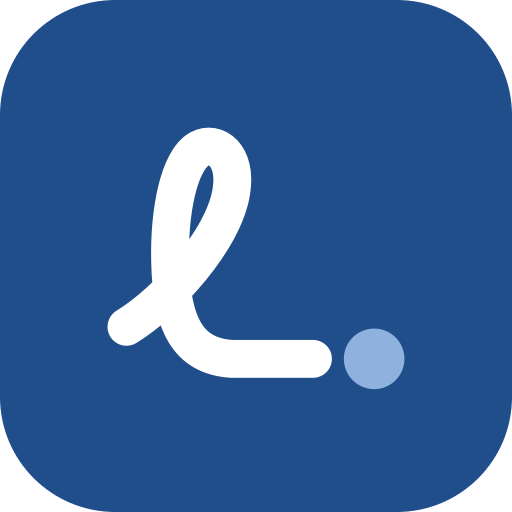

# Logo

The logo of Leicht·Facile in the app, on the project's site (leichtfacile.ch, from the
repository leicht-facile-web) and in the docs. The owner chose it on 2 November 2026 from
four directions ([below](#the-four-directions)).

<p>
&nbsp;&nbsp;
<picture>
  <source srcset="images/logo/logo-dark.svg" media="(prefers-color-scheme: dark)">
  
</picture>
</p>

## The idea

A knot in the sentence, untied: one stroke loops like a handwritten L, runs out straight
and ends in a full stop. Each language of the app knows the idiom: auf den Punkt, al
punto, mettre les points sur les i, to the point.

The name stays in type. The loop is the only handwritten part: it is the tangled
sentence, and the clear name next to it is the result. The name also has to be read
where the symbol only has to be recognised, and easy-language rules ask for plain,
upright letters; the app keeps to them in its own interface too
([ui-design.md](ui-design.md) §3.2).

## The parts

- **The symbol**: the stroke in white and its full stop in `#8FB1DE` on a rounded tile
  in the accent, `#1F4E8A`. The tile is the same on light and dark backgrounds.
- **The wordmark**: "Leicht·Facile" in Atkinson Hyperlegible Next Bold, the app's own
  typeface, turned into outlines from the app's woff2 files with the font's kerning, in
  ink (`#1A1E23`, on dark `#E6E9ED`). The Mediopunkt is a circle in the accent
  (`#1F4E8A`, on dark `#8FB1DE`), a little larger than the font's own and with a little
  more space on each side.
- **Together**: the tile so large that its looped L is as tall as the name's capital L
  (the tile 2.05 times the cap height) and stands on the name's baseline, a third of the
  tile's width between the two.
- **Colours**: the tokens of [ui-design.md](ui-design.md) §3.1. No logo uses green, amber
  or red: in the app they are the status colours.

## The files

In [images/logo/](images/logo/):

| File | What | Used in |
|------|------|---------|
| `logo.svg` | Tile and name, for light backgrounds | README, docs, the app and the site |
| `logo-dark.svg` | The same for dark backgrounds | The same, under a dark system setting |
| `logo-mono.svg` | One colour, `currentColor`: black as an image, the text colour when inlined | Print, one-colour uses |
| `icon.svg` | The app icon, 512 px, round corners | `publiccode.yml`, slides |
| `favicon.svg` | The tile drawn again on the 16 px grid, sharp at 16 and 32 px | Browser tabs |
| `social-preview.png` | 1280 × 640 | The repository's social preview on GitHub (Settings, General, Social preview; uploaded by hand) |

The app serves its copies from `src/leichtfacile/web/static/`: `favicon.svg`,
`favicon.ico` (16 and 32 px, for browsers without SVG favicons), `apple-touch-icon.png`
(180 px and square, since a phone rounds the corners itself), `logo.svg` and
`logo-dark.svg`. The site has the same favicons at its root, the two logos in
`images/logo/` and a social preview per language in `images/social/` (1200 × 630, the
page's headline, its `og:image`).

[scripts/logo.py](../scripts/logo.py) writes all of them, the site's files into the
sibling checkout of leicht-facile-web (`--site`):

```bash
uv run --with "fonttools[woff]" --with uharfbuzz python scripts/logo.py
```

## Using it

- `logo.svg` on light backgrounds, `logo-dark.svg` on dark ones, `logo-mono.svg` where
  there is one colour only. Not recoloured, stretched or redrawn; the symbol stays on its
  tile.
- At least half the tile's size of space around it. The logo at least 16 px high; below
  32 px the app icon gives way to `favicon.svg`.
- Where no picture fits (a line of text, a footer), the name is written in text:
  Leicht·Facile, with the Mediopunkt.

**Not in the exports.** Markdown, HTML and Word carry no logo: the letter goes out under
the authority's name, and a mark next to an easy-language text can be taken for a quality
seal such as Inclusion Europe's Easy-to-Read logo, which needs a test by readers from the
target group. The Word footer names the tool in text (`footer_line` in
`src/leichtfacile/export/docx.py`).

## The four directions

Proposed on 2 November 2026. The design canvas shows each in the app, on the site and in
the docs: https://claude.ai/artifact/QC4HfXbvCUtPL1u44uCoA6 (private to the owner's
account; shared from its Share menu).

- **A, the dot**: the name alone as the logo, the monogram L·F as the app icon.
- **B, short lines**: three short lines flush left, the middle one a long word split by
  the Mediopunkt, like an easy-language text.
- **C, to the point**: chosen.
- **D, kept safe**: square brackets around the dot, code holding a fact.

Left out on purpose: a speech bubble (it reads as a chatbot, which the README sets the app
apart from); the Swiss cross (its use is restricted by the Wappenschutzgesetz, SR 232.21,
it would suggest a product of the Confederation, the app also serves Germany and Austria,
and red is the app's error colour); a book or a reading figure (too close to the
Easy-to-Read logo); a seal or a stamp (it would read as a certification).
