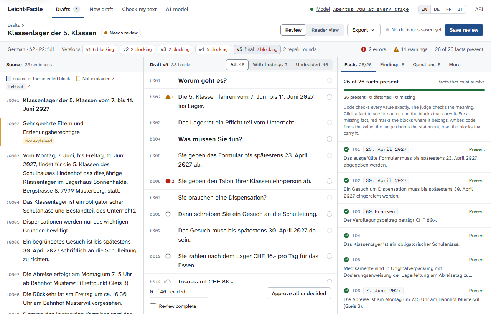

# Use case: letters from schools and other organisations

Status: built and tested, 31 October 2026. Companion to [architecture.md](architecture.md)
and the third written-out use case after [use-case-canton.md](use-case-canton.md) and
[use-case-decisions.md](use-case-decisions.md); all use cases at a glance are in
[use-cases.md](use-cases.md), this one as its §8.

## 1. Who and why

A public school: the secretariat, the school administration (Schulleitung) and the
class teachers. A school writes to every family several times a year: the camp letter,
the information evening, the trial-apprenticeship week, the school rules, the reply
slip to sign. The letters reach parents who read little, parents who are still
learning German, French or Italian, and students of twelve to fifteen. They are not
decisions, they decide nothing, and no appeal period hangs on them. What hangs on them
is practical: the date of departure, the time at the station, the deadline for the
reply slip, the amount to pay, the phone number of the camp, the packing list.

A school is not an authority in the sense of the other use cases, and the app knew
only authorities until 30 October 2026: the prompts called every source an official
text, the style guide asked for the Sie form, and the glossary explained a Gesuch as a
request to an office. Since 31 October 2026 a job names its sender and its form of
address, as data in `src/leichtfacile/senders/senders.toml`
([architecture.md §4.3](architecture.md#43-plan-and-write-model)). The same two
options serve every sender that is no authority: a club, a daycare centre, a parish, a
company writing to its customers ([use-cases.md §11](use-cases.md#11-letters-of-insurers-pension-funds-and-utilities)).

## 2. Setup

As for a canton ([use-case-canton.md §2](use-case-canton.md#2-setup-done-once-by-it)):
the app on a server of the school authority or the municipality, one outbound
connection to a model endpoint. A letter to all parents of a class carries no secret,
so any endpoint the school authority accepts will do, the Public AI gateway with
Apertus among them. A letter about one child, such as a special-education decision, is
under official secrecy and belongs to the decision mode and to an endpoint the
authority controls ([use-cases.md §8](use-cases.md#8-school-and-special-education-decisions)).

The six school letters ship as examples (`data/examples/README.md`): the Klassenlager
letter to parents and the Schnupperwoche letter to students, each in German, French
and Italian, with invented schools in Musterwil, Exempleville and Esempiopoli. The
New draft form offers them with one click, with the sender and the form of address
already set.

## 3. A typical case: the camp letter

The Primarschule Musterwil writes to the parents of the fifth classes about the
Klassenlager of 7 to 11 June 2027: a compulsory school event, departure on Monday at
7.15 from the station, return on Friday at about 16.30, the parents' share of the
food costs (CHF 16.- a day, CHF 80.- in all, due within 30 days, waived on a written
request), a dispensation only on a written request by 30 April, the reply slip
(Talon) due on 23 April with allergies and medication, a packing list of seven items,
the camp phone, the information evening on 20 April at 19.30, the secretariat's hours.
Two pages in the usual tone of a Swiss Elternbrief.

### Step 1: submit the letter

The secretariat pastes the letter or uploads the PDF, chooses German and the level
A2, and sets the sender to "school". The form of address stays "formal" (Sie): the
letter goes to the parents.

### Step 2: the model reads the letter and writes the fact sheet

The fact sheet lists what must survive: the dates and times, the amounts and the
period to pay, the deadlines for the request and the reply slip, the phone numbers
and the address of the camp house, and the answers to the parents' questions (What is
this? What must I do? By when? What does it cost? Whom do I ask?). Code completes
the values the model missed and, since 31 October 2026, adds one fact per item of
every list in the letter (`rules/lists.py`): the seven items of the packing list are
seven facts the draft must carry.

### Step 3: the model writes the draft as a school

The prompts call the source a school's document and name the school as the sender in
every stage, so the draft speaks as the school: "Die Schule" and "die Schulleitung", not
"das Amt". Questions as headings, one idea per sentence, the glossary for the hard
words.

### Step 4: code checks the rules and the facts

The checker verifies the rules of Leichte Sprache and, above all, the facts: every
date, time, amount and phone number with its exact value (FACT-01), every item of the
packing list cited by a block of the draft (FACT-10). A packing list that lost
"Kopie der Krankenkassenkarte" blocks the draft until a repair round adds it.

### Step 5: the judge, the repair rounds, the review

As in every job: the larger model judges meaning, the flagged sentences go back to
the writer, and the secretariat reviews the result side by side with the letter, sees
every fact as present or missing, every omission with its reason, and approves, edits
or rejects each block. The glossary now carries the school's words: Klassenlager,
Klassenlehrperson, Talon, Dispensation, Haftpflichtversicherung, each with a checked
explanation from the vocabulary ([rules.md](rules.md#vocabulary), "School letters").

<picture>
  <source srcset="images/review-school-dark.png" media="(prefers-color-scheme: dark)">
  
</picture>

The camp letter in review on the Public AI 70B (31 October 2026): 26 of 26 facts present
after two repair rounds, the draft speaks as the school ("Dann schreiben Sie ein Gesuch an
die Schulleitung"), two errors left for the reviewer.

### Step 6: export

Markdown, HTML or Word, with the packing list as a list and the reply slip as the
last part, plus the audit bundle. The easy-language version goes out as an enclosure
to the letter, or replaces it.

## 4. The letter to students

The Sekundarschule Musterwil writes to the students of the second classes about the
Schnupperwoche of 15 to 19 March 2027: find a trial apprenticeship, hand in the
employer's confirmation by 19 February, tell the class teacher by 5 February without
a place, the BIZ's address and hours, the employer's working hours, a sick call by
7.30, a medical certificate after two days, travel costs up to CHF 30.- a week, the
report due within two weeks. Swiss lower secondary schools write to their students in
the du form, and so does the letter.

The job sets the form of address to "informal". The style guide asks for du, the
rule that checks the form of address (LEX-06) expects du, and the prompts name the
pronoun. On the Public AI 70B the German draft came out in du throughout; without the
option the same letter had come out in Sie twice and in du once. The French letter
uses tu. The Italian one asks for tu as well, where the 70B still mixes Lei, tu and
voi in places; the plural form (voi, as Ticino writes to parents) is the third option.

## 5. What the school letters taught the app

Three things went wrong in the first runs of 30 October 2026, and each got its fix:

- **The form of address was unstable.** The same letter came out in Sie or in du at
  random. Fix: the sender and the form of address as job options (31 October 2026).
- **Packing lists lost items.** The German draft kept 2 of 7 items, the French none,
  and the Italian restated the list in sentences. Nothing had checked list items,
  since an item carries no value. Fix: every item of a list in the source is a fact
  the draft must carry, FACT-10 blocks a draft that drops one, and a repair round
  asks for it (31 October 2026). With the fix the German draft kept 7 of 7 and the
  French 12 of 12.
- **The glossary spoke for an office.** A Gesuch was "a request to an office", the
  accident insurance "pays for the time without work", and the Italian draft wrote
  "L'ufficio invia la fattura" for a school. Fix: a school group in the vocabulary,
  the liability insurance explained, and the three explanations reworded for a school
  or a child (31 October 2026). On the six letters the glossaries then took 40 of
  their 54 explanations from the vocabulary.

The fixes hold for the authority letters too: the 25 Public AI evaluation pairs kept
their fact coverage and their style errors, and their lists came back whole as well
(208 of 321 list items cited instead of 146; [prompts.md](prompts.md), row 20).

## 6. Tested on 30 and 31 October 2026

The six letters went through the full pipeline on the Public AI gateway with Apertus
1.5 70B as writer and judge, in ten runs over the two days while the fixes of §5 were
built, not every letter in every run. The last run, with everything in place:

| Letter | Facts carried | Rule errors left | Calls | Time |
|--------|---------------|------------------|-------|------|
| Klassenlager, German, to parents | 23 of 23 | 2 | 14 | 3 min |
| Camp de classe, French, to parents | 23 of 24 | 1 | 5 | 1.5 min |
| Schnupperwoche, German, to students (du) | 14 of 15 | 3 | 11 | 2.3 min |
| Semaine de stage, French, to students (tu) | 15 of 15 | 4 | 9 | 2 min |
| Settimana verde, Italian, to parents | 26 of 26 | 3 | 6 | 1.6 min |
| Settimana di stage, Italian, to students (tu) | 13 of 13 | 1 | 15 | 3 min |

Every draft ends in review, as every draft does; what the reviewer sees is the fact
checklist with one or two open items, the glossary with the school's words, and the
packing list as a list. The Italian parents' letter still mixes the forms of address
under the formal setting, which is why the plural option exists and is worth a run.

## 7. What it does not do

- It does not replace the secretariat's reading of the draft. A school letter is
  short, and the review takes minutes; the point is that the review starts from a
  draft whose dates, amounts and lists have been checked by code.
- It does not know a school's own words beyond the vocabulary's school group. A
  school that writes "Schulsozialarbeit" or "Tagesstruktur" in every letter can add
  the terms to its own vocabulary file ([rules.md](rules.md#vocabulary)).
- The vocabulary's explanations address the reader as Sie, vous or Lei where they
  address anybody; in a letter to a student the explanation of Arztzeugnis still says
  Sie. An open point of the form of address.
- Letters about one child, placements and special-education decisions are decisions
  under official secrecy: the decision mode and an endpoint the authority controls
  ([use-case-decisions.md](use-case-decisions.md)).

## References

- Federal Supreme Court, BGE 144 I 1 (7 December 2017): a compulsory school camp is
  part of the free public school; parents may be charged the food costs they save at
  home, nothing more. The reason the camp letters limit the parents' share to the
  food costs.
