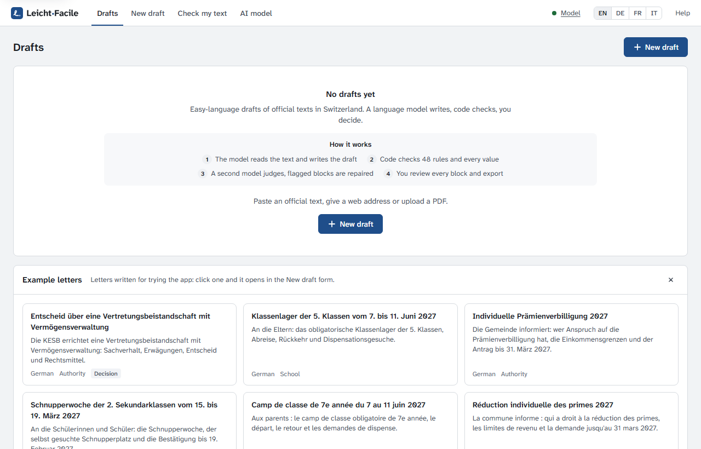
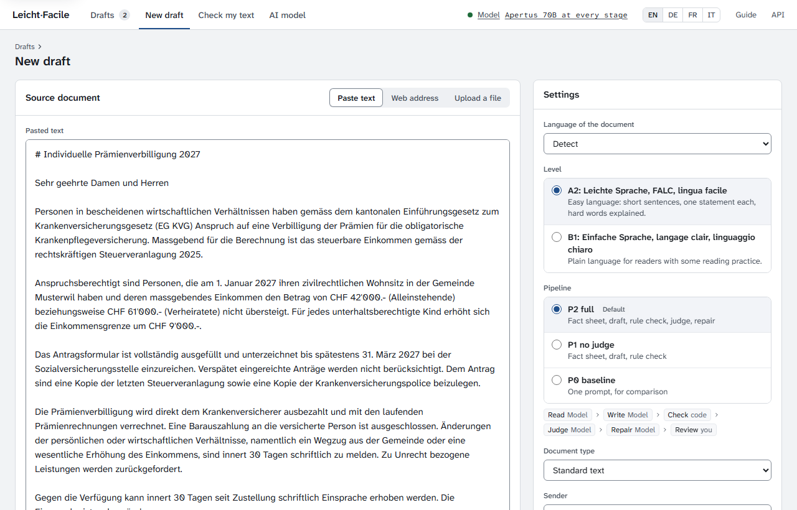
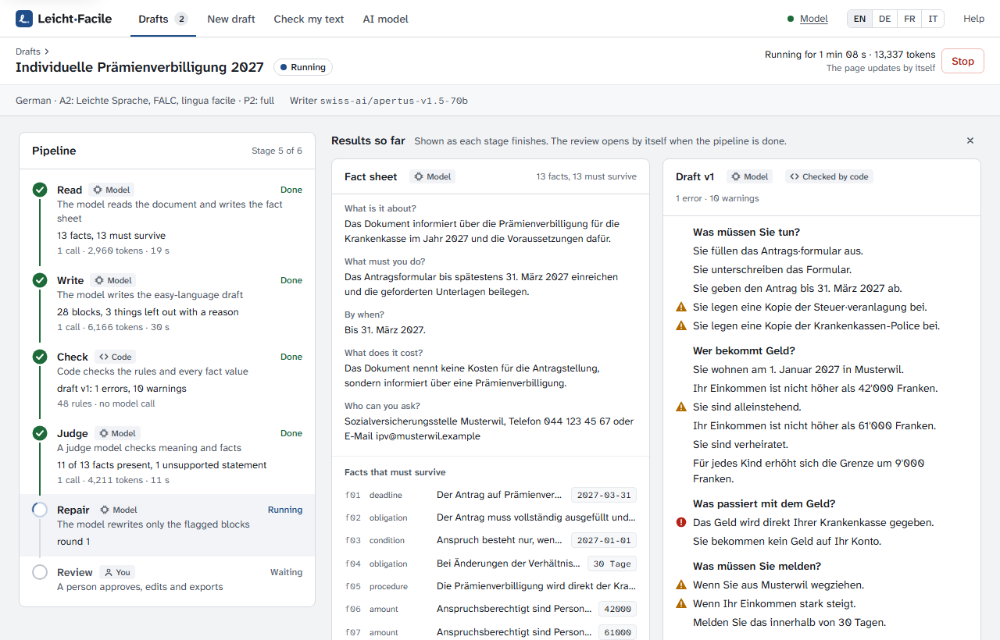
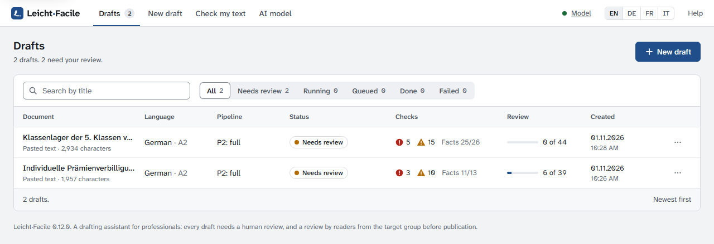
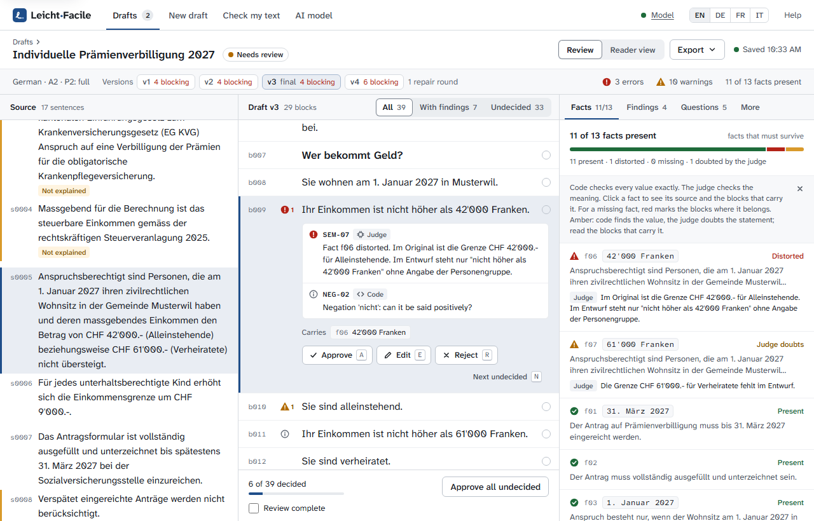
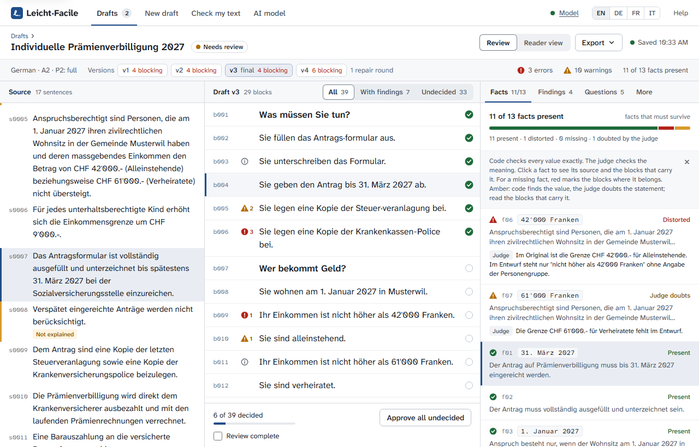
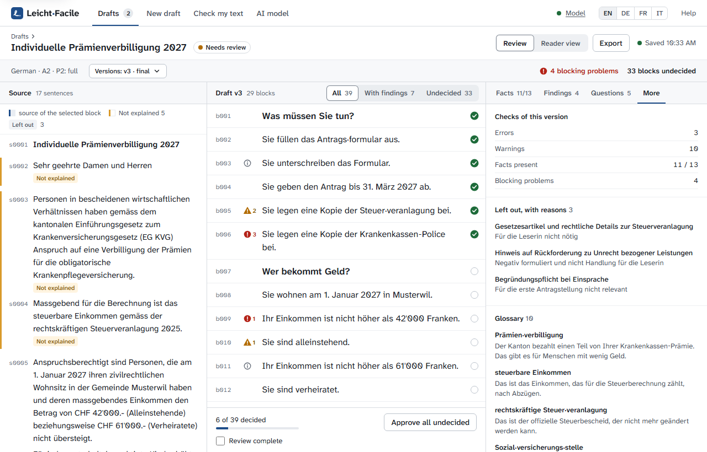
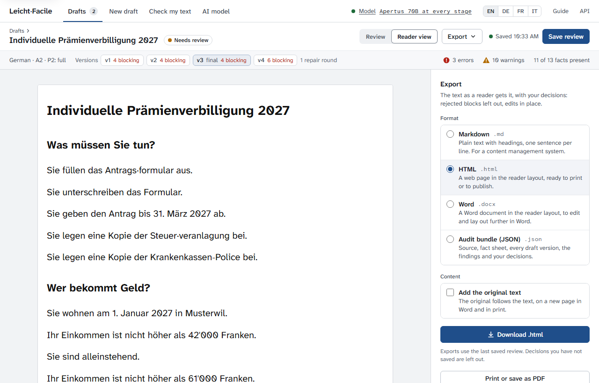
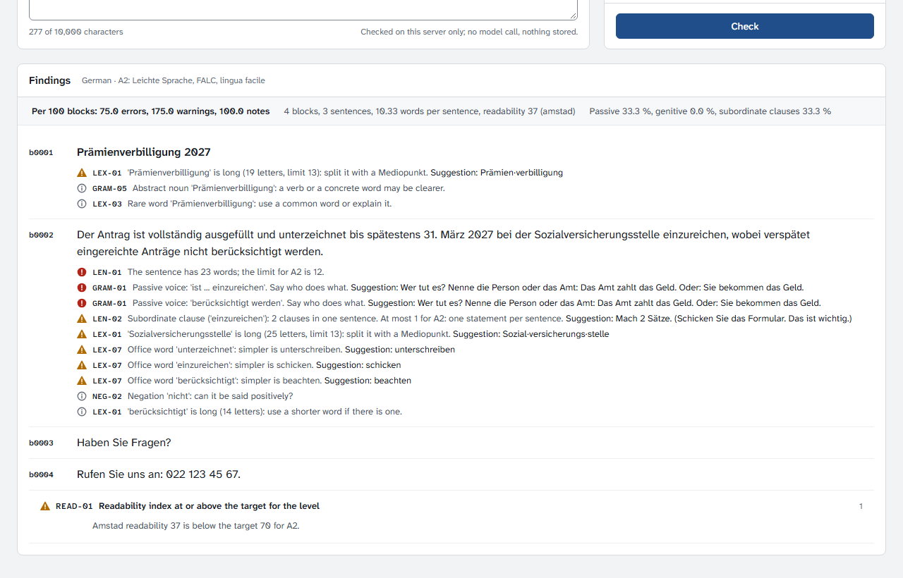
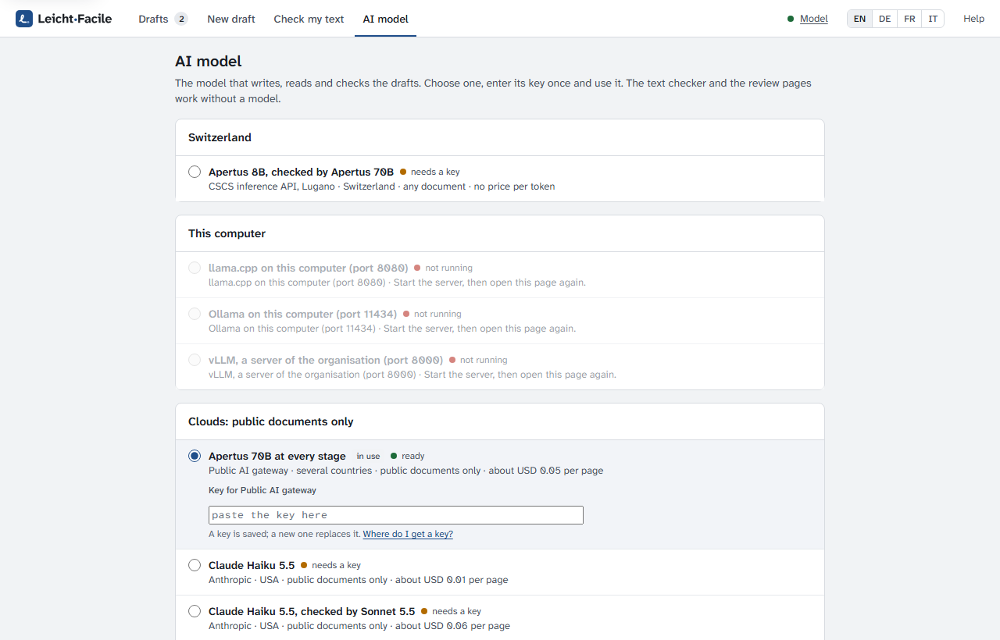

# User guide

This guide is for the people who write and review easy-language texts with Leicht·Facile:
at an authority, a school or another organisation. It follows one letter from the source
text to the exported easy-language version. You need no technical knowledge. Someone has
installed the app for you and given you its address, or you started it yourself
([quickstart.md](quickstart.md)).

**Your steps:** [Start a draft](#2-start-a-draft) → [wait a few minutes](#3-while-the-model-works)
→ [review each block](#5-review-the-draft) →
[check the facts](#6-check-the-facts) → [export](#8-reader-view-and-export).

Leicht·Facile is a drafting assistant. A language model writes the draft, code checks it,
and you decide what goes out. Every draft needs your review, and before publication a test
by readers from the target group.

The screenshots show the German example letter that ships with the app (the premium
reduction of the invented Gemeinde Musterwil) with the interface in English. The
interface also speaks German, French and Italian: switch at the top right.

- [1. The screen](#1-the-screen)
- [2. Start a draft](#2-start-a-draft)
- [3. While the model works](#3-while-the-model-works)
- [4. The list of drafts](#4-the-list-of-drafts)
- [5. Review the draft](#5-review-the-draft)
- [6. Check the facts](#6-check-the-facts)
- [7. What was left out, the glossary, running again](#7-what-was-left-out-the-glossary-running-again)
- [8. Reader view and export](#8-reader-view-and-export)
- [9. Check a text you wrote](#9-check-a-text-you-wrote)
- [10. The AI model](#10-the-ai-model)
- [11. Good to know](#11-good-to-know)
- [Words used in the app](#words-used-in-the-app)

## 1. The screen

The bar at the top is the same on every page:

- **Drafts**: the list of all drafts. The number next to it counts the drafts that wait
  for a review.
- **New draft**: start a draft from an official text.
- **Check my text**: check a text you wrote yourself, without a model.
- **AI model**: which model writes the drafts. The page appears when more than one model
  is offered.
- **Model**: the dot is green when the model answers, amber when the provider answers
  but does not list the model, red when it cannot be reached. Point at it to see which
  model is in use. Without a model the app makes no drafts, but the review and the text
  check still work.
- **EN DE FR IT**: the language of the interface. The language of your documents is set
  per draft.
- **Help**: opens this guide on the project's site, in a new tab.

Before the first draft, the start page explains the four steps, and the card **Example
letters** under it shows the letters that ship with the app, each with a short
description, those in the language of the interface first. Click one to open the New
draft form with the letter filled in. The cross on the card hides it in this browser;
**Show the example letters**, under the four steps, brings it back.

Some pages open with a short explanation in a box, such as the Facts tab of the review
or Check my text. Once you know it, click the cross: the box stays away in this browser.

## 2. Start a draft

Click **New draft**. On the left you give the source text, on the right the settings.

**The source.** Choose one of three ways:

- **Paste text**: copy the text from your document, headings included. Up to the number
  of characters shown under the field.
- **Web address**: the address of a public web page. The app takes the page's main text
  and drops menus and footers. Pages in a private network are refused.
- **Upload a file**: a PDF with a text layer, an HTML page, a text or a Markdown file, up
  to 15 MB. A scanned letter without a text layer is refused with a message: the app
  does not read images yet.

The text of a web page or a file has the same limit as pasted text. A longer one is
refused with its length: split it and make a draft of each part, one chapter at a time.

**The settings.** The defaults fit most letters, and the form keeps the level, the
sender and the form of address of your last draft.

| Setting | What to choose |
|---------|----------------|
| Level | **A2** for easy language (Leichte Sprache, FALC, lingua facile): short sentences, one statement each, hard words explained. **B1** for plain language (Einfache Sprache, langage clair, linguaggio chiaro), for readers with some reading practice. The level names the set of rules, not a measured reading level. |
| Document type | **Standard text**, or **Decision letter** for a decision of an authority or a court: then give the addressee and the fixed notice that opens and closes the text. |
| Sender | **Authority**, **School** or **Other organisation**: the draft speaks in the sender's voice. |
| Form of address | **Formal** (Sie, vous, Lei), **Informal, one reader** (du, tu) or **Informal, several readers** (ihr, vous, voi). |

**More options** opens the rest; the defaults are right in almost every case.

| Option | What to choose |
|--------|----------------|
| Language of the document | **Detect** works for German, French and Italian. |
| Title | Optional: the name in the list of drafts. Without it, the document's own title is used. |
| AI model | Only when several are offered: the model for this draft alone. |
| Models | The model names for the three stages; empty, the chosen model's. For testing other models. |

Click **Create draft**. An installation that compares the pipelines also shows a
**Pipeline** choice: keep **P2 full**; P1 leaves out the judge, P0 is a single prompt
for comparison.

## 3. While the model works

The draft page shows each stage as it runs. A letter of one or two pages takes a few
minutes. The page updates by itself; you can leave it and come back through the list of
drafts.

| Stage | Who | What happens |
|-------|-----|--------------|
| Read | Model | The model reads the document and writes the fact sheet: the reader's core questions and every fact with its exact value (deadlines, amounts, contacts). Code adds every date, amount, contact and other exact value the model missed. |
| Write | Model | The first draft in easy language. Every sentence points to the source sentences it comes from; everything left out has a reason. |
| Check | Code | The rules of the published guidelines, and an exact check of every fact value: nothing lost, nothing invented. |
| Judge | Model | A second model checks the meaning: distorted facts, statements the source does not make, metaphors, unclear references. |
| Repair | Model | Only the flagged blocks are rewritten, in rounds, until no blocking problem is left. Then one sentence for each value that must survive and is still missing. |
| Review | You | Approve, edit or reject each block, then export. |

Under **Results so far** you see the fact sheet and the latest version as soon as they
exist. **Stop** ends the run. If a run fails, the stages that finished are kept: click
**Run again from the start**. When the pipeline is done, the review page opens.

## 4. The list of drafts

**Drafts** lists every draft, the newest first.

- **Status**: Queued, Running (with the stage), Needs review, Done (review complete) or
  Failed.
- **Checks**: the errors and warnings of the final version, and how many facts that must
  survive are in it.
- **Review**: how many blocks you have decided.
- The menu at the end of a row: **Open**, **Reader view**, the exports and **Delete**.

Search by title, filter by status or language. Depending on the settings of your
installation, drafts nobody changed for a while are deleted after some days; ask whoever
runs the app.

## 5. Review the draft

The review page has three columns: the **Source** on the left, the **Draft** in the
middle and the **Checks** on the right. Click a block in the draft: it opens, and the
source sentences it comes from light up on the left.

**The strip under the title** shows the language, the level and the pipeline, then the
**Versions** of the draft: v1 is the first draft, every repair round adds one, and one is
marked **final**, not always the last. Each version shows its blocking problems. You review the
final version; click another to compare. On the right: the errors, the warnings and the
facts found in the version you see.

**The source** shows the document sentence by sentence, numbered. A sentence marked
**Left out** was dropped on purpose, with the reason next to it. **Not explained** marks a
source sentence no block refers to: read it, it may hold something the draft lacks.

**A block** is a heading, a sentence group or a list item of the draft. The mark on the
left of a block shows its worst finding: red for an error, amber for a warning. Open the
block to see:

- **Edited text**: the field where you change the block.
- **The findings**, each with the rule and who found it: **Code** (a rule check) or
  **Judge** (the second model). Some come with a suggestion; **Apply** puts it into the
  edited text.
- **Carries**: the facts this block carries.
- **The decision**: **Approve**, **Edit** or **Reject**, and **Next undecided**.

**How to decide.** Read the block against its source sentences.

- **Approve** when it is correct and easy to read.
- **Edit** when it needs a change: choose Edit and change the text in the field.
- **Reject** when it does not belong in the text. A rejected block is left out of the
  export.

Above the blocks, **All**, **With findings** and **Undecided** filter the list. Glossary
entries at the end of the draft are decided like blocks: they go into the export.

**Keys** (while the draft column has the focus): **J** and **K** or the arrow keys move
between blocks, **A**, **E** and **R** approve, edit and reject, **N** jumps to the next
undecided block, **Ctrl+S** saves.

**Saving.** Your decisions are kept only when you click **Save review** (top right). The
note next to it says when you last saved. **Approve all undecided** at the bottom approves
every block you have not decided. When you are done, tick **Review complete** and save:
the draft's status becomes Done. If a colleague saved the same review in the meantime,
the app refuses your save and asks you to reload the page, so nobody overwrites the other.

## 6. Check the facts

The right column has four tabs. **Facts** lists the facts that must survive, with the
count of those present.

Click a fact to see its source sentence on the left and the blocks that carry it in the
middle. Code checks every value exactly (a date, an amount, a phone number); the judge
checks the meaning. A fact can be:

| Status | Meaning |
|--------|---------|
| present | The fact is in the draft: code finds its value, or the judge finds the statement. |
| missing | The fact is not in the draft. Red marks the blocks where it belongs. |
| distorted | The judge finds the statement changed. |
| judge doubts | Code finds the value, but the judge doubts the statement: read the blocks that carry it. |
| unchecked | A fact without a value code can check, and no judge ran (pipeline P1): read it yourself. |

For a missing fact, **Suggest a sentence** asks the model for one sentence from the
source paragraph. Code says whether the sentence holds the value. **Add to block** puts it
into the block as an edit; read it, then save the review.

The other tabs:

- **Findings**: findings about the whole document, such as a missing fact. Findings on a
  single block show in the draft.
- **Questions**: the five core questions of a reader (What is it about? What must you
  do? By when? What does it cost? Who can you ask?), answered from the fact sheet. Click
  an answer to see where it comes from.
- **More**: see the next section.

## 7. What was left out, the glossary, running again

The **More** tab shows:

- **Left out, with reasons**: what the draft leaves out and why. Click an entry to see
  the source sentences.
- **Glossary**: the hard words and their explanations. Those marked **from the
  vocabulary** were added by code from a checked list, not written by the model.
- **Measures**: sentences, words per sentence, a readability score, the share of passive
  sentences and the facts found by code.
- **Run**: what the run used (tokens, time) and which models wrote and judged.
- **Run again from**: **Write again**, **Read and write again** or **Judge and repair
  again**. A new run replaces the draft and discards your review of it.
- **Delete**: removes the draft and everything it produced.

## 8. Reader view and export

**Reader view** (top of the review page) shows the text as a reader gets it, with your
decisions: rejected blocks left out, edits in place.

On the right you choose the export:

| Format | For |
|--------|-----|
| Markdown (.md) | Plain text with headings, one sentence per line, for a content management system. |
| HTML (.html) | A web page in the reader layout, to print or to publish. |
| Word (.docx) | A Word document in the reader layout, to edit and lay out further. |
| Audit bundle (.json) | The whole job: the source, the fact sheet, every draft version, the findings and your decisions. Keep it as a record of how the text came about. |

**Add the original text** appends the source text, on a new page in Word and in print.
**Print or save as PDF** prints the reader view on A4; choose "Save as PDF" as the
printer for a PDF.

The export uses the **last saved review**: save before you export. Undecided blocks stay
in, as drafted. The checklist **Before publication** shows how many blocks are decided,
the blocking problems left in the version and whether the review is marked complete.

The menu of a row in the list of drafts offers the same exports.

## 9. Check a text you wrote

**Check my text** runs the rule check on a text you wrote yourself: sentence length,
grammar, words, numbers, dates and spelling. It takes milliseconds, calls no model and
stores nothing.

Paste the text, headings included, choose the language and the level and click **Check**.
The findings show per block, with suggestions where the rule has one. The line on top
counts the errors, warnings and notes per 100 blocks, so texts of different lengths
compare.

The check knows the rules, not the meaning: whether your text keeps every fact of an
original needs a draft under **New draft**.

## 10. The AI model

Usually whoever runs the app chooses the model, and you can skip this page. The **AI
model** page lists the models on offer, grouped by where they run.

- **Switzerland** and **This computer**: models that run in Switzerland or on your own
  machine. They may receive any document, confidential letters included.
- **Clouds: public documents only**: models of providers abroad. Send them only texts
  that are public anyway, such as a web page.

Each model shows its status: **ready**, **needs a key**, **not running** or what it lacks.
To use one, choose it, paste its key once and click **Use this model**. **Check the key**
asks the provider whether it knows the key; **Make a test call** sends a short request.
**Fine-tune** saves a variant of the chosen model with other settings. When the model is
set in the installation's settings, the page says so and changes nothing.

## 11. Good to know

- **You decide.** The app finds what code can count and what a second model notices. It
  cannot tell whether a text works for its readers: that needs your review, and before
  publication a test by readers from the target group.
- **Confidential texts** (a letter that names a person, a medical or a tax letter) belong
  only to a model that runs where your organisation controls it: the groups Switzerland
  and This computer on the AI model page.
- **Languages**: German as written in Switzerland, Germany or Austria (the installation
  sets the country), French and Italian as written in Switzerland.
- **Not yet**: scanned letters and photos. Give the app a PDF with a text layer, or paste
  the text.
- **The level is a set of rules.** A2 and B1 name the rules the draft follows; they do not
  measure how well a reader understands it.

## Words used in the app

| Word | Meaning |
|------|---------|
| Block | A heading, a group of sentences or a list item of the draft: the unit you decide. |
| Fact sheet | What the model read from the source: the core questions and every fact with its value. |
| Fact that must survive | A deadline, an amount, a right, a duty or a contact that the easy-language text must keep. |
| Finding | Something a check noticed: an **error** (blocks publication), a **warning** (read it) or a **note**. |
| Code | The rule check: plain program code, no model, the same result every time. |
| Judge | The second model, which checks the meaning of the draft against the source. |
| Repair round | One pass in which the model rewrites only the flagged blocks; each makes a new version. |
| Blocking problem | An error, a missing or distorted fact: what the repair rounds try to remove. |
| Version | One state of the draft: v1 is the first, each repair round adds one, one is final. |
| Audit bundle | The whole job as one file, for the record. |
