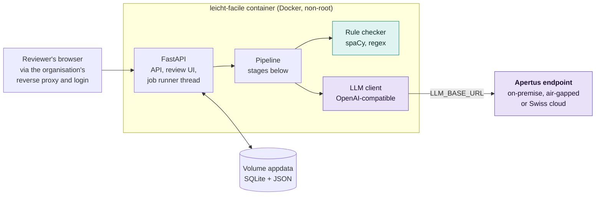
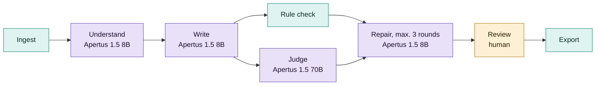

# Technical report - Leicht·Facile

Easy-language drafts of Swiss official texts with Apertus, with every fact checked by
code.

- **Track:** Track 2B - Own Project
- **Event:** Hack Apertus 2026, online
- **Team:** Röstigraben Bridgers - `member`, `member`, `member`
- **Repository:** https://github.com/bobrovsky420/leicht-facile
- **Demo:** `link to video`

## 1. Summary

**Problem.** About 844'000 adults in Switzerland aged 16 to 65 (15%) have low reading
skills (PIAAC 2023); people with intellectual disabilities, people learning a national
language and people with dementia need easy language too. Accessibility law asks
authorities to publish important information in Leichte Sprache, FALC or lingua
facile, but each version is written by hand by a few trained writers, who must check
every deadline, amount and phone number against the original.

**Approach.** Leicht·Facile is a drafting assistant for those writers, built on one
rule: *Apertus does everything that needs language understanding; plain code does
everything that can be counted.* Apertus 1.5 turns the document into a fact sheet,
writes a draft against it with provenance for every sentence, judges meaning with a
second, larger model, and repairs only the flagged sentences. Code checks the published
easy-language rules (42 checks for German, 39 for French), including the exact presence
of every fact value. A human reviews source and draft side by side and exports the text
with an audit trail. The system is one container plus an OpenAI-compatible Apertus
endpoint, so it runs on-premise, air-gapped or on a Swiss cloud, as letters under
official, medical or tax secrecy require; for those, Apertus is the only model that
fits (§3). A single prompt
("rewrite this in Leichte Sprache") gives text with no fact contract, no provenance and
no independent check; it is our baseline P0, the full pipeline is P2.

**Headline result.** On 20 held-out German pairs on the CSCS endpoint, the pipeline
keeps 80 percent of the source's countable facts (dates, amounts, phone numbers,
addresses) against 70 percent in the official easy-language versions, with 4.3 rule
errors per 100 blocks against 2.7 for the official versions and 22.0 for the one-prompt
baseline, which keeps every fact because it hardly simplifies. Its drafts contain 0.1
values per 100 blocks that the source does not have; the official versions 2.2.

## 2. Architecture

| Stage | Done by | Output |
|-------|---------|--------|
| Ingest | Code: trafilatura, pdfplumber, spaCy | `SourceDocument`: segments with stable ids (`s0001`) |
| Understand | Apertus 8B, thinking | `FactSheet`: the reader's core questions (what, what to do, by when, cost, contact), typed facts with normalised values and source ids. Code adds every date, amount, phone number, address, period or identifier the model missed |
| Write | Apertus 8B | `Draft`: blocks with the facts and source segments they carry, omissions with reasons, glossary |
| Rule check | Code: spaCy parse, regex, word frequencies | Findings with rule id, severity, evidence, suggestion |
| Judge | Apertus 70B, thinking | Each fact present, missing or distorted; unsupported blocks; meaning findings. The judge never rewrites |
| Repair | Apertus 8B | New text for flagged blocks only; up to 3 rounds; every version kept |
| Review, export | Human, then code | Per-block decisions; Markdown, HTML and a JSON audit bundle |

Key decisions (details in [docs/architecture.md](docs/architecture.md)):

- **Countable rules in code, meaning in the model.** Code decides sentence length,
  passive, genitive, Swiss number, date and phone formats, the Mediopunkt and fact
  coverage: exact, free, reproducible, no self-grading. The writer's style guide uses
  the same rules ([docs/rules.md](docs/rules.md)).
- **Fact coverage is the central check.** Every must-keep fact with a normalised value
  must appear in the draft in an accepted form (`31. März 2026`, `31.3.2026`), so a
  deadline that became 30 March is caught exactly (FACT-01). Its mirror, FACT-06, flags
  every value in the draft that the source does not contain.
- **Typed, persisted artifacts.** Each stage reads and writes pydantic models stored in
  SQLite: a failed job resumes from the last good stage, every intermediate result is
  visible in the UI, and the evaluation reuses the same artifacts.
- **Writer and judge are different models; one service.** FastAPI serves the API and a
  server-rendered review UI, a single worker thread runs the jobs. No Node build, no
  message broker, no CDN.

### Target architecture (mandatory)

Leicht·Facile is deployable in all three architectures. Its only runtime dependency is
the Apertus endpoint in `LLM_BASE_URL`; changing the deployment means changing that
variable.

| Architecture | How it is met |
|--------------|---------------|
| a) On-premise | `docker compose --profile local-llm up` adds a vLLM service from the official image `ghcr.io/swiss-ai/vllm_apertus_1.5_release` serving Apertus 1.5 8B on one GPU; the app points at `http://vllm:8000/v1`. A llama.cpp profile serves a 4-bit 8B on an 8 GB laptop GPU. |
| b) Air-gapped | As (a), with images and weights pulled in advance. Python packages, spaCy models and UI assets are baked into the image; no telemetry, no CDN, no installs at runtime. |
| c) Sovereign Swiss cloud | `LLM_BASE_URL` points at a Swiss-operated Apertus endpoint; the hackathon demo runs against the CSCS inference API in Lugano. |

External dependencies: at build time PyPI (locked by `uv.lock`), the spaCy model wheels
from GitHub and base images from Docker Hub and GHCR; at runtime only the Apertus
endpoint (and a URL the user submits). Data lives in the volume `appdata`. The
container runs as a non-root user, never logs document text above `DEBUG`, and has no
login, so it belongs behind the organisation's reverse proxy.

Hardware for (a) and (b): the 8B in bf16 needs about 16 GB plus KV cache, so it fits a
24 GB GPU (FP8 build: 11.4 GB). No GPU host with vLLM was reachable during the hackathon, so
the vLLM profile is validated by `docker compose config` only and these figures come
from the model card. Measured on a laptop RTX 4060 (8 GB, llama.cpp, 4-bit): about 37
tokens per second; Understand took 1.5 and Write with thinking 12 minutes for a
400-word letter.

## 3. Use of Apertus

- **Models:** `swiss-ai/Apertus-v1.5-8B` writes (Understand, Write, Repair, baseline)
  and `swiss-ai/Apertus-v1.5-70B` judges, set by `LLM_NAME` and `LLM_JUDGE_NAME`
  (without it, the judge is the 70B when the endpoint serves it).
  `LLM_UNDERSTAND_NAME` gives the Understand stage alone another model.
- **How it is used:** inference, as a structured-output agent pipeline without tool
  calling (the thinking variants are served with tools disabled). No fine-tuning.
- **Where it runs, and why only Apertus:** the CSCS inference API for the hackathon;
  the same client works unchanged with vLLM, llama.cpp or a Swiss cloud endpoint.
  Letters that name a person fall under official, medical or tax secrecy and may not
  go to a foreign cloud, so the organisation must run the model itself and account
  for what it learned. Only Apertus combines open weights, open training data
  (website opt-outs honoured), Swiss public origin and German, French and Italian
  ([docs/use-cases.md §2](docs/use-cases.md#why-only-apertus)).

| Stage | Model | Thinking | Temperature | max_tokens |
|-------|-------|----------|-------------|------------|
| Understand | 8B | on | 0.1 | 12000 |
| Write | 8B | on | 0.3 | 16000 |
| Judge | 70B | on | 0.0 | 12000 |
| Repair | 8B | off | 0.2 | 8000 |
| Baseline P0 | 8B | off | 0.3 | 6000 |

**Prompts** ([docs/prompts.md](docs/prompts.md)), in the document's language. Each
shows one filled JSON example instead of the schema, which small models copy more
reliably at a fraction of the tokens. Source sentences and draft blocks carry ids
(`[s0004]`, `[b007]`): the model cites, code verifies. The writer prompt asks for a
plan first (the reader's questions as headings) and contains the style guide for the
chosen level and two short example pairs written by the team. Repair receives only the
flagged blocks, their findings and the facts they must keep. Code guards send back an
answer that copies the prompt's example or adds a value the document does not have.

**Structured output and reliability.** Answers are stripped of reasoning, parsed
leniently (an 8B writes `s4` for `s0004`, or a string where a list was asked for) and
validated with pydantic; on failure the error goes back to the model once. Responses
are streamed, so a proxy cannot cut a long answer; broken streams, 429 and 5xx are
retried with backoff; every call is logged with stage, model, tokens and latency.

**Other models.** None at runtime or in the evaluation. The checker uses spaCy's
statistical parsers (not generative models) and wordfreq. Without a CSCS key, the
prompts were tested on a community 4-bit conversion of Apertus 1.5 8B in llama.cpp
(`Colby/apertus-v1.5-8b-text-Q4_K_M-GGUF`); those numbers are never mixed with CSCS
results.

## 4. Data

| Data | Origin | Licence and handling |
|------|--------|----------------------|
| Reference pairs: 35 documents with an official easy-language version (30 German: 20 `eval`, 10 `dev`; 5 French: 3 `eval`, 2 `dev`) | Cantons Zürich, Bern, St. Gallen, Luzern, Basel-Stadt, Graubünden, Zug, Geneva, Neuchâtel; federal offices BAG, BWL, EBGB | Personal use only. The repository holds only the manifest (`data/pairs/manifest.jsonl`: URLs, word counts, licence note per pair); `eval fetch` caches the texts in a git-ignored folder. URLs checked on 5 October 2026 |
| Example documents, few-shot examples, hard texts for tests | Written by the team: invented municipality, reserved `.example` domains | Part of the repository, under the project licence |

`dev` pairs serve prompt development and checker calibration; `eval` pairs are held out
for the reported numbers. No personal data is used. Developing and evaluating against
protected pages needs no consent as long as neither the texts nor our rewrites of them
are published (Copyright Act articles 24a and 24d; our reading, not legal advice;
[docs/sources.md](docs/sources.md) §4), so a published dataset could hold only the
manifest, the metrics, and texts free under article 5 with our outputs.

## 5. Evaluation

**Task.** Simplify a standard-language official text to level A2 (Leichte Sprache) and
keep every fact. Each held-out pair runs under these conditions with the 8B writer:

| Code | Condition | Measures |
|------|-----------|----------|
| P0 | One prompt: "Schreiben Sie diesen Text in Leichter Sprache:" | What a user gets from a chatbot |
| P0-ZH | The Canton of Zurich's public Leichte Sprache prompt, verbatim (`complete`: keep everything; `condensed`: essentials only, their default); German only | The best public Swiss prompt |
| P1 | Understand, Write, rule check; no judge, no repair | Fact sheet, planning, provenance |
| P2 | Full pipeline with judge and repair | Checking and repairing |

Two rows need no model: SOURCE (the original, scored as if it were a draft) and REF
(the official easy-language version written by professionals).

**Metrics**, the same for every row, on the final text: *fact coverage* (must-keep
facts with a normalised value found in the output); *hard facts kept* (the source's
dates, amounts, contacts, addresses and other countable values; by code, so
comparable with REF); *silent losses* (hard values lost without a trace: for a single
prompt and REF every lost value; for the pipeline the gaps of its code completion);
*invented values* (values the source lacks, by code); *unsupported blocks* (by the 70B
judge); *rule errors*; *readability* (Amstad, the German Flesch); *SARI* against the
official version (a port of `SARI.py`, checked bit for bit); cost and speed per
250-word page.

Results on the 20 held-out German pairs, CSCS endpoint, 6 October 2026, means over
pairs; "/100" is per 100 blocks ([eval/report.md](eval/report.md) has the full tables):

| Setup | Fact coverage | Hard facts kept | Silent losses | Invented values /100 | Unsupported /100 (judge) | Rule errors /100 | Amstad | SARI | USD / page | s / page |
|-------|---------------|-----------------|---------------|----------------------|--------------------------|------------------|--------|------|------------|----------|
| SOURCE | - | 100 % | 0 % | 0.0 | - | 31.3 | 36 | - | - | - |
| REF (official) | - | 70 % | 30 % | 2.2 | - | 2.7 | 62 | - | - | - |
| P0 | 93 % | 100 % | 0 % | 0.0 | - | 22.0 | 50 | 44.5 | 0.0001 | 2.0 |
| P0-ZH complete | 91 % | 95 % | 5 % | 0.0 | - | 15.4 | 47 | 43.2 | 0.0003 | 2.4 |
| P0-ZH condensed | 75 % | 77 % | 23 % | 0.0 | - | 8.7 | 48 | 41.7 | 0.0002 | 1.4 |
| P1 | 72 % | 69 % | - | 3.2 | - | 9.9 | 50 | 38.8 | 0.0012 | 10.9 |
| **P2 (ours)** | 84 % | 80 % | - | 0.1 | 6.9 | 4.3 | 51 | 40.6 | 0.0105 | 23.3 |
| P2, 70B everywhere | 78 % | 75 % | - | 0.3 | 4.7 | 1.4 | 58 | 41.7 | 0.0191 | 37.3 |
| P2, 70B reads, 8B writes | 66 % | 65 % | - | 0.6 | 6.2 | 2.1 | 54 | 39.0 | 0.0103 | 21.6 |

**Reading the table.** The baseline keeps everything as it rewrites little (7.7 words
per sentence; SARI rewards closeness to the source). The pipeline nears the official
sentence length (6.8 words against 6.1) and keeps more hard facts, but is less
readable (51 against 62). Judge and repair (P1 to P2) raise fact coverage from 72 to
84 percent and cut errors per 100 blocks from 9.9 to 4.3, invented values from 3.2 to
0.1. On the 14 pairs with 3 or more hard facts P2 keeps 77 percent, the official
versions 60. French (3 pairs): 73 percent fact coverage, 4.6 errors per 100 blocks,
readability 75 (official 85), nothing invented.

**Zurich's prompt as the second baseline.** To avoid a strawman, the Canton of
Zurich's prompt from its open-source app (39 rules and clause recipes) runs verbatim
on the same 8B. Its complete variant reaches 91 percent fact coverage, 7 points above
the pipeline, but with 15.4 errors per 100 blocks against 4.3 and readability 47
against 51; its condensed default keeps 77 percent of the hard facts. A single prompt
drops a fact silently; the pipeline lists it for the reviewer. Closing that gap is the
next prompt work.

**8B and 70B.** The 70B at every stage writes cleaner easy language (1.4 errors,
readability 58) but keeps fewer facts, at 1.8 times the price per page; the hybrid
keeps the fewest. The 8B stays the writer and the 70B the judge; the 70B everywhere is
a quality tier for style, on-premise at four GPUs instead of one. Seconds per page
undercount every setup, because cached calls count as 0 s.

**Judge reliability.** Agreement (Cohen's κ) between the judge and hand labels on 30
facts and 30 blocks is prepared (`eval sample`, `eval kappa`) but not yet measured;
until then the judge's verdicts are a signal for the reviewer, not ground truth.

**Checker calibration and tests.** On official pages each error is a real deviation or
a false positive to fix; calibration cut errors per 100 blocks from 12.6 to 2.0 (30
German pages) and from 5.3 to 2.2 (5 French). 999 offline tests include golden
sentences for every rule (two or more that fire, one that must not).

## 6. Limitations

- **A2 with an 8B model.** The drafts match the official versions' sentence length but
  not their readability (51 against 62) and keep 84 percent of the must-keep facts; the
  rest is listed for the reviewer.
- **Not a certification.** Easy-language texts must be tested by readers from the
  target group; the tool prepares that test, it does not replace it.
- **Italian** runs through the same pipeline but gets only the language-independent
  rules (facts, layout, readability) until its rule set and prompts ship. The B1
  thresholds are our own; no official Swiss B1 rule set exists.
- **The judge is a model**, and obligations and conditions without a value rely on it
  alone; many pages carry few countable facts, so the fact-rich subset is reported too.
- **Not yet supported:** scanned PDFs and photos (image input through the API works on
  CSCS, the ingest step is not built), DOCX export, an air-gapped image bundle, login.
- **Live pages change.** The evaluation uses cached copies with a fetch date.

## 7. Reproducibility

- **Run:** set `LLM_BASE_URL`, `LLM_API_KEY` and `LLM_NAME` in the shell or in `.env`
  (`cp .env.example .env`), then `make run` (http://localhost:8000). `make check-llm`
  makes one call to the endpoint; `make smoke` runs a bundled letter through the full
  pipeline.
- **Numbers:** `make eval` fetches the pairs, scores the references, runs P0, P0-ZH, P1
  and P2 with the response cache on (an interrupted run resumes) and writes the report
  tables; `make calibrate` runs the checker on the official pages without a model.
- **CI:** GitHub Actions runs the linter, the tests and a start of the Docker image on
  every push.
- **Environment:** Python 3.14 in `python:3.14-slim`, dependencies locked in
  `uv.lock`, spaCy models pinned by wheel URL, uv 0.12.18.
- **Models, prompts, seeds:** names and settings as in §3; each result stores the hash
  of its prompt template. Temperatures above zero are not seeded; reruns reproduce
  exact outputs through the response cache.
- **Hardware and commit:** the CSCS endpoint for all reported numbers; commit
  `commit of the reported run`.

## 8. Next steps

- Italian (lingua facile) rules, prompts and evaluation; image input for scanned
  letters and photos; DOCX export (writers work in Word); an air-gapped image bundle.
- Learning from review: approved drafts and reviewer edits as training and preference
  data for a LoRA on the 8B writer with the official Apertus fine-tuning recipes.
- Texts under secrecy, where only Apertus fits ([docs/use-cases.md](docs/use-cases.md)):
  a decision mode for letters that go out with decisions of child and adult
  protection authorities and courts ([docs/use-case-decisions.md](docs/use-case-decisions.md)),
  then patient letters, penal and payment orders, social, school and tax decisions,
  letters from health insurers. Most turn on a period, a reference number, an address
  or a dose, which code already checks like a date.
- A pilot with a cantonal easy-language office, with target-group testing.

## License

Code: Apache License 2.0 ([LICENSE](LICENSE)). This report: Creative Commons
Attribution 4.0 (CC-BY-4.0). All HackApertus projects are open-sourced.

## References

- Apertus v1.5 model card: https://huggingface.co/swiss-ai/Apertus-v1.5-8B
- Apertus vLLM serving guide: https://apertus-ai.org/docs/guides/vllm/
- CSCS LLM inference API: https://docs.cscs.ch/services/inference/api/
- Canton of Zürich, rules for Leichte Sprache:
  https://www.zh.ch/de/webangebote-entwickeln-und-gestalten/inhalt/barrierefreiheit/regeln-fuer-leichte-sprache.html
- EBGB, Leitfaden Leichte Sprache:
  https://www.ebgb.admin.ch/dam/de/sd-web/ZHKNDzIYahOc/Leitfaden%20Leichte%20Sprache.pdf
- Inclusion Europe, "Information for all" (German, French and Italian editions)
- SBFI, PIAAC 2023 results for Switzerland (press release, 23 October 2025):
  https://www.sbfi.admin.ch/de/newnsb/JrHo0f0D4ssv3Nu8Ee678
- Amstad, T. (1978): Wie verständlich sind unsere Zeitungen? (German readability index)
- Xu, W. et al. (2016): Optimizing Statistical Machine Translation for Text
  Simplification. TACL 4 (SARI)
- Swiss Copyright Act (URG), articles 5, 24a, 24d: https://www.fedlex.admin.ch/eli/cc/1993/1798_1798_1798/de
