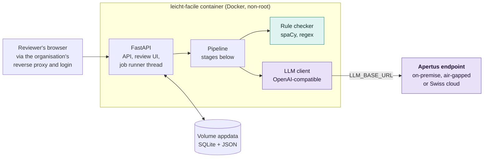
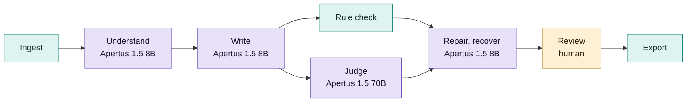

# Technical report - Leicht·Facile

Easy-language drafts of Swiss official texts with Apertus, with every fact checked by code

- **Track:** Track 2B - Own Project
- **Event:** Hack Apertus 2026, online
- **Team:** Röstigraben Bridgers - Alexander Bobrovsky (bobrovsky@seznam.cz), Ivan
  Kuzmych (i.kuzmych@hotmail.com)
- **Repository:** https://github.com/bobrovsky420/leicht-facile
- **Demo video:** <https://youtu.be/3UVbaXQ8I6o>
- **Maturity:** Deployable prototype for German and French drafts of public texts and
  letters; proof of concept for court and KESB decisions, which name people and are a
  main reason for a sovereign model; image input explored, not built.

## 1. Summary

**Problem.** About 1.25 million adults in Switzerland aged 16 to 65 (22%) have low
reading skills (Swiss Federal Statistical Office, PIAAC 2022/23); people with intellectual
disabilities, language learners and people with dementia need easy language too.

Disability law (Behindertengleichstellungsgesetz BehiG and the UN disability convention)
asks authorities for accessible information, and cantons have begun to publish in Leichte Sprache, FALC or
lingua facile; each version is written by hand by a few trained writers, who must
check every deadline, amount and phone number against the original.

**Approach.** Leicht·Facile is a drafting assistant for the people who write official
texts: trained writers, and the case workers, clerks and physicians who write decisions
and letters themselves. One rule: *Apertus does everything that needs language
understanding; plain code does everything that can be counted.* Apertus turns the
document into a fact sheet, writes a draft with provenance for every sentence, judges
meaning with a second, larger model, repairs only the flagged sentences and asks again
for each value still missing. Code checks the published easy-language rules
(45 checks for German, 41 for French), including the exact presence of every fact
value. A person reviews source and draft side by side and exports with an audit trail.

One container plus an OpenAI-compatible Apertus endpoint runs on-premise, air-gapped or
on a Swiss cloud, as letters under official, medical or tax secrecy require; for those,
only Apertus fits (§3).

A single prompt ("rewrite this in Leichte Sprache"), with no fact contract, provenance
or independent check, is our baseline P0; the full pipeline is P2.

**Headline result.** Our pipeline against a strong single prompt (defined in §5), on the
same model and 20 held-out German pairs (CSCS endpoint, final run of 11 October 2026).
Pipeline first, prompt second:

- **Must-keep facts found:** 100 against 83 percent.
- **Countable values kept** (dates, amounts, phone numbers, addresses): 97 against 85
  percent. The official easy-language versions keep 67 percent; they drop values on
  purpose.
- **Values lost without a trace:** none against 15 percent, and 33 percent in the
  prompt's condensed default. The pipeline lists every value it loses for the reviewer.
- **Rule errors per 100 blocks:** 4.2 against 15.0.
- **Invented values per 100 blocks:** 0.1 against 0.0, rare on both sides.

## 2. Architecture

| Stage | Done by | Output |
|-------|---------|--------|
| Ingest | Code: trafilatura, pdfplumber, spaCy | `SourceDocument`: segments with stable ids (`s0001`) |
| Understand | Apertus 8B, thinking | `FactSheet`: the reader's core questions, typed facts with normalised values and source ids; code adds every date, amount, contact, address, period or identifier the model missed |
| Write | Apertus 8B | `Draft`: blocks with the facts and source segments they carry, omissions with reasons, glossary |
| Rule check | Code: spaCy, regex, wordfreq | Findings with rule id, severity, evidence, suggestion |
| Judge | Apertus 70B, thinking | Each fact present, missing or distorted; unsupported blocks; meaning findings. The judge never rewrites |
| Repair | Apertus 8B | New text for flagged blocks only; up to 3 rounds; every version kept |
| Recover | Apertus 8B | One sentence for each must-keep value still missing (at most 10), checked and judged like a round |
| Review, export | Human, then code | Per-block decisions; Markdown, HTML, Word and a JSON audit bundle |

### Key decisions

Meaning in the model, countable rules in code (exact, free, reproducible, no
self-grading). Every must-keep value must appear in an accepted form
(`31. März 2026`, `31.3.2026`), so a deadline that became `30 March` is caught;
every value the source does not contain is flagged. Typed artifacts in SQLite let a
failed job resume and the UI and the evaluation show every intermediate result. One
service: FastAPI, a server-rendered UI, one worker thread by default; no Node build, no CDN.

### Target architecture

Leicht·Facile is deployable in all three architectures. Its only runtime dependency is
the Apertus endpoint in `LLM_BASE_URL`; changing the deployment means changing that
variable.

| Architecture | How it is met | Tested on |
|--------------|---------------|-----------|
| a) On-premise | `docker compose --profile local-llm up` adds a vLLM service from the official image `ghcr.io/swiss-ai/vllm_apertus_1.5_release` serving Apertus 1.5 8B on one GPU; the app points at `http://vllm:8000/v1`. | vLLM on one NVIDIA L4 24 GB (rented AWS g6.xlarge in Zurich, Ubuntu 24.04, 10 October 2026): `make run` from a clean clone, two jobs end to end. llama.cpp on a laptop RTX 4060 8 GB. |
| b) Air-gapped | As (a), with images and weights pulled in advance. Python packages, spaCy models and UI assets are baked into the image; no telemetry, no CDN, no installs at runtime. | Not run without a network. Tests check that the UI loads nothing from another host; CI starts the image against an unreachable endpoint. |
| c) Sovereign Swiss cloud | `LLM_BASE_URL` points at a Swiss-operated Apertus endpoint. | The CSCS inference API in Lugano: every evaluation run in §5 and the two example letters. |

What the running system contacts:

| Service | When | What it receives |
|---------|------|------------------|
| Apertus endpoint (`LLM_BASE_URL`) | Every model call; its model list once per process | Document text, fact sheet and drafts, inside prompts |
| The server of a URL the user enters | Only for URL input | A request for that page; no document data |

Nothing else: no telemetry, CDN, outside fonts or scripts, update check or login
provider; on-premise or air-gapped, no data leaves the organisation at runtime. Build
time: PyPI (`uv.lock`), spaCy wheels from GitHub, images from Docker Hub and GHCR.
The container runs as non-root, logs no document text above `DEBUG` and listens on
localhost; published further, it insists on a shared token or the reverse proxy's user
header (the organisation's login).

### Licences and providers

Apertus 1.5 Apache 2.0 with an acceptable use policy (accepted once for the gated
download), code Apache 2.0, spaCy models MIT (German) and LGPL-LR (French), fonts OFL.
Any OpenAI-compatible server works (used: CSCS, Public AI, llama.cpp; vLLM
on-premise): no single provider is needed.

| Hardware | Model and server | Memory | Speed |
|----------|------------------|--------|-------|
| NVIDIA L4 24 GB | 8B in bf16, vLLM | 17.2 GiB of weights; with the FP8 KV cache, one 32k request fits | 16 tokens per second, near the limit of the card's memory bandwidth |
| Laptop RTX 4060 8 GB | 8B in 4-bit, llama.cpp | 5.1 GB of weights | About 37 tokens per second |

## 3. Use of Apertus

- **Models:** `swiss-ai/Apertus-v1.5-8B` writes (Understand, Write, Repair, Recover,
  baseline) and `swiss-ai/Apertus-v1.5-70B` judges, set by `LLM_NAME` and
  `LLM_JUDGE_NAME`.
- **How it is used:** inference, as a structured-output agent pipeline without tool
  calling (the thinking variants are served with tools disabled). No fine-tuning.
- **Where it runs, and why only Apertus:** the CSCS inference API for the hackathon;
  the same client works unchanged with vLLM, llama.cpp or a Swiss cloud endpoint.
  Letters that name a person fall under official, medical or tax secrecy and may not
  go to a foreign cloud, so the organisation must run the model itself and account
  for what it learned. Only Apertus combines open weights, open training data
  (website opt-outs honoured), Swiss public origin and German, French and Italian
  ([track_2b/docs/use-cases.md §2](docs/use-cases.md#why-only-apertus)).
- **Why these sizes:** the 8B is enough to read and write. It finds the must-keep facts
  as well as the 70B does, at half the price per page (§5). The 70B judges, because
  meaning needs a second, larger model than the one that wrote the draft.

| Stage | Model | Thinking | Temperature | Max tokens |
|-------|-------|----------|-------------|------------|
| Understand | 8B | on | 0.1 | 12000 |
| Write | 8B | off | 0.3 | 8000 |
| Judge | 70B | on | 0.0 | 12000 |
| Repair | 8B | off | 0.2 | 6000 |
| Recover | 8B | off | 0.2 | 1500 |
| Baseline P0 | 8B | off | 0.3 | 6000 |

**Prompts and parsing** ([track_2b/docs/prompts.md](docs/prompts.md)), in the document's
language, each with one filled JSON example instead of the schema. Sentences and blocks
carry ids (`[s0004]`, `[b007]`): the model cites, code verifies; the judge's unsupported
verdicts must quote words that stand in the draft. The writer plans first
(the reader's questions as headings) with the level's style guide and two example pairs
written by the team; repair gets only the flagged blocks, their findings and facts.
Answers are parsed leniently and validated with pydantic (one retry with the error);
calls are streamed, retried on broken streams, 429 and 5xx, and logged.

**Where Apertus fell short**, and what does the job instead:

- The 8B drops must-keep facts while writing, ignored compound splits it was given,
  copied values from the prompt's example and broke JSON: code completes the fact
  sheet, splits compounds, returns answers with values the document lacks and repairs
  the JSON; facts rounds and the recover round ask again, a polish round repairs the
  sentences they add.
- The 70B judge's fact verdicts agree with blind labels hardly better than chance (κ
  0.08, §5), so every fact number comes from code.
- On the local 4-bit build, Write with thinking took 24 minutes and paraphrased;
  without, 28 seconds and easy language. Write runs without thinking.
- 8B drafts read worse than the official versions (Amstad 51 against 62); the 70B
  writes cleaner (56) at twice the price per page.
- On a whole scanned page both models change digits (in an IBAN or a phone number, for example); names
  and e-mail addresses are unsafe in every setting. Image input is not built
  ([track_2b/docs/image-input.md](docs/image-input.md)).

**Other models and coding assistants.** No other model at runtime; spaCy's statistical
parsers and wordfreq serve the checker. The 59 labels for the judge's agreement (§5)
were made by Claude (Anthropic), blind to the verdicts; no pipeline score depends on
them. The code, tests and documents were written with AI coding assistants (Claude Code, Anthropic),
directed and reviewed by the team; the assistants also ran the tests and the
evaluation scripts; the design, the decisions and every claim here are the team's.

## 4. Data

| Data | Origin | Licence and handling |
|------|--------|----------------------|
| Reference pairs: **35** documents with an official easy-language version (**30** German: 20 eval, 10 dev; **5** French: 3 eval, 2 dev) | Cantons Zürich, Bern, St. Gallen, Luzern, Basel-Stadt, Graubünden, Zug, Geneva, Neuchâtel; federal offices BAG, BWL, EBGB | Personal use only. The repository holds only the manifest (`track_2b/data/pairs/manifest.jsonl`: URLs, licence notes); `eval fetch` caches the texts, git-ignored, with a fetch date |
| Example documents, few-shot examples, hard texts for tests | Written by the team: invented municipality, reserved `.example` domains | In the repository, under the project licence |

Dev pairs serve prompt development and calibration; eval pairs are held out. No
personal data is used. Evaluating against protected pages needs no consent as long as
neither the texts nor our rewrites are published (Copyright Act art. 24a and 24d; our
reading, not legal advice; [track_2b/docs/sources.md](docs/sources.md) §4).

## 5. Evaluation

**Task.** Simplify a standard-language official text to Leichte Sprache and keep every
fact. Each held-out pair runs under these conditions:

| Code | Condition | Measures |
|------|-----------|----------|
| P0 | One prompt: "Schreiben Sie diesen Text in Leichter Sprache:" | What a user gets from a chatbot |
| P0-ZH | The Canton of Zurich's public Leichte Sprache prompt, verbatim; German only | The strong single prompt: Zurich's published prompt, the only public Swiss one we found |
| P1 | Understand, Write, rule check; no judge, no repair | Fact sheet, planning, provenance |
| P2 | Full pipeline with judge and repair | Checking and repairing |

Two rows need no model: SOURCE (the original, scored as if it were a draft) and REF
(the official easy-language version written by professionals).

**Metrics**, on every row's final text: *fact coverage* (must-keep facts with a source
value found); *hard facts kept* (the source's countable values, by code, so comparable
with REF); *silent losses* (hard values lost without a trace; for the pipeline, the
gaps of its code completion); *values not in the source*; *unsupported blocks* (70B
judge); *rule errors*; *readability* (Amstad, the German Flesch); *SARI* against the
official version (a port of `SARI.py`, checked bit for bit); cost at Public AI's token
prices and speed per 250-word page.

Results on the 20 held-out German pairs, final run on the CSCS endpoint, 11 October
2026. Each number is the mean over the pairs; "/100" means per 100 blocks. P1 and the
last row reused answers from the cache: P1's time is not measured, the last row's is
too low.

| Setup | Fact coverage | Hard facts kept | Silent losses | Values not in source /100 | Unsupported /100 (judge) | Rule errors /100 | Amstad | SARI | USD / page | s / page |
|-------|---------------|-----------------|---------------|----------------------|--------------------------|------------------|--------|------|------------|----------|
| SOURCE | - | 100 % | 0 % | 0.0 | - | 31.3 | 36 | - | - | - |
| REF (official) | - | 67 % | 33 % | 2.8 | - | 2.7 | 62 | - | - | - |
| P0 | 92 % | 93 % | 7 % | 0.2 | - | 19.5 | 52 | 43.0 | 0.0001 | 2.6 |
| P0-ZH complete | 83 % | 85 % | 15 % | 0.0 | - | 15.0 | 47 | 43.0 | 0.0003 | 2.4 |
| P0-ZH condensed | 69 % | 67 % | 33 % | 0.2 | - | 9.0 | 46 | 41.5 | 0.0002 | 1.4 |
| P1 | 74 % | 73 % | 0 % | 1.1 | - | 8.3 | 51 | 40.6 | 0.0014 | - |
| **P2 (ours)** | 100 % | 97 % | 0 % | 0.1 | 1.6 | 4.2 | 51 | 41.7 | 0.0131 | 63.3 |
| P2, 70B everywhere | 99 % | 92 % | 0 % | 0.0 | 1.1 | 0.6 | 56 | 43.8 | 0.0262 | 57.5 |
| P2, 70B reads, 8B writes | 100 % | 95 % | 0 % | 0.1 | 1.0 | 1.9 | 53 | 42.0 | 0.0163 | 32.4 |

**Reading the table.** The one-sentence prompt and the strong prompt's complete mode keep most
values because they rewrite little (7.6 and 7.0 words per sentence; SARI rewards
closeness to the source) and lose the rest without a trace; the condensed mode,
its default, simplifies more and drops a third of the values. The pipeline
nears the official sentence length (7.1 words against 6.1), keeps more hard facts
than the official versions, which condense on purpose, and reads worse (51 against
62). Judge, repair and the recover round (P1 to P2) raise fact coverage from 74 to 100
percent and cut rule errors from 8.3 to 4.2 per 100 blocks; no must-keep fact is
missing from the final versions (205 on the 23 pairs). Two fifths of P2's rule errors
come from one 7-page source, written out in full. On the 17 pairs with 3 or more hard
facts P2 keeps 97 percent, the official versions 61. A single prompt varies from run to
run: on unchanged templates, P0-ZH complete found 91 percent of the facts on 10 October
and 83 on 11 October (one answer per pair at temperature 0.3). French (3 pairs): 100
percent fact coverage, 87 percent of the hard facts, 4.9 errors, readability 74
(official 85).

**Cost and scale.** At Public AI's list prices the pipeline costs about
one and a half US cents per 250-word page (P2: 0.0131 USD, the recover and polish rounds
included; the 70B everywhere 0.0262), so ten times the volume costs ten times the
cents. On own
hardware the GPU is a fixed cost until it is busy. Speed is the limit: at ten times the
volume, jobs wait in a queue, as one runs at a time; running several at once is a
setting we have not measured. The writer's time is the cost that
matters: our own review of three P2 drafts in the UI (the two example letters and one
dev pair, 1,079 source words together), from opening the review to the export, took
15 minutes by stopwatch, about 3.5 minutes per 250-word page (the team, not experts).

**Judge reliability.** 30 facts and 30 blocks from the P2 dev drafts of 6 October
(70B judge), drawn evenly over the verdicts and labelled blind to them (`eval sample`,
`eval kappa`). Blocks, supported or not: agreement 80 %, Cohen's κ 0.60. Facts,
present, missing or distorted: 38 %, κ 0.08 (present or not: 62 %, κ 0.22). The fact
verdicts are a hint for the reviewer, not a measure: every fact number here comes from
code, and the review page shows a verdict that code contradicts as a doubt.

**Checker calibration and tests.** On official pages each error is a real deviation or
a false positive to fix; calibration cut errors per 100 blocks from 12.6 to 2.0 (30
German pages) and from 5.3 to 2.2 (5 French). 1,422 offline tests include golden
sentences for every rule (two or more that fire, one that must not).

## 6. Limitations

- **Readability with an 8B model.** At level A2 the drafts do not yet read as easily as
  the official versions: their sentences are almost as short (7.1 against 6.1 words),
  but their readability score is lower (Amstad 51 against 62). The facts are not the
  problem: the drafts keep all must-keep facts and 97 percent of the countable values,
  and list every value they lose (20 German eval pairs, CSCS).
- **Not a certification.** Easy-language texts must be tested by readers from the
  target group; the tool prepares that test, it does not replace it.
- **Italian** gets only the language-independent rules (facts, layout, readability).
  The B1 thresholds are our own; no official Swiss B1 rule set exists.
- **The judge is a model**, and obligations and conditions without a value rely on it
  alone; many pages carry few countable facts, so the fact-rich subset is reported too.
- **Decision mode v1** is calibrated on one team-written KESB decision and one
  published court decision; no authority and no reader has seen its output.
- **Not yet supported:** scanned PDFs and photos (§3), an air-gapped image bundle, user
  accounts of its own (a shared token or the proxy's user header stand in).
- **Unmeasured:** the rewrite recipes the checker hands the writer for a subordinate
  clause, in German and French; the dev runs measured the rounds, not them.

## 7. Reproducibility

- **Run:** `LLM_BASE_URL`, `LLM_API_KEY` and `LLM_NAME` in the shell or in `.env`, then
  `make run`, which opens http://localhost:8000 in the browser once the app is up;
  `make smoke` runs a bundled letter end to end.
- **Numbers:** `make eval` fetches the pairs, runs P0, P0-ZH, P1 and P2 with the
  response cache (an interrupted run resumes) and writes the tables; `make calibrate`
  runs the checker on the official pages without a model.
- **Environment:** Python 3.14 in `python:3.14-slim`, dependencies locked in `uv.lock`,
  spaCy models pinned by wheel URL; CI runs the linter, the tests and a start of the
  Docker image on every push.
- **Seeds:** temperatures above zero are not seeded; reruns reproduce exact outputs
  through the response cache, and each result stores the hash of its prompt template.
- **Hardware and commit:** the evaluation numbers come from the CSCS endpoint, the
  hardware figures in §2 from our own runs (the L4 run in `track_2b/eval/hardware/`);
  commit `663b609` (the final run of 11 October
  2026, on the prompt templates with the document fence against prompt injection).

## 8. Next steps

- **Into use.** Before a canton's first real letter: its login proxy in front (the app
  reads the proxy's user header), to build; a GPU host and the weights under the
  acceptable use policy, to obtain; its IT security review and a data protection
  assessment, to approve. The target-group test stays with the office.
- **The same need elsewhere.** Every canton and federal office that publishes easy
  language, and texts under secrecy, where only Apertus fits
  ([track_2b/docs/use-cases.md](docs/use-cases.md)): decisions of KESB and courts (decision mode
  v1 exists; next an anonymisation step), patient letters, penal and payment orders,
  social, school and tax decisions. Most turn on a period, a reference number, an
  address or a dose, which code already checks like a date.
- Italian rules and prompts; image input in strips with a person checking every name
  and address; an air-gapped bundle; a LoRA on the 8B from approved drafts and edits.

## License

Code: Apache License 2.0. This report: Creative Commons
Attribution 4.0 (CC-BY-4.0).

## References

- Apertus v1.5 model card: https://huggingface.co/swiss-ai/Apertus-v1.5-8B
- CSCS LLM inference API: https://docs.cscs.ch/services/inference/api/
- Canton of Zürich, [rules for Leichte Sprache](https://www.zh.ch/de/webangebote-entwickeln-und-gestalten/inhalt/barrierefreiheit/regeln-fuer-leichte-sprache.html)
- Canton of Zürich, [simply-simplify-language](https://github.com/machinelearningZH/simply-simplify-language) (the prompt of P0-ZH)
- EBGB, [Leitfaden Leichte Sprache](https://www.ebgb.admin.ch/dam/de/sd-web/ZHKNDzIYahOc/Leitfaden%20Leichte%20Sprache.pdf)
- EBGB, [Behindertengleichstellungsgesetz BehiG](https://www.ebgb.admin.ch/de/behindertengleichstellungsgesetz-behig) (SR 151.3)
- Inclusion Europe, "Information for all" (German, French and Italian editions)
- Swiss Federal Statistical Office (2024): [PIAAC 2022/2023, first results](https://www.bfs.admin.ch/asset/fr/33346105)
- Amstad, T. (1978): Wie verständlich sind unsere Zeitungen? (German readability index)
- Xu, W. et al. (2016): Optimizing SMT for Text Simplification. TACL 4 (SARI)
- Swiss [Copyright Act (URG)](https://www.fedlex.admin.ch/eli/cc/1993/1798_1798_1798/de), art. 5, 24a, 24d
