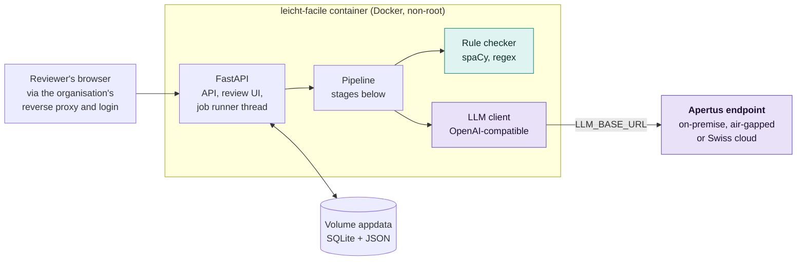
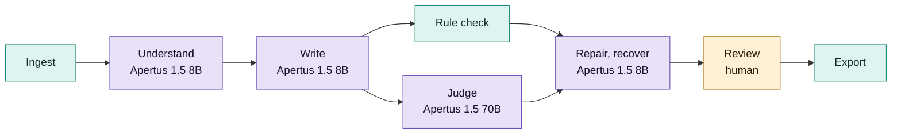

# Technical report - Leicht·Facile

Easy-language drafts of Swiss official texts with Apertus, with every fact value checked
by code.

- **Track:** Track 2B - Own Project
- **Event:** Hack Apertus 2026, online
- **Team:** Röstigraben Bridgers - Alexander Bobrovsky (bobrovsky@seznam.cz), Ivan
  Kuzmych (i.kuzmych@hotmail.com)
- **Repository:** https://github.com/bobrovsky420/leicht-facile
- **Demo:** **[PENDING: video URL]**
- **Maturity:** deployable prototype for German and French drafts of public texts and
  letters; proof of concept for court and KESB decisions; image input explored, not
  built. **[OWNER: confirm]**

## 1. Summary

**Problem.** About 1.25 million adults in Switzerland aged 16 to 65 (22%) have low
reading skills (Swiss Federal Statistical Office, PIAAC 2022/23); people with intellectual
disabilities, language learners and people with dementia need easy language too.
Disability law (BehiG and the UN disability convention) asks authorities for
accessible information, and cantons have begun to publish in Leichte Sprache, FALC or
lingua facile; each version is written by hand by a few trained writers, who must
check every deadline, amount and phone number against the original.

**Approach.** Leicht·Facile is a drafting assistant for the people who write official
texts: trained writers, and the case workers, clerks and physicians who write decisions
and letters themselves. One rule: *Apertus does everything that needs language
understanding; plain code does everything that can be counted.* Apertus 1.5 turns the
document into a fact sheet, writes a draft with provenance for every sentence, judges
meaning with a second, larger model, repairs only the flagged sentences and asks again
for each value still missing. Code checks the published easy-language rules
(45 checks for German, 41 for French), including the exact presence of every fact
value. A person reviews source and draft side by side and exports with an audit trail.
One container plus an OpenAI-compatible Apertus endpoint runs on-premise, air-gapped or
on a Swiss cloud, as letters under official, medical or tax secrecy require; for those,
only Apertus fits (§3). A single prompt ("rewrite this in Leichte Sprache"), with no
fact contract, provenance or independent check, is our baseline P0; the full pipeline
is P2.

**Headline result.** **[PENDING: final run after Sun 11 Oct, and D-M; below, the
numbers of 6 Oct, without the recover round.]** On 20 held-out German pairs on the CSCS endpoint, the
pipeline keeps 80 percent of the source's countable facts (dates, amounts, phone
numbers, addresses) against 70 percent in the official easy-language versions, which
drop values on purpose, with 4.3 rule errors per 100 blocks against 2.7 for the
official versions and 22.0 for the one-prompt baseline, which keeps every fact because
it hardly simplifies. Its drafts contain 0.1 values per 100 blocks that the source does
not have; the official versions 2.2.

## 2. Architecture

| Stage | Done by | Output |
|-------|---------|--------|
| Ingest | Code: trafilatura, pdfplumber, spaCy | `SourceDocument`: segments with stable ids (`s0001`) |
| Understand | Apertus 8B, thinking | `FactSheet`: the reader's core questions, typed facts with normalised values and source ids; code adds every date, amount, contact, address, period or identifier the model missed |
| Write | Apertus 8B | `Draft`: blocks with the facts and source segments they carry, omissions with reasons, glossary |
| Rule check | Code: spaCy parse, regex, word frequencies | Findings with rule id, severity, evidence, suggestion |
| Judge | Apertus 70B, thinking | Each fact present, missing or distorted; unsupported blocks; meaning findings. The judge never rewrites |
| Repair | Apertus 8B | New text for flagged blocks only; up to 3 rounds; every version kept |
| Recover | Apertus 8B | One sentence for each must-keep value still missing (at most 10), checked and judged like a round |
| Review, export | Human, then code | Per-block decisions; Markdown, HTML and a JSON audit bundle |

Key decisions ([track_2b/docs/architecture.md](docs/architecture.md)): countable rules in code,
meaning in the model (exact, free, reproducible, no self-grading;
[track_2b/docs/rules.md](docs/rules.md)). Every must-keep value must appear in an accepted form
(`31. März 2026`, `31.3.2026`), so a deadline that became 30 March is caught;
every value the source does not contain is flagged. Typed artifacts in SQLite let a
failed job resume and the UI and the evaluation show every intermediate result. One
service: FastAPI, a server-rendered UI, one worker thread; no Node build, no CDN.

### Target architecture (mandatory)

Leicht·Facile is deployable in all three architectures. Its only runtime dependency is
the Apertus endpoint in `LLM_BASE_URL`; changing the deployment means changing that
variable.

| Architecture | How it is met |
|--------------|---------------|
| a) On-premise | `docker compose --profile local-llm up` adds a vLLM service from the official image `ghcr.io/swiss-ai/vllm_apertus_1.5_release` serving Apertus 1.5 8B on one GPU (run on an L4 24 GB, below); the app points at `http://vllm:8000/v1`. A llama.cpp profile serves a 4-bit 8B on an 8 GB laptop GPU. |
| b) Air-gapped | As (a), with images and weights pulled in advance. Python packages, spaCy models and UI assets are baked into the image; no telemetry, no CDN, no installs at runtime. |
| c) Sovereign Swiss cloud | `LLM_BASE_URL` points at a Swiss-operated Apertus endpoint; the hackathon demo runs against the CSCS inference API in Lugano. |

What the running system contacts:

| Service | When | What it receives |
|---------|------|------------------|
| Apertus endpoint (`LLM_BASE_URL`) | Every model call; its model list once per process | Document text, fact sheet and drafts, inside prompts |
| The server of a URL the user enters | Only for URL input | A request for that page; no document data |

Nothing else: no telemetry, CDN, outside fonts or scripts, update check or login
provider; on-premise or air-gapped, no data leaves the organisation at runtime. Build
time: PyPI (`uv.lock`), spaCy wheels from GitHub, images from Docker Hub and GHCR.
The container runs as non-root, logs no document text above `DEBUG` and has no
login, so it belongs behind the organisation's reverse proxy. Licences: Apertus 1.5 Apache 2.0 with an acceptable use
policy (accepted once for the gated download), code Apache 2.0, spaCy models MIT
(German) and LGPL-LR (French), fonts OFL. Any OpenAI-compatible server works (used:
CSCS, Public AI, llama.cpp; vLLM on-premise): no single provider is needed.

Hardware for (a) and (b), measured on one NVIDIA L4 24 GB
(`track_2b/eval/hardware/`): the 8B in bf16 takes 17.2 GiB, and with the profile's FP8 KV cache
one 32k request fits. It generates 16 tokens per second, close to the limit of the
card's memory bandwidth. A laptop RTX 4060 8 GB (llama.cpp, 4-bit) gave about 37 tokens per second.

## 3. Use of Apertus

- **Models:** `swiss-ai/Apertus-v1.5-8B` writes (Understand, Write, Repair, Recover,
  baseline) and `swiss-ai/Apertus-v1.5-70B` judges, set by `LLM_NAME` and
  `LLM_JUDGE_NAME` (without it, the judge is the 70B when the endpoint serves it).
  `LLM_UNDERSTAND_NAME` gives the Understand stage alone another model.
- **How it is used:** inference, as a structured-output agent pipeline without tool
  calling (the thinking variants are served with tools disabled). No fine-tuning.
- **Where it runs, and why only Apertus:** the CSCS inference API for the hackathon;
  the same client works unchanged with vLLM, llama.cpp or a Swiss cloud endpoint.
  Letters that name a person fall under official, medical or tax secrecy and may not
  go to a foreign cloud, so the organisation must run the model itself and account
  for what it learned. Only Apertus combines open weights, open training data
  (website opt-outs honoured), Swiss public origin and German, French and Italian
  ([track_2b/docs/use-cases.md §2](docs/use-cases.md#why-only-apertus)).
- **Why these sizes:** the 8B is enough to read and write: it kept more facts than the
  70B running every stage, at about half the price per page (§5), and runs on one
  24 GB GPU (§2), where the 70B needs four. The 70B judges,
  because meaning needs a second, larger model than the one that wrote the draft. The
  70B reading for the 8B kept the fewest facts.

| Stage | Model | Thinking | Temperature | max_tokens |
|-------|-------|----------|-------------|------------|
| Understand | 8B | on | 0.1 | 12000 |
| Write | 8B | off | 0.3 | 8000 |
| Judge | 70B | on | 0.0 | 12000 |
| Repair | 8B | off | 0.2 | 6000 |
| Recover | 8B | off | 0.2 | 1500 |
| Baseline P0 | 8B | off | 0.3 | 6000 |

**[PENDING: check the table against the final run's settings.]** **Prompts and parsing** ([track_2b/docs/prompts.md](docs/prompts.md)), in the document's
language, each with one filled JSON example instead of the schema. Sentences and blocks
carry ids (`[s0004]`, `[b007]`): the model cites, code verifies. The writer plans first
(the reader's questions as headings) with the level's style guide and two example pairs
written by the team; repair gets only the flagged blocks, their findings and facts.
Answers are parsed leniently and validated with pydantic (one retry with the error);
calls are streamed, retried on broken streams, 429 and 5xx, and logged.

**Where Apertus fell short**, and what does the job instead:

- The 8B drops must-keep facts while writing, ignored compound splits it was given,
  copied values from the prompt's example and broke JSON: code completes the fact
  sheet, splits compounds, returns answers with values the document lacks and repairs
  the JSON; facts rounds and the recover round ask again.
- The 70B judge's fact verdicts agree with blind labels hardly better than chance (κ
  0.08, §5), so every fact number comes from code.
- On the local 4-bit build, Write with thinking took 24 minutes and paraphrased;
  without, 28 seconds and easy language. Write runs without thinking.
- 8B drafts read worse than the official versions (Amstad 51 against 62); the 70B
  writes cleaner but keeps fewer facts.
- On a whole scanned page both models change digits (an IBAN into another IBAN); names
  and e-mail addresses are unsafe in every setting. Image input is not built
  ([track_2b/docs/image-input.md](docs/image-input.md)).

**Other models and coding assistants.** No other model at runtime; spaCy's statistical
parsers and wordfreq serve the checker. The 59 labels for the judge's agreement (§5)
were made by Claude (Anthropic), blind to the verdicts; no pipeline score depends on
them. Prompt tests without a key ran on a community 4-bit build of the 8B in llama.cpp
(`Colby/apertus-v1.5-8b-text-Q4_K_M-GGUF`), never mixed with CSCS numbers. The code,
tests and documents were written with AI coding assistants (Claude Code, Anthropic),
directed and reviewed by the team; the assistants also ran the tests and the
evaluation scripts; the design, the decisions and every claim here are the team's.

## 4. Data

| Data | Origin | Licence and handling |
|------|--------|----------------------|
| Reference pairs: 35 documents with an official easy-language version (30 German: 20 `eval`, 10 `dev`; 5 French: 3 `eval`, 2 `dev`) | Cantons Zürich, Bern, St. Gallen, Luzern, Basel-Stadt, Graubünden, Zug, Geneva, Neuchâtel; federal offices BAG, BWL, EBGB | Personal use only. The repository holds only the manifest (`track_2b/data/pairs/manifest.jsonl`: URLs, licence notes); `eval fetch` caches the texts, git-ignored, with a fetch date |
| Example documents, few-shot examples, hard texts for tests | Written by the team: invented municipality, reserved `.example` domains | In the repository, under the project licence |

`dev` pairs serve prompt development and calibration; `eval` pairs are held out. No
personal data is used. Evaluating against protected pages needs no consent as long as
neither the texts nor our rewrites are published (Copyright Act art. 24a and 24d; our
reading, not legal advice; [track_2b/docs/sources.md](docs/sources.md) §4).

## 5. Evaluation

**Task.** Simplify a standard-language official text to Leichte Sprache and keep every
fact. Each held-out pair runs under these conditions:

| Code | Condition | Measures |
|------|-----------|----------|
| P0 | One prompt: "Schreiben Sie diesen Text in Leichter Sprache:" | What a user gets from a chatbot |
| P0-ZH | The Canton of Zurich's public Leichte Sprache prompt, verbatim (`complete`: keep everything; `condensed`: essentials only, their default); German only | Zurich's published prompt, the only public Swiss one we found |
| P1 | Understand, Write, rule check; no judge, no repair | Fact sheet, planning, provenance |
| P2 | Full pipeline with judge and repair | Checking and repairing |

Two rows need no model: SOURCE (the original, scored as if it were a draft) and REF
(the official easy-language version written by professionals).

**Metrics**, on every row's final text: *fact coverage* (must-keep facts with a source
value found); *hard facts kept* (the source's countable values, by code, so comparable
with REF); *silent losses* (hard values lost without a trace; for the pipeline, the
gaps of its code completion); *values not in the source*; *unsupported blocks* (70B
judge); *rule errors*; *readability* (Amstad, the German Flesch); *SARI* against the
official version (a port of `SARI.py`, checked bit for bit); cost at Public AI's token
prices and speed per 250-word page.

Results on the 20 held-out German pairs, CSCS endpoint, 6 October 2026, means over
pairs; "/100" is per 100 blocks; seconds undercount, as cached calls count 0 s
([track_2b/eval/report.md](eval/report.md) has the full tables). **[PENDING: the final run replaces this table, the paragraphs below it and §1; the
recover round, on by default since 9 October, is not in these rows.]**

| Setup | Fact coverage | Hard facts kept | Silent losses | Values not in source /100 | Unsupported /100 (judge) | Rule errors /100 | Amstad | SARI | USD / page | s / page |
|-------|---------------|-----------------|---------------|----------------------|--------------------------|------------------|--------|------|------------|----------|
| SOURCE | - | 100 % | 0 % | 0.0 | - | 31.3 | 36 | - | - | - |
| REF (official) | - | 70 % | 30 % | 2.2 | - | 2.7 | 62 | - | - | - |
| P0 | 93 % | 100 % | 0 % | 0.0 | - | 22.0 | 50 | 44.5 | 0.0001 | 2.0 |
| P0-ZH complete | 91 % | 95 % | 5 % | 0.0 | - | 15.4 | 47 | 43.2 | 0.0003 | 2.4 |
| P0-ZH condensed | 75 % | 77 % | 23 % | 0.0 | - | 8.7 | 48 | 41.7 | 0.0002 | 1.4 |
| P1 | 72 % | 69 % | - | 3.2 | - | 9.9 | 50 | 38.8 | 0.0012 | 10.9 |
| **P2 (ours)** | 84 % | 80 % | - | 0.1 | 6.9 | 4.3 | 51 | 40.6 | 0.0105 | 23.3 |
| P2, 70B everywhere | 78 % | 75 % | - | 0.3 | 4.7 | 1.4 | 58 | 41.7 | 0.0191 | 37.3 |
| P2, 70B reads, 8B writes | 66 % | 65 % | - | 0.6 | 6.2 | 2.1 | 54 | 39.0 | 0.0103 | 21.6 |

**Reading the table.** The baseline keeps everything because it rewrites little (7.7
words per sentence; SARI rewards closeness to the source). The pipeline nears the
official sentence length (6.8 words against 6.1) and keeps more hard facts than the
official versions, which condense on purpose, but reads worse (51 against 62). Judge
and repair (P1 to P2) raise fact coverage from 72 to 84 percent and cut rule errors
from 9.9 to 4.3 and values not in the source from 3.2 to 0.1 per 100 blocks. On the 14
pairs with 3 or more hard facts P2 keeps 77 percent, the official versions 60. French
(3 pairs): 73 percent fact coverage, 4.6 errors, readability 75 (official 85).

**Cost, and ten times the volume.** At Public AI's list prices the pipeline costs about
one US cent per 250-word page (P2: 0.0105 USD; the recover round adds about 12 percent
of tokens and 5 s per page), so ten times the volume costs ten times the cents. On own
hardware the GPU is a fixed cost until it is busy. Speed is the limit: one job runs at
a time, so at ten times the volume jobs wait in a queue; vLLM serves parallel requests,
so more workers on the same GPU are the next step (not built, not measured). The rule
check takes 47 ms (median, a 15-block letter). The writer's time is the cost that
matters: **[PENDING: our review time per page by stopwatch (team, not experts), and a
published drafting time per page, or the statement that we found none.]**

**Judge reliability.** 30 facts and 30 blocks from the P2 dev drafts of 6 October
(70B judge), drawn evenly over the verdicts and labelled blind to them (`eval sample`,
`eval kappa`). Blocks, supported or not: agreement 80 %, Cohen's κ 0.60. Facts,
present, missing or distorted: 38 %, κ 0.08 (present or not: 62 %, κ 0.22). The fact
verdicts are a hint for the reviewer, not a measure: every fact number here comes from
code, and the review page shows a verdict that code contradicts as a doubt.

**Checker calibration and tests.** On official pages each error is a real deviation or
a false positive to fix; calibration cut errors per 100 blocks from 12.6 to 2.0 (30
German pages) and from 5.3 to 2.2 (5 French). 1,244 offline tests **[PENDING: the count
on the submitted commit]** include golden sentences for every rule (two or more that
fire, one that must not).

## 6. Limitations

- **A2 with an 8B model.** Drafts match the official sentence length, not the
  readability (51 against 62), and keep 84 percent of the must-keep facts, listing the
  rest. **[PENDING: final numbers]**
- **Not a certification.** Easy-language texts must be tested by readers from the
  target group; the tool prepares that test, it does not replace it.
- **Italian** gets only the language-independent rules (facts, layout, readability).
  The B1 thresholds are our own; no official Swiss B1 rule set exists.
- **The judge is a model**, and obligations and conditions without a value rely on it
  alone; many pages carry few countable facts, so the fact-rich subset is reported too.
  On one GPU the 8B judges, which we have not evaluated.
- **Decision mode v1** is calibrated on one team-written KESB decision and one
  published court decision; no authority and no reader has seen its output.
- **Not yet supported:** scanned PDFs and photos (§3), DOCX export, an air-gapped image
  bundle, login.

## 7. Reproducibility

- **Run:** `LLM_BASE_URL`, `LLM_API_KEY` and `LLM_NAME` in the shell or in `.env`, then
  `make run` (http://localhost:8000); `make smoke` runs a bundled letter end to end.
- **Numbers:** `make eval` fetches the pairs, runs P0, P0-ZH, P1 and P2 with the
  response cache (an interrupted run resumes) and writes the tables; `make calibrate`
  runs the checker on the official pages without a model.
- **Environment:** Python 3.14 in `python:3.14-slim`, dependencies locked in `uv.lock`,
  spaCy models pinned by wheel URL; CI runs the linter, the tests and a start of the
  Docker image on every push.
- **Seeds:** temperatures above zero are not seeded; reruns reproduce exact outputs
  through the response cache, and each result stores the hash of its prompt template.
- **Hardware and commit:** the CSCS endpoint for all reported numbers except §2's L4
  figures (`track_2b/eval/hardware/`); commit
  **[PENDING: hash of the reported run]**.

## 8. Next steps

- **Into use.** Before a canton's first real letter: login through its own proxy and
  DOCX export (writers work in Word), to build; a GPU host and the weights under the
  acceptable use policy, to obtain; its IT security review and a data protection
  assessment, to approve. The target-group test stays with the office. First user:
  **[OWNER: none is named yet; say so plainly, or name one that agrees.]**
- **The same need elsewhere.** Every canton and federal office that publishes easy
  language, and texts under secrecy, where only Apertus fits
  ([track_2b/docs/use-cases.md](docs/use-cases.md)): decisions of KESB and courts (decision mode
  v1 exists; next an anonymisation step), patient letters, penal and payment orders,
  social, school and tax decisions. Most turn on a period, a reference number, an
  address or a dose, which code already checks like a date.
- Italian rules and prompts; image input in strips with a person checking every name
  and address; an air-gapped bundle; a LoRA on the 8B from approved drafts and edits.

## License

Code: Apache License 2.0 ([LICENSE](../LICENSE)). This report: Creative Commons
Attribution 4.0 (CC-BY-4.0).

## References

- Apertus v1.5 model card: https://huggingface.co/swiss-ai/Apertus-v1.5-8B
- CSCS LLM inference API: https://docs.cscs.ch/services/inference/api/
- Canton of Zürich, [rules for Leichte Sprache](https://www.zh.ch/de/webangebote-entwickeln-und-gestalten/inhalt/barrierefreiheit/regeln-fuer-leichte-sprache.html)
- Canton of Zürich, [simply-simplify-language](https://github.com/machinelearningZH/simply-simplify-language) (the prompt of P0-ZH)
- EBGB, [Leitfaden Leichte Sprache](https://www.ebgb.admin.ch/dam/de/sd-web/ZHKNDzIYahOc/Leitfaden%20Leichte%20Sprache.pdf)
- Inclusion Europe, "Information for all" (German, French and Italian editions)
- Swiss Federal Statistical Office (2024): [PIAAC 2022/2023, first results](https://www.bfs.admin.ch/asset/fr/33346105)
- Amstad, T. (1978): Wie verständlich sind unsere Zeitungen? (German readability index)
- Xu, W. et al. (2016): Optimizing SMT for Text Simplification. TACL 4 (SARI)
- Swiss [Copyright Act (URG)](https://www.fedlex.admin.ch/eli/cc/1993/1798_1798_1798/de), art. 5, 24a, 24d
